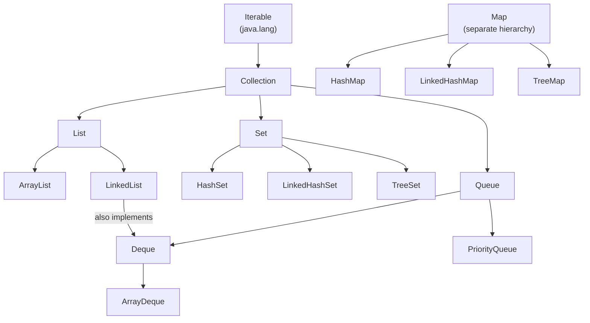
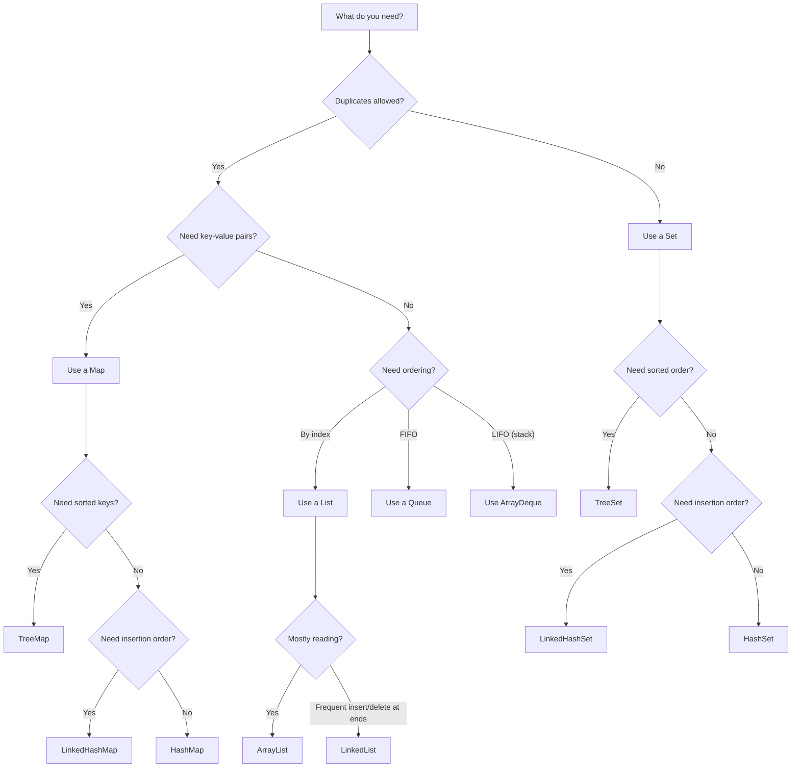

# Collections Framework

> The Collections Framework is Java's built-in library of data structures — dynamic arrays, linked lists, sets, maps, queues, and stacks — that replace fixed-size arrays with flexible, powerful containers.

## What You'll Learn

- What the Collections Framework is and its hierarchy
- `List` interface — `ArrayList` and `LinkedList`
- `Set` interface — `HashSet`, `LinkedHashSet`, and `TreeSet`
- `Map` interface — `HashMap`, `LinkedHashMap`, and `TreeMap`
- `Queue` and `Deque` — `LinkedList`, `PriorityQueue`, and `ArrayDeque`
- `Stack` — and why `ArrayDeque` is preferred
- Iterating over collections — `for-each`, `Iterator`, `forEach`
- The `Collections` utility class — sorting, searching, reversing, shuffling
- Choosing the right collection for your use case
- Common patterns and practical examples

---

## What is the Collections Framework?

The **Collections Framework** is a set of **interfaces**, **classes**, and **algorithms** in `java.util` that provide ready-to-use data structures.

### Why Not Just Use Arrays?

| Arrays | Collections |
| :--- | :--- |
| Fixed size — cannot grow or shrink | Dynamic size — grows and shrinks automatically |
| Can hold primitives and objects | Can hold only objects (use wrapper classes for primitives) |
| No built-in methods for search, sort, etc. | Rich API — `add`, `remove`, `contains`, `sort`, etc. |
| Must manage size manually | Size is managed automatically |

```java
// Array — fixed size, manual work
int[] arr = new int[3];
arr[0] = 10;
// arr[3] = 40;  // 💥 ArrayIndexOutOfBoundsException

// ArrayList — dynamic size, easy API
ArrayList<Integer> list = new ArrayList<>();
list.add(10);
list.add(20);
list.add(30);
list.add(40);  // ✅ Grows automatically
```

---

## Collections Hierarchy

The framework is built on a hierarchy of interfaces:



> [!NOTE]
> `Map` is **not** part of the `Collection` interface. It is a separate hierarchy because maps store **key-value pairs**, not individual elements. However, it is still considered part of the Collections Framework.

---

## `List` — Ordered, Allows Duplicates

A `List` is an **ordered** collection that **allows duplicate** elements. Elements are accessed by their **index** (like arrays).

### `ArrayList` — The Most Used Collection

`ArrayList` is backed by a **dynamic array**. It is the go-to choice for most situations.

```java
import java.util.ArrayList;

public class ArrayListDemo {
    public static void main(String[] args) {
        // Create an ArrayList of Strings
        ArrayList<String> fruits = new ArrayList<>();

        // Add elements
        fruits.add("Apple");
        fruits.add("Banana");
        fruits.add("Cherry");
        fruits.add("Apple");  // Duplicates are allowed

        System.out.println(fruits);  // [Apple, Banana, Cherry, Apple]
        System.out.println("Size: " + fruits.size());  // 4
    }
}
```

### Essential `ArrayList` Methods

```java
import java.util.ArrayList;

public class ArrayListMethods {
    public static void main(String[] args) {
        ArrayList<String> names = new ArrayList<>();

        // Adding
        names.add("Alice");              // Add at end
        names.add("Bob");
        names.add("Charlie");
        names.add(1, "Zara");           // Add at index 1, shifts others right

        System.out.println(names);       // [Alice, Zara, Bob, Charlie]

        // Accessing
        String first = names.get(0);     // "Alice"
        int size = names.size();         // 4

        // Searching
        boolean has = names.contains("Bob");     // true
        int idx = names.indexOf("Charlie");      // 3
        boolean empty = names.isEmpty();         // false

        // Modifying
        names.set(0, "Alicia");          // Replace element at index 0
        System.out.println(names);       // [Alicia, Zara, Bob, Charlie]

        // Removing
        names.remove("Zara");           // Remove by value (first occurrence)
        names.remove(0);               // Remove by index
        System.out.println(names);       // [Bob, Charlie]

        // Clear all
        names.clear();
        System.out.println(names.isEmpty());  // true
    }
}
```

### `ArrayList` Method Reference

| Method | Returns | Description |
| :--- | :--- | :--- |
| `add(element)` | `boolean` | Adds element at the end |
| `add(index, element)` | `void` | Inserts element at the given index |
| `get(index)` | `E` | Returns element at the given index |
| `set(index, element)` | `E` | Replaces element at the given index |
| `remove(index)` | `E` | Removes element at the given index |
| `remove(object)` | `boolean` | Removes first occurrence of the element |
| `contains(object)` | `boolean` | Returns `true` if element exists |
| `indexOf(object)` | `int` | Returns first index of element, or `-1` |
| `size()` | `int` | Returns number of elements |
| `isEmpty()` | `boolean` | Returns `true` if list has no elements |
| `clear()` | `void` | Removes all elements |
| `sort(comparator)` | `void` | Sorts the list |

### Programming to the Interface

Instead of declaring the variable as `ArrayList`, use the `List` interface type. This makes your code flexible — you can switch implementations later without changing the rest of your code:

```java
import java.util.List;
import java.util.ArrayList;

// GOOD — programming to the interface
List<String> names = new ArrayList<>();

// If you later need LinkedList, only this line changes:
// List<String> names = new LinkedList<>();
```

> [!TIP]
> **Best practice:** Declare variables and parameters as `List`, `Set`, or `Map` (the interface), not `ArrayList`, `HashSet`, or `HashMap` (the implementation). This is called "programming to the interface."

---

### `LinkedList` — Fast Insertions and Deletions

`LinkedList` stores elements as **nodes** connected by pointers. Each node knows its previous and next neighbour.

```java
import java.util.LinkedList;
import java.util.List;

public class LinkedListDemo {
    public static void main(String[] args) {
        LinkedList<String> tasks = new LinkedList<>();

        tasks.add("Task A");
        tasks.add("Task B");
        tasks.add("Task C");

        // LinkedList-specific methods
        tasks.addFirst("Urgent Task");    // Add at beginning
        tasks.addLast("Low Priority");    // Add at end

        System.out.println(tasks);
        // [Urgent Task, Task A, Task B, Task C, Low Priority]

        String first = tasks.getFirst();  // "Urgent Task"
        String last = tasks.getLast();    // "Low Priority"

        tasks.removeFirst();              // Remove from beginning
        tasks.removeLast();               // Remove from end

        System.out.println(tasks);        // [Task A, Task B, Task C]
    }
}
```

### `ArrayList` vs `LinkedList`

| Operation | `ArrayList` | `LinkedList` |
| :--- | :--- | :--- |
| **Access by index** (`get`) | ⚡ O(1) — very fast | 🐌 O(n) — must traverse |
| **Add/remove at end** | ⚡ O(1) amortised | ⚡ O(1) |
| **Add/remove at beginning** | 🐌 O(n) — shifts elements | ⚡ O(1) |
| **Add/remove in middle** | 🐌 O(n) — shifts elements | ⚡ O(1) if you have the node |
| **Memory** | Less (contiguous array) | More (node + 2 pointers per element) |
| **Best for** | Random access, reading | Frequent insertions/deletions |

> **Rule of thumb:** Use `ArrayList` unless you have a specific reason to use `LinkedList`. `ArrayList` is faster for almost all real-world workloads because of CPU cache efficiency.

---

## `Set` — No Duplicates

A `Set` is a collection that **does not allow duplicate elements**. If you try to add a duplicate, it is silently ignored.

### `HashSet` — Fastest, No Order

`HashSet` uses a **hash table** internally. It offers O(1) performance for `add`, `remove`, and `contains`.

```java
import java.util.HashSet;
import java.util.Set;

public class HashSetDemo {
    public static void main(String[] args) {
        Set<String> languages = new HashSet<>();

        languages.add("Java");
        languages.add("Python");
        languages.add("JavaScript");
        languages.add("Java");        // Duplicate — ignored
        languages.add("Python");      // Duplicate — ignored

        System.out.println(languages);         // [Java, JavaScript, Python] (order may vary)
        System.out.println(languages.size());  // 3 — duplicates were not added

        // Checking membership
        System.out.println(languages.contains("Java"));   // true
        System.out.println(languages.contains("Ruby"));   // false

        // Removing
        languages.remove("Python");
        System.out.println(languages);  // [Java, JavaScript]
    }
}
```

> [!NOTE]
> `HashSet` does **not** maintain insertion order. The iteration order may differ from the order you added elements.

### `LinkedHashSet` — Maintains Insertion Order

```java
import java.util.LinkedHashSet;
import java.util.Set;

Set<String> orderedSet = new LinkedHashSet<>();
orderedSet.add("Banana");
orderedSet.add("Apple");
orderedSet.add("Cherry");

System.out.println(orderedSet);  // [Banana, Apple, Cherry] — insertion order preserved
```

### `TreeSet` — Sorted Order

`TreeSet` keeps elements in **sorted (natural) order**:

```java
import java.util.TreeSet;
import java.util.Set;

Set<Integer> numbers = new TreeSet<>();
numbers.add(30);
numbers.add(10);
numbers.add(50);
numbers.add(20);
numbers.add(40);

System.out.println(numbers);  // [10, 20, 30, 40, 50] — always sorted
```

### Comparing the Three Sets

| Implementation | Order | Performance | Use When |
| :--- | :--- | :--- | :--- |
| **`HashSet`** | No order | O(1) add/remove/contains | You just need uniqueness, order doesn't matter |
| **`LinkedHashSet`** | Insertion order | O(1) add/remove/contains | You need uniqueness + insertion order |
| **`TreeSet`** | Sorted order | O(log n) add/remove/contains | You need uniqueness + sorted order |

### Practical Use — Removing Duplicates from a List

```java
import java.util.ArrayList;
import java.util.LinkedHashSet;
import java.util.List;

List<String> withDuplicates = new ArrayList<>();
withDuplicates.add("Apple");
withDuplicates.add("Banana");
withDuplicates.add("Apple");
withDuplicates.add("Cherry");
withDuplicates.add("Banana");

// Remove duplicates while preserving order
List<String> unique = new ArrayList<>(new LinkedHashSet<>(withDuplicates));
System.out.println(unique);  // [Apple, Banana, Cherry]
```

---

## `Map` — Key-Value Pairs

A `Map` stores data as **key-value pairs**. Each key maps to exactly one value. Keys must be unique; values can repeat.

### `HashMap` — The Most Used Map

```java
import java.util.HashMap;
import java.util.Map;

public class HashMapDemo {
    public static void main(String[] args) {
        Map<String, Integer> ages = new HashMap<>();

        // Adding key-value pairs
        ages.put("Alice", 25);
        ages.put("Bob", 30);
        ages.put("Charlie", 28);
        ages.put("Alice", 26);  // Overwrites Alice's age (keys are unique)

        System.out.println(ages);  // {Alice=26, Bob=30, Charlie=28}

        // Accessing values
        int aliceAge = ages.get("Alice");              // 26
        int unknownAge = ages.getOrDefault("Diana", 0); // 0 (Diana doesn't exist)

        // Checking
        boolean hasAlice = ages.containsKey("Alice");    // true
        boolean hasAge30 = ages.containsValue(30);       // true

        // Size
        System.out.println("Size: " + ages.size());      // 3

        // Removing
        ages.remove("Bob");
        System.out.println(ages);  // {Alice=26, Charlie=28}
    }
}
```

### Essential `Map` Methods

| Method | Returns | Description |
| :--- | :--- | :--- |
| `put(key, value)` | `V` | Adds or updates a key-value pair |
| `get(key)` | `V` | Returns the value for the key, or `null` |
| `getOrDefault(key, default)` | `V` | Returns the value, or `default` if key is absent |
| `containsKey(key)` | `boolean` | Checks if the key exists |
| `containsValue(value)` | `boolean` | Checks if the value exists |
| `remove(key)` | `V` | Removes the key-value pair |
| `size()` | `int` | Number of key-value pairs |
| `isEmpty()` | `boolean` | True if map has no entries |
| `keySet()` | `Set<K>` | Returns all keys as a `Set` |
| `values()` | `Collection<V>` | Returns all values |
| `entrySet()` | `Set<Map.Entry>` | Returns all key-value pairs |
| `putIfAbsent(key, value)` | `V` | Adds only if key doesn't already exist |

### Iterating Over a Map

```java
import java.util.HashMap;
import java.util.Map;

Map<String, Integer> scores = new HashMap<>();
scores.put("Alice", 95);
scores.put("Bob", 88);
scores.put("Charlie", 92);

// Method 1: Iterate over entries (MOST COMMON)
for (Map.Entry<String, Integer> entry : scores.entrySet()) {
    System.out.println(entry.getKey() + " → " + entry.getValue());
}

// Method 2: Iterate over keys only
for (String name : scores.keySet()) {
    System.out.println(name + " → " + scores.get(name));
}

// Method 3: Iterate over values only
for (int score : scores.values()) {
    System.out.println("Score: " + score);
}

// Method 4: forEach with lambda (Java 8+)
scores.forEach((name, score) -> {
    System.out.println(name + " → " + score);
});
```

### `LinkedHashMap` — Maintains Insertion Order

```java
Map<String, Integer> ordered = new LinkedHashMap<>();
ordered.put("Charlie", 92);
ordered.put("Alice", 95);
ordered.put("Bob", 88);

System.out.println(ordered);  // {Charlie=92, Alice=95, Bob=88} — insertion order
```

### `TreeMap` — Sorted by Keys

```java
Map<String, Integer> sorted = new TreeMap<>();
sorted.put("Charlie", 92);
sorted.put("Alice", 95);
sorted.put("Bob", 88);

System.out.println(sorted);  // {Alice=95, Bob=88, Charlie=92} — alphabetical order
```

### Comparing the Three Maps

| Implementation | Key Order | Performance | Use When |
| :--- | :--- | :--- | :--- |
| **`HashMap`** | No order | O(1) get/put | Default choice; fastest |
| **`LinkedHashMap`** | Insertion order | O(1) get/put | Need predictable iteration order |
| **`TreeMap`** | Sorted order | O(log n) get/put | Need sorted keys |

### Practical Use — Counting Word Frequency

```java
import java.util.HashMap;
import java.util.Map;

public class WordCounter {
    public static void main(String[] args) {
        String text = "the cat sat on the mat the cat";
        String[] words = text.split(" ");

        Map<String, Integer> frequency = new HashMap<>();

        for (String word : words) {
            frequency.put(word, frequency.getOrDefault(word, 0) + 1);
        }

        System.out.println(frequency);
        // {cat=2, on=1, mat=1, sat=1, the=3}
    }
}
```

**How `getOrDefault` works here:**
- First time seeing "the" → `getOrDefault("the", 0)` returns `0` → put "the" = 1
- Second time seeing "the" → `getOrDefault("the", 0)` returns `1` → put "the" = 2
- Third time seeing "the" → `getOrDefault("the", 0)` returns `2` → put "the" = 3

---

## `Queue` — First In, First Out (FIFO)

A `Queue` processes elements in the **order they were added** — the first element added is the first one removed.

```java
import java.util.LinkedList;
import java.util.Queue;

public class QueueDemo {
    public static void main(String[] args) {
        Queue<String> queue = new LinkedList<>();

        // Adding to the queue (enqueue)
        queue.offer("Customer 1");
        queue.offer("Customer 2");
        queue.offer("Customer 3");

        System.out.println(queue);  // [Customer 1, Customer 2, Customer 3]

        // Viewing the front element without removing
        String front = queue.peek();  // "Customer 1"
        System.out.println("Next in line: " + front);

        // Removing from the queue (dequeue)
        String served = queue.poll();  // "Customer 1"
        System.out.println("Now serving: " + served);
        System.out.println("Remaining: " + queue);  // [Customer 2, Customer 3]
    }
}
```

### Queue Methods — Safe vs Throwing

| Operation | Throws Exception | Returns `null`/`false` |
| :--- | :--- | :--- |
| **Add** | `add(e)` | `offer(e)` |
| **Remove** | `remove()` | `poll()` |
| **View front** | `element()` | `peek()` |

> [!TIP]
> Prefer `offer`, `poll`, and `peek` — they return `null` or `false` when the queue is empty instead of throwing an exception.

### `PriorityQueue` — Sorted Queue

Elements are ordered by their **natural ordering** (or a custom comparator), not insertion order:

```java
import java.util.PriorityQueue;
import java.util.Queue;

Queue<Integer> pq = new PriorityQueue<>();
pq.offer(30);
pq.offer(10);
pq.offer(50);
pq.offer(20);

// Elements come out in sorted order (smallest first)
while (!pq.isEmpty()) {
    System.out.print(pq.poll() + " ");  // 10 20 30 50
}
```

---

## `Deque` — Double-Ended Queue

A `Deque` (pronounced "deck") allows adding and removing from **both ends**:

```java
import java.util.ArrayDeque;
import java.util.Deque;

public class DequeDemo {
    public static void main(String[] args) {
        Deque<String> deque = new ArrayDeque<>();

        // Add at both ends
        deque.addFirst("A");
        deque.addLast("B");
        deque.addFirst("C");

        System.out.println(deque);  // [C, A, B]

        // Remove from both ends
        String first = deque.removeFirst();  // "C"
        String last = deque.removeLast();    // "B"

        System.out.println(deque);  // [A]
    }
}
```

### Using `ArrayDeque` as a Stack

`ArrayDeque` is the **recommended** replacement for the legacy `Stack` class:

```java
import java.util.ArrayDeque;
import java.util.Deque;

Deque<String> stack = new ArrayDeque<>();

// Push — add to the top
stack.push("First");
stack.push("Second");
stack.push("Third");

System.out.println(stack);     // [Third, Second, First]

// Peek — view the top without removing
System.out.println(stack.peek());  // "Third"

// Pop — remove from the top
System.out.println(stack.pop());   // "Third"
System.out.println(stack.pop());   // "Second"
System.out.println(stack);         // [First]
```

> [!NOTE]
> The legacy `java.util.Stack` class extends `Vector` and is synchronised — making it unnecessarily slow for single-threaded code. Use `ArrayDeque` instead.

---

## Iterating Over Collections

### Method 1: Enhanced `for-each` Loop

```java
List<String> names = List.of("Alice", "Bob", "Charlie");

for (String name : names) {
    System.out.println(name);
}
```

### Method 2: `Iterator`

The `Iterator` allows safe removal of elements during iteration:

```java
import java.util.ArrayList;
import java.util.Iterator;
import java.util.List;

List<String> names = new ArrayList<>(List.of("Alice", "Bob", "Charlie", "Bob"));
Iterator<String> it = names.iterator();

while (it.hasNext()) {
    String name = it.next();
    if (name.equals("Bob")) {
        it.remove();  // Safe removal during iteration
    }
}

System.out.println(names);  // [Alice, Charlie]
```

> [!WARNING]
> Removing elements from a collection inside a `for-each` loop throws `ConcurrentModificationException`. Always use an `Iterator` when you need to remove elements while iterating.

### Method 3: `forEach` with Lambda (Java 8+)

```java
List<String> names = List.of("Alice", "Bob", "Charlie");

names.forEach(name -> System.out.println(name));

// Or with method reference
names.forEach(System.out::println);
```

### Method 4: Traditional `for` Loop (for Lists only)

```java
List<String> names = List.of("Alice", "Bob", "Charlie");

for (int i = 0; i < names.size(); i++) {
    System.out.println(i + ": " + names.get(i));
}
```

---

## The `Collections` Utility Class

`java.util.Collections` (note the **s**) provides static utility methods for working with collections:

```java
import java.util.ArrayList;
import java.util.Collections;
import java.util.List;

List<Integer> numbers = new ArrayList<>(List.of(5, 2, 8, 1, 9, 3));

// Sorting
Collections.sort(numbers);
System.out.println(numbers);  // [1, 2, 3, 5, 8, 9]

// Reverse order
Collections.reverse(numbers);
System.out.println(numbers);  // [9, 8, 5, 3, 2, 1]

// Shuffle (random order)
Collections.shuffle(numbers);
System.out.println(numbers);  // Random order each time

// Min and Max
Collections.sort(numbers);
System.out.println("Min: " + Collections.min(numbers));
System.out.println("Max: " + Collections.max(numbers));

// Frequency
List<String> words = List.of("a", "b", "a", "c", "a");
System.out.println(Collections.frequency(words, "a"));  // 3

// Unmodifiable list
List<String> immutable = Collections.unmodifiableList(new ArrayList<>(words));
// immutable.add("d");  // 💥 UnsupportedOperationException
```

### `List.of()` and `Map.of()` — Immutable Factory Methods (Java 9+)

```java
// Immutable list — cannot add, remove, or modify
List<String> names = List.of("Alice", "Bob", "Charlie");

// Immutable set
Set<Integer> nums = Set.of(1, 2, 3, 4, 5);

// Immutable map
Map<String, Integer> ages = Map.of("Alice", 25, "Bob", 30);
```

These are convenient for creating small, fixed collections.

---

## Choosing the Right Collection



### Quick Decision Table

| Need | Best Choice |
| :--- | :--- |
| Dynamic array with index access | `ArrayList` |
| Unique elements, no order needed | `HashSet` |
| Unique elements, sorted | `TreeSet` |
| Key-value lookup | `HashMap` |
| Key-value, sorted by key | `TreeMap` |
| FIFO queue | `LinkedList` or `ArrayDeque` |
| Stack (LIFO) | `ArrayDeque` |
| Priority-based processing | `PriorityQueue` |
| Thread-safe map | `ConcurrentHashMap` |

---

## Complete Example — Student Management System

```java
import java.util.*;

public class StudentManager {
    public static void main(String[] args) {
        // List of students (ordered, allows duplicates)
        List<String> students = new ArrayList<>();
        students.add("Alice");
        students.add("Bob");
        students.add("Charlie");
        students.add("Diana");
        students.add("Bob");  // Duplicate allowed in List

        System.out.println("All students: " + students);

        // Map of student grades
        Map<String, Integer> grades = new HashMap<>();
        grades.put("Alice", 92);
        grades.put("Bob", 85);
        grades.put("Charlie", 78);
        grades.put("Diana", 95);

        // Find students who scored above 80
        List<String> topStudents = new ArrayList<>();
        for (Map.Entry<String, Integer> entry : grades.entrySet()) {
            if (entry.getValue() >= 80) {
                topStudents.add(entry.getKey());
            }
        }
        Collections.sort(topStudents);
        System.out.println("Top students (>=80): " + topStudents);

        // Set of unique subjects
        Set<String> subjects = new TreeSet<>();
        subjects.add("Physics");
        subjects.add("Math");
        subjects.add("Chemistry");
        subjects.add("Math");  // Duplicate — ignored

        System.out.println("Subjects (sorted): " + subjects);

        // Queue for exam order
        Queue<String> examQueue = new LinkedList<>(students);
        System.out.println("\nExam order:");
        while (!examQueue.isEmpty()) {
            System.out.println("  Now: " + examQueue.poll());
        }

        // Stack for undo operations
        Deque<String> undoStack = new ArrayDeque<>();
        undoStack.push("Added Alice");
        undoStack.push("Added Bob");
        undoStack.push("Removed Charlie");

        System.out.println("\nUndo history (most recent first):");
        while (!undoStack.isEmpty()) {
            System.out.println("  Undo: " + undoStack.pop());
        }
    }
}
```

Output:

```text
All students: [Alice, Bob, Charlie, Diana, Bob]
Top students (>=80): [Alice, Bob, Diana]
Subjects (sorted): [Chemistry, Math, Physics]

Exam order:
  Now: Alice
  Now: Bob
  Now: Charlie
  Now: Diana
  Now: Bob

Undo history (most recent first):
  Undo: Removed Charlie
  Undo: Added Bob
  Undo: Added Alice
```

---

## Summary

| Collection | Interface | Duplicates | Order | Key Feature |
| :--- | :--- | :--- | :--- | :--- |
| **`ArrayList`** | `List` | ✅ | Insertion | Fast random access by index |
| **`LinkedList`** | `List`, `Deque` | ✅ | Insertion | Fast add/remove at both ends |
| **`HashSet`** | `Set` | ❌ | None | Fast membership check |
| **`LinkedHashSet`** | `Set` | ❌ | Insertion | Unique + preserves insertion order |
| **`TreeSet`** | `Set` | ❌ | Sorted | Unique + always sorted |
| **`HashMap`** | `Map` | Keys ❌, Values ✅ | None | Fast key-value lookup |
| **`LinkedHashMap`** | `Map` | Keys ❌, Values ✅ | Insertion | Predictable iteration order |
| **`TreeMap`** | `Map` | Keys ❌, Values ✅ | Sorted by key | Sorted key-value pairs |
| **`PriorityQueue`** | `Queue` | ✅ | Priority (natural) | Smallest element first |
| **`ArrayDeque`** | `Deque` | ✅ | Insertion | Stack and queue operations |
