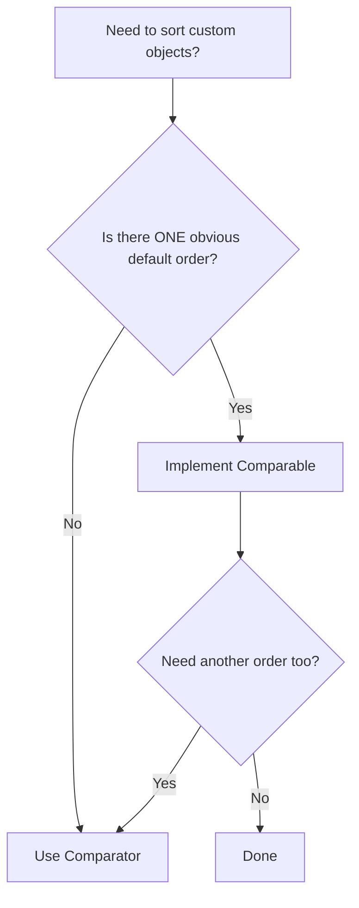

# Comparable, Comparator and Iterator

> Java can sort numbers and Strings out of the box, but to sort your own objects (students, products, employees) you must tell Java *how* to compare them — that is what `Comparable` and `Comparator` do.

## What You'll Learn

- Why sorting custom objects fails without extra information
- `Comparable` — defining the **natural order** of a class
- How `compareTo()` works and what its return value means
- `Comparator` — defining **custom / multiple** sort orders
- Writing comparators with anonymous classes, lambdas, and `Comparator.comparing()`
- Chaining comparators with `thenComparing()` and reversing with `reversed()`
- Sorting `List`, arrays, `TreeSet`, `TreeMap`, and `PriorityQueue` with custom order
- `Comparable` vs `Comparator` — when to use which
- How `Iterator` works and how to write your own `Iterable` class
- `ListIterator`, iterating over a `Map`, and `forEachRemaining`
- Fail-fast vs fail-safe iterators and `ConcurrentModificationException`
- Lazy iterators and converting an `Iterable` into a `Stream`
- Common mistakes (integer overflow, null handling, inconsistent comparisons)

---

## The Problem: Sorting Custom Objects

Sorting built-in types works immediately:

```java
import java.util.*;

public class Main {
    public static void main(String[] args) {
        List<Integer> nums = new ArrayList<>(List.of(5, 2, 9, 1));
        Collections.sort(nums);
        System.out.println(nums);   // [1, 2, 5, 9]

        List<String> names = new ArrayList<>(List.of("Charlie", "Alice", "Bob"));
        Collections.sort(names);
        System.out.println(names);  // [Alice, Bob, Charlie]
    }
}
```

`Integer` and `String` already know how to compare themselves. But what about our own class?

```java
class Student {
    String name;
    int marks;

    Student(String name, int marks) {
        this.name = name;
        this.marks = marks;
    }
}

List<Student> students = new ArrayList<>();
students.add(new Student("Alice", 85));
students.add(new Student("Bob", 92));

Collections.sort(students);   // ❌ Compile error!
```

Java does not know whether to sort students by name, by marks, or by something else. We must give it a rule.

> [!NOTE]
> Java offers two ways to provide that rule: `Comparable` (built **into** the class) and `Comparator` (a **separate** rule object).

---

## Comparable — Natural Ordering

`Comparable<T>` is an interface in `java.lang` with a single method:

```java
public interface Comparable<T> {
    int compareTo(T other);
}
```

A class that implements it declares: *"this is my default way of being ordered."*

### The `compareTo` Contract

`a.compareTo(b)` returns an `int`:

| Return value | Meaning |
| :--- | :--- |
| **Negative** (e.g. `-1`) | `a` comes **before** `b` |
| **Zero** | `a` and `b` are considered **equal** in order |
| **Positive** (e.g. `1`) | `a` comes **after** `b` |

### Example: Sort Students by Marks (Ascending)

```java
import java.util.*;

class Student implements Comparable<Student> {
    private String name;
    private int marks;

    public Student(String name, int marks) {
        this.name = name;
        this.marks = marks;
    }

    public String getName() { return name; }
    public int getMarks()   { return marks; }

    @Override
    public int compareTo(Student other) {
        return Integer.compare(this.marks, other.marks);
    }

    @Override
    public String toString() {
        return name + "(" + marks + ")";
    }
}

public class Main {
    public static void main(String[] args) {
        List<Student> students = new ArrayList<>();
        students.add(new Student("Alice", 85));
        students.add(new Student("Bob", 92));
        students.add(new Student("Charlie", 70));

        Collections.sort(students);
        System.out.println(students);
        // [Charlie(70), Alice(85), Bob(92)]
    }
}
```

### Code Explanation

| Line | What it does |
| :--- | :--- |
| `implements Comparable<Student>` | Promises Java that `Student` objects can be compared with other `Student` objects |
| `compareTo(Student other)` | Called by the sort algorithm for each pair of students |
| `this.marks` | The current object's marks |
| `other.marks` | The marks of the student being compared against |
| `Integer.compare(a, b)` | Returns negative / zero / positive — safe replacement for `a - b` |
| `Collections.sort(students)` | Uses `compareTo` to decide the order |

### Descending Order

Swap the operands:

```java
@Override
public int compareTo(Student other) {
    return Integer.compare(other.marks, this.marks);  // highest first
}
```

### Comparing Strings

`String` already implements `Comparable`, so delegate to it:

```java
@Override
public int compareTo(Student other) {
    return this.name.compareTo(other.name);   // alphabetical
}
```

> [!WARNING]
> Avoid `return this.marks - other.marks;`. With large or negative values the subtraction can **overflow** and give the wrong sign. Always use `Integer.compare`.

### Where Natural Ordering Is Used Automatically

If a class implements `Comparable`, these work with no extra setup:

```java
Collections.sort(list);
Arrays.sort(array);
new TreeSet<>(students);
new TreeMap<Student, String>();
new PriorityQueue<Student>();
Collections.max(list);
Collections.min(list);
```

---

## Comparator — Custom Ordering

`Comparable` has a limitation: a class has **only one** `compareTo`. What if you want to sort by marks today and by name tomorrow? Or you cannot modify the class (e.g. it belongs to a library)?

`Comparator<T>` lives in `java.util` and is a **separate** object that defines an ordering:

```java
public interface Comparator<T> {
    int compare(T a, T b);
}
```

### Way 1: Separate Class

```java
import java.util.*;

class SortByName implements Comparator<Student> {
    @Override
    public int compare(Student a, Student b) {
        return a.getName().compareTo(b.getName());
    }
}

// Usage
Collections.sort(students, new SortByName());
```

### Way 2: Anonymous Class

```java
Collections.sort(students, new Comparator<Student>() {
    @Override
    public int compare(Student a, Student b) {
        return a.getName().compareTo(b.getName());
    }
});
```

### Way 3: Lambda Expression (Recommended)

`Comparator` has a single abstract method, so a lambda replaces all the boilerplate:

```java
Collections.sort(students, (a, b) -> a.getName().compareTo(b.getName()));

// or directly on the list (Java 8+)
students.sort((a, b) -> Integer.compare(a.getMarks(), b.getMarks()));
```

Lambda syntax: `(parameters) -> expression`

| Part | Meaning |
| :--- | :--- |
| `(a, b)` | The two objects being compared |
| `->` | Separates parameters from the body |
| `Integer.compare(...)` | The value returned as the comparison result |

### Way 4: `Comparator.comparing()` (Cleanest)

```java
students.sort(Comparator.comparing(Student::getName));
students.sort(Comparator.comparingInt(Student::getMarks));
```

- `Student::getName` is a **method reference** — shorthand for `s -> s.getName()`.
- `comparingInt` / `comparingDouble` / `comparingLong` avoid boxing for primitives.

---

## Reversing and Chaining Comparators

### Reverse Order

```java
students.sort(Comparator.comparingInt(Student::getMarks).reversed());
// highest marks first
```

### Multi-Level Sorting with `thenComparing`

Sort by marks (descending); if marks tie, sort by name (ascending):

```java
students.sort(
    Comparator.comparingInt(Student::getMarks).reversed()
              .thenComparing(Student::getName)
);
```

### Full Example

```java
import java.util.*;

public class Main {
    public static void main(String[] args) {
        List<Student> students = new ArrayList<>();
        students.add(new Student("Alice", 85));
        students.add(new Student("Bob", 92));
        students.add(new Student("Charlie", 85));
        students.add(new Student("Diana", 92));

        // 1. By name
        students.sort(Comparator.comparing(Student::getName));
        System.out.println("By name:  " + students);
        // [Alice(85), Bob(92), Charlie(85), Diana(92)]

        // 2. By marks descending, then name
        students.sort(
            Comparator.comparingInt(Student::getMarks).reversed()
                      .thenComparing(Student::getName)
        );
        System.out.println("By marks: " + students);
        // [Bob(92), Diana(92), Alice(85), Charlie(85)]
    }
}
```

### Useful Comparator Helpers

| Method | Purpose |
| :--- | :--- |
| `Comparator.comparing(keyExtractor)` | Compare by an extracted key |
| `Comparator.comparingInt(...)` | Same, for `int` keys (no boxing) |
| `.reversed()` | Reverse the order |
| `.thenComparing(...)` | Tie-breaker when the first comparison is equal |
| `Comparator.naturalOrder()` | Uses `compareTo` (ascending) |
| `Comparator.reverseOrder()` | Reverse of natural order |
| `Comparator.nullsFirst(c)` / `nullsLast(c)` | Handles `null` values safely |

---

## Custom Order in Sorted Collections

### Arrays

```java
String[] words = {"banana", "kiwi", "apple"};
Arrays.sort(words, Comparator.comparing(String::length));
System.out.println(Arrays.toString(words));  // [kiwi, apple, banana]

Integer[] nums = {3, 1, 2};
Arrays.sort(nums, Collections.reverseOrder());  // [3, 2, 1]
```

> [!NOTE]
> A `Comparator` works only with **object** arrays (`Integer[]`), not primitive arrays (`int[]`).

### `TreeSet` and `TreeMap`

```java
Set<Student> byName = new TreeSet<>(Comparator.comparing(Student::getName));
Map<String, Integer> reverseMap = new TreeMap<>(Comparator.reverseOrder());
```

> [!WARNING]
> `TreeSet` / `TreeMap` treat two elements as **duplicates** when the comparator returns `0`. If you compare students only by marks, two students with equal marks — one will be silently dropped. Add tie-breakers.

### `PriorityQueue`

```java
// Max-heap: largest number first
PriorityQueue<Integer> maxHeap = new PriorityQueue<>(Comparator.reverseOrder());
maxHeap.addAll(List.of(5, 1, 8, 3));
System.out.println(maxHeap.poll());  // 8

// Students with highest marks first
PriorityQueue<Student> pq =
    new PriorityQueue<>(Comparator.comparingInt(Student::getMarks).reversed());
```

---

## Comparable vs Comparator

| Feature | `Comparable` | `Comparator` |
| :--- | :--- | :--- |
| **Package** | `java.lang` | `java.util` |
| **Method** | `compareTo(T other)` | `compare(T a, T b)` |
| **Where defined** | Inside the class itself | In a separate class / lambda |
| **Number of orders** | Only **one** (natural order) | **Unlimited** |
| **Modifies the class?** | Yes | No |
| **Use when** | There is one obvious default order | Multiple orders, or you can't edit the class |
| **Sort call** | `Collections.sort(list)` | `Collections.sort(list, comparator)` |



---

## Iterator and Iterable

### How `for-each` Really Works

Any class implementing `Iterable<T>` can be used in a `for-each` loop. The loop is compiled to an `Iterator` call:

```java
for (String s : list) {
    System.out.println(s);
}

// is equivalent to:
Iterator<String> it = list.iterator();
while (it.hasNext()) {
    String s = it.next();
    System.out.println(s);
}
```

### The `Iterator` Interface

| Method | Description |
| :--- | :--- |
| `hasNext()` | Returns `true` if more elements remain |
| `next()` | Returns the next element and advances |
| `remove()` | Removes the last element returned by `next()` |

### Safe Removal While Looping

```java
List<Integer> nums = new ArrayList<>(List.of(1, 2, 3, 4, 5, 6));

Iterator<Integer> it = nums.iterator();
while (it.hasNext()) {
    if (it.next() % 2 == 0) {
        it.remove();   // ✅ safe
    }
}
System.out.println(nums);  // [1, 3, 5]
```

Using `nums.remove(...)` inside a `for-each` throws `ConcurrentModificationException`. Alternatively use `nums.removeIf(n -> n % 2 == 0);`.

### Writing Your Own Iterable Class

```java
import java.util.*;

class NumberRange implements Iterable<Integer> {
    private final int start;
    private final int end;

    public NumberRange(int start, int end) {
        this.start = start;
        this.end = end;
    }

    @Override
    public Iterator<Integer> iterator() {
        return new Iterator<Integer>() {
            private int current = start;

            @Override
            public boolean hasNext() {
                return current <= end;
            }

            @Override
            public Integer next() {
                return current++;
            }
        };
    }
}

public class Main {
    public static void main(String[] args) {
        for (int n : new NumberRange(1, 5)) {
            System.out.print(n + " ");   // 1 2 3 4 5
        }
    }
}
```

### Code Explanation

| Part | What it does |
| :--- | :--- |
| `implements Iterable<Integer>` | Makes the class usable in `for-each` |
| `iterator()` | Returns an object that knows how to walk through the elements |
| `current` | Remembers the position between calls |
| `hasNext()` | Tells the loop whether to continue |
| `next()` | Returns the current value, then moves forward (`current++`) |

### Throwing `NoSuchElementException`

A well-behaved iterator should throw `NoSuchElementException` if `next()` is called after the elements run out:

```java
@Override
public Integer next() {
    if (!hasNext()) {
        throw new NoSuchElementException("No more numbers in range");
    }
    return current++;
}
```

### Iterating Over a Map

A `Map` is not `Iterable` itself; iterate over one of its **views**:

```java
Map<String, Integer> marks = new HashMap<>();
marks.put("Alice", 85);
marks.put("Bob", 92);
marks.put("Charlie", 70);

// Entries (key + value) — most common
for (Map.Entry<String, Integer> e : marks.entrySet()) {
    System.out.println(e.getKey() + " -> " + e.getValue());
}

// Only keys / only values
for (String name : marks.keySet())   { System.out.println(name); }
for (int mark : marks.values())      { System.out.println(mark); }

// Safe removal while iterating
Iterator<Map.Entry<String, Integer>> it = marks.entrySet().iterator();
while (it.hasNext()) {
    if (it.next().getValue() < 80) {
        it.remove();   // removes Charlie
    }
}

// Or simply
marks.entrySet().removeIf(e -> e.getValue() < 80);
```

### `forEachRemaining`

`Iterator` has a default method that consumes whatever elements are left:

```java
Iterator<String> it = List.of("A", "B", "C", "D").iterator();
it.next();                                   // skip "A"
it.forEachRemaining(System.out::println);    // B C D
```

### `ListIterator` — Two-Way Iteration

`List` offers a richer iterator that can move **backwards**, **add**, and **replace** elements:

```java
List<String> names = new ArrayList<>(List.of("Alice", "Bob", "Charlie"));
ListIterator<String> li = names.listIterator();

// Forward
while (li.hasNext()) {
    int index = li.nextIndex();
    String name = li.next();
    System.out.println(index + ": " + name);
    if (name.equals("Bob")) {
        li.set("Bobby");          // replace current
        li.add("Bob's Friend");   // insert after current
    }
}

// Backward
while (li.hasPrevious()) {
    System.out.print(li.previous() + " ");
}
// Charlie Bob's Friend Bobby Alice
```

| Method | Description |
| :--- | :--- |
| `hasNext()` / `next()` | Move forward |
| `hasPrevious()` / `previous()` | Move backward |
| `nextIndex()` / `previousIndex()` | Current position |
| `set(e)` | Replaces the last element returned |
| `add(e)` | Inserts an element at the cursor |
| `remove()` | Removes the last element returned |

### Iterator vs ListIterator vs for-each

| Feature | `for-each` | `Iterator` | `ListIterator` |
| :--- | :--- | :--- | :--- |
| Works on | Any `Iterable` | Any `Collection` | `List` only |
| Direction | Forward | Forward | Forward & backward |
| Remove while looping | ❌ | ✅ | ✅ |
| Add / replace while looping | ❌ | ❌ | ✅ |
| Access index | ❌ | ❌ | ✅ |
| Simplicity | Best | Medium | Medium |

### Fail-Fast vs Fail-Safe Iterators

If a collection is **structurally modified** (add/remove) while being iterated by anything other than the iterator itself, behaviour depends on the iterator type:

| Type | Behaviour | Examples |
| :--- | :--- | :--- |
| **Fail-fast** | Throws `ConcurrentModificationException` immediately | `ArrayList`, `HashMap`, `HashSet`, `LinkedList` |
| **Fail-safe / weakly consistent** | Does not throw; iterates a snapshot or tolerates changes | `CopyOnWriteArrayList`, `ConcurrentHashMap` |

```java
List<Integer> list = new ArrayList<>(List.of(1, 2, 3));
for (Integer n : list) {
    if (n == 2) list.remove(n);   // 💥 ConcurrentModificationException
}

List<Integer> safe = new java.util.concurrent.CopyOnWriteArrayList<>(List.of(1, 2, 3));
for (Integer n : safe) {
    if (n == 2) safe.remove(n);   // ✅ works (iterates over a snapshot)
}
```

> [!NOTE]
> Fail-fast detection is on a **best-effort** basis — never rely on the exception for program logic. It exists to help you find bugs.

### A Lazy (Infinite) Iterator

Iterators do not need to store all values — they can compute them on demand:

```java
import java.util.*;

class Fibonacci implements Iterable<Long> {
    private final int count;

    public Fibonacci(int count) { this.count = count; }

    @Override
    public Iterator<Long> iterator() {
        return new Iterator<>() {
            private int produced = 0;
            private long a = 0, b = 1;

            @Override
            public boolean hasNext() { return produced < count; }

            @Override
            public Long next() {
                if (!hasNext()) throw new NoSuchElementException();
                long result = a;
                long next = a + b;
                a = b;
                b = next;
                produced++;
                return result;
            }
        };
    }
}

for (long f : new Fibonacci(10)) {
    System.out.print(f + " ");   // 0 1 1 2 3 5 8 13 21 34
}
```

Only the current state (`a`, `b`) is stored — memory use stays constant, no matter how large `count` is.

### Iterable and `forEach` / Streams

Anything implementing `Iterable` automatically gets a `forEach` method, and can be turned into a `Stream`:

```java
new NumberRange(1, 5).forEach(n -> System.out.print(n + " "));   // 1 2 3 4 5

import java.util.stream.*;

int sumOfSquares = StreamSupport.stream(new NumberRange(1, 5).spliterator(), false)
        .mapToInt(n -> n * n)
        .sum();
System.out.println(sumOfSquares);   // 55
```

### Iterating in Sorted Order with a Comparator

Iterators from sorted collections follow the comparator's order:

```java
TreeSet<Student> ranked = new TreeSet<>(
    Comparator.comparingInt(Student::getMarks).reversed()
              .thenComparing(Student::getName));
ranked.addAll(students);

for (Student s : ranked) {
    System.out.println(s);        // highest marks first
}

Iterator<Student> desc = ranked.descendingIterator();   // reverse of that order
```

> [!TIP]
> `HashSet` and `HashMap` iterate in **no guaranteed order**; use `LinkedHashSet`/`LinkedHashMap` for insertion order, or `TreeSet`/`TreeMap` for sorted order.


---

## Common Mistakes

| Mistake | Problem | Fix |
| :--- | :--- | :--- |
| `return a.x - b.x;` | Integer overflow gives wrong order | Use `Integer.compare(a.x, b.x)` |
| Comparator returns `0` for different objects in `TreeSet` | Elements silently dropped | Add `thenComparing` tie-breakers |
| `Collections.sort(list)` on a class without `Comparable` | Compile error | Implement `Comparable` or pass a `Comparator` |
| `compareTo` on a `null` field | `NullPointerException` | Use `Comparator.nullsFirst/nullsLast` |
| `compareTo` inconsistent with `equals` | Odd behaviour in `TreeSet` vs `HashSet` | Keep both based on the same fields |
| Removing from a list inside `for-each` | `ConcurrentModificationException` | Use `Iterator.remove()` or `removeIf` |
| Using `Comparator` on `int[]` | Does not compile | Use `Integer[]` |

---

## Practical Example: Employee Report

```java
import java.util.*;

class Employee {
    private final String name;
    private final String department;
    private final double salary;

    public Employee(String name, String department, double salary) {
        this.name = name;
        this.department = department;
        this.salary = salary;
    }

    public String getName()       { return name; }
    public String getDepartment() { return department; }
    public double getSalary()     { return salary; }

    @Override
    public String toString() {
        return String.format("%-8s %-6s %8.2f", name, department, salary);
    }
}

public class Main {
    public static void main(String[] args) {
        List<Employee> staff = new ArrayList<>(List.of(
            new Employee("Alice",   "IT",  75000),
            new Employee("Bob",     "HR",  50000),
            new Employee("Charlie", "IT",  90000),
            new Employee("Diana",   "HR",  62000),
            new Employee("Eve",     "IT",  75000)
        ));

        // Department A-Z, then salary high-to-low, then name A-Z
        staff.sort(
            Comparator.comparing(Employee::getDepartment)
                      .thenComparing(Employee::getSalary, Comparator.reverseOrder())
                      .thenComparing(Employee::getName)
        );

        staff.forEach(System.out::println);
    }
}
```

**Output:**

```text
Diana    HR     62000.00
Bob      HR     50000.00
Charlie  IT     90000.00
Alice    IT     75000.00
Eve      IT     75000.00
```

---

## Summary

| Concept | Key Point |
| :--- | :--- |
| **`Comparable<T>`** | Gives a class one **natural order** via `compareTo(T other)` |
| **`compareTo` result** | Negative = before, zero = equal, positive = after |
| **`Comparator<T>`** | A separate object defining any order via `compare(T a, T b)` |
| **Lambda comparator** | `(a, b) -> Integer.compare(a.x, b.x)` |
| **`Comparator.comparing`** | Cleanest way to build comparators from getters |
| **`reversed()` / `thenComparing()`** | Reverse order / add tie-breakers |
| **Sorted collections** | `TreeSet`, `TreeMap`, `PriorityQueue` accept a `Comparator` |
| **`Iterator`** | `hasNext()`, `next()`, `remove()` — the engine behind `for-each` |
| **`Iterable`** | Implement it to make your own class usable in `for-each` |
| **`ListIterator`** | Two-way iteration on lists with `set`, `add`, `remove` |
| **Map iteration** | Iterate `entrySet()`, `keySet()`, or `values()`; remove via iterator or `removeIf` |
| **Fail-fast** | `ArrayList`/`HashMap` throw `ConcurrentModificationException` on outside modification |
| **Fail-safe** | `CopyOnWriteArrayList`/`ConcurrentHashMap` tolerate concurrent changes |
| **Lazy iterators** | Compute values on demand (e.g. `Fibonacci`) with constant memory |
| **Safety** | Use `Integer.compare`, never subtraction; remove via `Iterator` |
