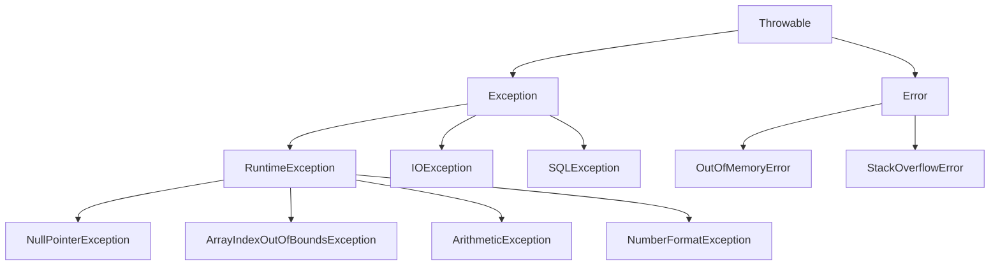
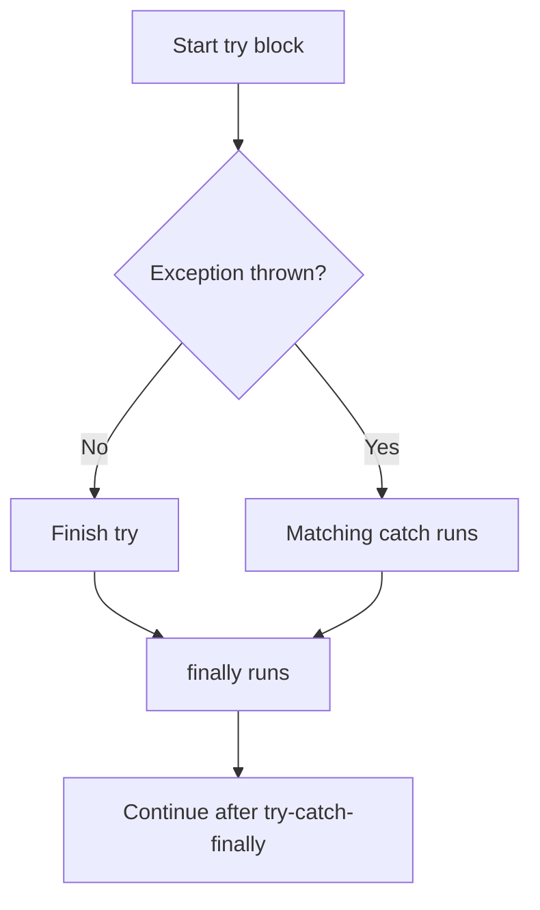

# Exception Handling

> An exception is an unexpected event that disrupts the normal flow of a program; exception handling lets your code detect, report, and recover from errors instead of crashing.

## What You'll Learn

- What exceptions are and why they occur
- The exception hierarchy — `Throwable`, `Error`, `Exception`, `RuntimeException`
- Checked vs unchecked exceptions
- `try`, `catch`, and `finally` blocks
- Handling multiple exceptions and multi-catch
- `throw` vs `throws`
- Creating custom exceptions
- `try-with-resources` for automatic cleanup
- Stack traces and how to read them
- Best practices and common mistakes

---

## What is an Exception?

An **exception** is an event that occurs during program execution and disrupts the normal flow of instructions.

```java
public class Main {
    public static void main(String[] args) {
        int a = 10;
        int b = 0;
        System.out.println("Before division");
        System.out.println(a / b);          // 💥 ArithmeticException
        System.out.println("After division"); // never runs
    }
}
```

**Output:**

```text
Before division
Exception in thread "main" java.lang.ArithmeticException: / by zero
    at Main.main(Main.java:6)
```

Without handling, the program **terminates** at the error line. With exception handling, we can respond gracefully and keep running.

### Common Causes

| Situation | Exception |
| :--- | :--- |
| Dividing an integer by zero | `ArithmeticException` |
| Calling a method on `null` | `NullPointerException` |
| Accessing an invalid array index | `ArrayIndexOutOfBoundsException` |
| Converting `"abc"` to a number | `NumberFormatException` |
| Casting to an incompatible type | `ClassCastException` |
| Opening a file that doesn't exist | `FileNotFoundException` |
| Reading/writing fails | `IOException` |

---

## Exception Hierarchy

All exceptions are objects of classes that descend from `Throwable`.



| Class | Meaning |
| :--- | :--- |
| **`Throwable`** | Root of everything that can be thrown |
| **`Error`** | Serious JVM problems (out of memory, stack overflow) — **don't catch** |
| **`Exception`** | Problems your program can reasonably handle |
| **`RuntimeException`** | Programming bugs — usually avoidable with correct code |

---

## Checked vs Unchecked Exceptions

### Checked Exceptions

Subclasses of `Exception` **excluding** `RuntimeException`. The compiler **forces** you to handle or declare them.

Examples: `IOException`, `FileNotFoundException`, `SQLException`, `InterruptedException`.

```java
import java.io.*;

FileReader fr = new FileReader("data.txt");  // ❌ Compile error: unhandled FileNotFoundException
```

### Unchecked Exceptions

`RuntimeException` and its subclasses, plus `Error`. The compiler does **not** force handling.

Examples: `NullPointerException`, `ArithmeticException`, `IllegalArgumentException`, `IndexOutOfBoundsException`.

### Comparison

| Feature | Checked | Unchecked |
| :--- | :--- | :--- |
| **Checked at** | Compile time | Runtime |
| **Must handle/declare?** | Yes | No |
| **Typical cause** | External problems (files, network, DB) | Programming bugs |
| **Extends** | `Exception` | `RuntimeException` |
| **Example** | `IOException` | `NullPointerException` |

---

## try-catch

Put risky code in `try`; handle problems in `catch`.

```java
public class Main {
    public static void main(String[] args) {
        try {
            int result = 10 / 0;
            System.out.println(result);
        } catch (ArithmeticException e) {
            System.out.println("Cannot divide by zero!");
        }
        System.out.println("Program continues...");
    }
}
```

**Output:**

```text
Cannot divide by zero!
Program continues...
```

### Code Explanation

| Part | What it does |
| :--- | :--- |
| `try { ... }` | Contains code that might throw an exception |
| `catch (ArithmeticException e)` | Runs only if that type of exception is thrown inside `try` |
| `e` | The exception object — holds the message and stack trace |
| After the block | Execution continues normally |

> [!NOTE]
> As soon as an exception occurs inside `try`, the **remaining lines in `try` are skipped** and control jumps to the matching `catch`.

### Useful Methods on the Exception Object

```java
try {
    Integer.parseInt("abc");
} catch (NumberFormatException e) {
    System.out.println(e.getMessage());   // For input string: "abc"
    System.out.println(e);                // java.lang.NumberFormatException: For input string: "abc"
    e.printStackTrace();                  // prints full stack trace
}
```

---

## Multiple catch Blocks

A single `try` can have several `catch` blocks. The **first matching** one runs.

```java
try {
    String s = null;
    int[] arr = new int[3];
    arr[5] = 10;
    System.out.println(s.length());
} catch (ArrayIndexOutOfBoundsException e) {
    System.out.println("Bad index: " + e.getMessage());
} catch (NullPointerException e) {
    System.out.println("Null value!");
} catch (Exception e) {
    System.out.println("Something else went wrong: " + e);
}
```

> [!WARNING]
> Order matters: put **specific** exceptions first and **general** ones (`Exception`) last. Reversing them is a compile error because the general catch would make the specific one unreachable.

### Multi-catch (Java 7+)

When several exceptions are handled the same way:

```java
try {
    // risky code
} catch (NumberFormatException | NullPointerException e) {
    System.out.println("Invalid input: " + e.getMessage());
}
```

---

## finally

The `finally` block runs **whether or not** an exception occurred — ideal for cleanup (closing files, connections).

```java
public class Main {
    public static void main(String[] args) {
        try {
            System.out.println("Opening resource");
            int x = 5 / 0;
        } catch (ArithmeticException e) {
            System.out.println("Error caught");
        } finally {
            System.out.println("Closing resource");   // always runs
        }
    }
}
```

**Output:**

```text
Opening resource
Error caught
Closing resource
```

### Execution Flow



### Rules

- `finally` runs even if `try` or `catch` contains `return`.
- It is skipped only if the JVM exits (`System.exit(0)`) or crashes.
- A `try` needs at least one `catch` **or** a `finally`.

```java
static int test() {
    try {
        return 1;
    } finally {
        System.out.println("finally still runs");
    }
}
```

---

## throw and throws

### `throw` — Raise an Exception Yourself

```java
public static void setAge(int age) {
    if (age < 0) {
        throw new IllegalArgumentException("Age cannot be negative: " + age);
    }
    System.out.println("Age set to " + age);
}
```

### `throws` — Declare That a Method May Throw

Used for **checked** exceptions you choose not to handle inside the method; the caller must handle them.

```java
import java.io.*;

public static String readFirstLine(String path) throws IOException {
    BufferedReader br = new BufferedReader(new FileReader(path));
    String line = br.readLine();
    br.close();
    return line;
}

public static void main(String[] args) {
    try {
        System.out.println(readFirstLine("notes.txt"));
    } catch (IOException e) {
        System.out.println("Could not read file: " + e.getMessage());
    }
}
```

### throw vs throws

| Feature | `throw` | `throws` |
| :--- | :--- | :--- |
| **Purpose** | Actually throws an exception object | Declares possible exceptions |
| **Location** | Inside a method body | In the method signature |
| **Followed by** | An exception **instance** (`new ...`) | Exception **class names** |
| **Count** | One at a time | One or more, comma-separated |

---

## Custom Exceptions

Create your own exception to express business rules clearly.

### Checked Custom Exception

```java
class InsufficientBalanceException extends Exception {
    public InsufficientBalanceException(String message) {
        super(message);
    }
}
```

### Unchecked Custom Exception

```java
class InvalidAgeException extends RuntimeException {
    public InvalidAgeException(String message) {
        super(message);
    }
}
```

### Full Example

```java
class InsufficientBalanceException extends Exception {
    private final double shortfall;

    public InsufficientBalanceException(String message, double shortfall) {
        super(message);
        this.shortfall = shortfall;
    }

    public double getShortfall() { return shortfall; }
}

class BankAccount {
    private double balance;

    public BankAccount(double balance) { this.balance = balance; }

    public void withdraw(double amount) throws InsufficientBalanceException {
        if (amount > balance) {
            throw new InsufficientBalanceException(
                "Insufficient balance", amount - balance);
        }
        balance -= amount;
    }
}

public class Main {
    public static void main(String[] args) {
        BankAccount acc = new BankAccount(500);
        try {
            acc.withdraw(800);
        } catch (InsufficientBalanceException e) {
            System.out.println(e.getMessage() + ", short by " + e.getShortfall());
        }
    }
}
```

**Output:**

```text
Insufficient balance, short by 300.0
```

### Code Explanation

| Part | What it does |
| :--- | :--- |
| `extends Exception` | Makes it a **checked** exception |
| `super(message)` | Passes the message to the parent so `getMessage()` works |
| Extra field `shortfall` | Custom exceptions can carry additional data |
| `throws` on `withdraw` | Warns callers they must handle it |

---

## try-with-resources

Resources such as files and connections must be closed. `try-with-resources` (Java 7+) closes them **automatically**, even if an exception occurs. The resource must implement `AutoCloseable`.

```java
import java.io.*;

try (BufferedReader br = new BufferedReader(new FileReader("notes.txt"))) {
    String line;
    while ((line = br.readLine()) != null) {
        System.out.println(line);
    }
} catch (IOException e) {
    System.out.println("Error: " + e.getMessage());
}
// br is closed automatically here
```

Multiple resources are separated by semicolons and closed in **reverse** order:

```java
try (FileReader fr = new FileReader("in.txt");
     BufferedReader br = new BufferedReader(fr)) {
    // use br
}
```

> [!TIP]
> Always prefer `try-with-resources` over manual `close()` calls in `finally`; it is shorter and safer.

---

## Reading a Stack Trace

```text
Exception in thread "main" java.lang.NullPointerException
    at Student.getNameLength(Student.java:12)
    at Main.printInfo(Main.java:8)
    at Main.main(Main.java:4)
```

- **Top line**: exception type and message.
- **First `at` line**: where it actually happened (`Student.java`, line 12) — start debugging here.
- **Following lines**: the chain of method calls that led there (bottom = program entry point).

---

## Exception Propagation

If a method doesn't handle an exception, it passes up to its caller, then that caller's caller, until something catches it — or the program terminates.

```java
static void c() { int x = 1 / 0; }   // throws
static void b() { c(); }             // doesn't handle
static void a() {
    try {
        b();
    } catch (ArithmeticException e) {
        System.out.println("Handled in a()");
    }
}
```

`c` → `b` → `a` (caught here).

---

## Best Practices

| Do | Don't |
| :--- | :--- |
| Catch **specific** exceptions | Catch `Exception` / `Throwable` blindly |
| Use meaningful messages | Leave `catch` blocks empty (swallowing errors) |
| Use `try-with-resources` for I/O | Forget to close resources |
| Validate input and **prevent** exceptions (e.g. null checks) | Use exceptions for normal control flow |
| Log or rethrow what you can't handle | Print and ignore: `e.printStackTrace()` only |
| Use unchecked exceptions for programming errors | Throw `RuntimeException` with no message |
| Preserve the cause: `throw new MyException("msg", e)` | Lose the original exception |

### Wrapping an Exception (Preserving the Cause)

```java
try {
    Integer.parseInt("abc");
} catch (NumberFormatException e) {
    throw new IllegalStateException("Config value is invalid", e);
}
```

---

## Common Mistakes

| Mistake | Problem | Fix |
| :--- | :--- | :--- |
| Empty `catch {}` | Errors silently disappear | At least log the exception |
| `catch (Exception e)` first | Compile error — later catches unreachable | Order from specific to general |
| Returning inside `finally` | Overrides exceptions and earlier returns | Avoid `return` in `finally` |
| Catching `Error` | Hides fatal JVM problems | Let it propagate |
| Forgetting `throws` on a checked exception | Compile error | Handle it or declare it |
| Using exceptions for flow control | Slow and confusing | Use `if` checks |

---

## Practical Example: Safe Number Input

```java
import java.util.*;

public class Main {
    public static void main(String[] args) {
        Scanner sc = new Scanner(System.in);
        int number = 0;
        boolean valid = false;

        while (!valid) {
            System.out.print("Enter a whole number: ");
            try {
                number = Integer.parseInt(sc.nextLine().trim());
                valid = true;
            } catch (NumberFormatException e) {
                System.out.println("❌ That's not a valid number. Try again.");
            }
        }

        System.out.println("You entered: " + number);
        sc.close();
    }
}
```

**Sample run:**

```text
Enter a whole number: abc
❌ That's not a valid number. Try again.
Enter a whole number: 42
You entered: 42
```

---

## Summary

| Concept | Key Point |
| :--- | :--- |
| **Exception** | An event that disrupts normal program flow |
| **Hierarchy** | `Throwable` → `Error` / `Exception` → `RuntimeException` |
| **Checked** | Compiler forces handling (`IOException`) |
| **Unchecked** | Runtime bugs (`NullPointerException`), handling optional |
| **`try-catch`** | Run risky code and handle failures |
| **Multiple catch** | Specific first, general last; use `\|` for multi-catch |
| **`finally`** | Always runs — used for cleanup |
| **`throw`** | Throws an exception object inside a method |
| **`throws`** | Declares exceptions in the method signature |
| **Custom exception** | Extend `Exception` (checked) or `RuntimeException` (unchecked) |
| **try-with-resources** | Auto-closes `AutoCloseable` resources |
| **Best practice** | Catch specific exceptions, never swallow them, preserve causes |
