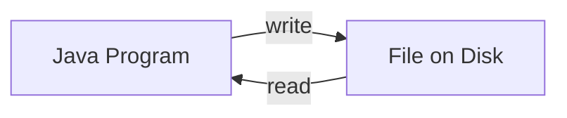

# File I/O

> File I/O lets your program permanently store and retrieve data — reading and writing text and binary files, working with paths and directories, and saving whole objects using serialization.

## What You'll Learn

- Why file handling matters (persisting data beyond program execution)
- The `File` class — checking, creating, deleting files and directories
- Modern file handling with `Path`, `Paths`, and `Files` (NIO.2)
- Reading text files — `Files.readAllLines`, `BufferedReader`, `Scanner`
- Writing text files — `Files.writeString`, `BufferedWriter`, `PrintWriter`
- Appending to files
- Byte streams — `FileInputStream` and `FileOutputStream` (copying binary files)
- Working with directories — listing, creating, walking
- Serialization — saving and loading objects
- Handling file exceptions and closing resources
- Common mistakes and a practical example

---

## Why File I/O?

Variables live in memory and vanish when the program ends. Files let data **persist**: configuration, logs, saved game state, reports, and more.



> [!NOTE]
> Almost every file operation can fail (file missing, no permission, disk full), so file methods throw the **checked** `IOException`. You must handle or declare it — see [Exception Handling](./11.exception-handling.md).

### Streams: Bytes vs Characters

| Type | Base classes | Use for |
| :--- | :--- | :--- |
| **Byte streams** | `InputStream`, `OutputStream` | Binary data (images, PDFs, audio) |
| **Character streams** | `Reader`, `Writer` | Text data (`.txt`, `.csv`, `.json`) |

---

## The File Class

`java.io.File` represents a file or directory **path**. Creating a `File` object does **not** create the file on disk.

```java
import java.io.File;
import java.io.IOException;

public class Main {
    public static void main(String[] args) {
        File file = new File("notes.txt");

        try {
            if (file.createNewFile()) {
                System.out.println("Created: " + file.getName());
            } else {
                System.out.println("File already exists.");
            }
        } catch (IOException e) {
            System.out.println("Error: " + e.getMessage());
        }

        System.out.println("Exists?   " + file.exists());
        System.out.println("Absolute: " + file.getAbsolutePath());
        System.out.println("Size:     " + file.length() + " bytes");
        System.out.println("Readable: " + file.canRead());
    }
}
```

### Common `File` Methods

| Method | Description |
| :--- | :--- |
| `exists()` | Does it exist on disk? |
| `createNewFile()` | Creates an empty file (returns `false` if it exists) |
| `delete()` | Deletes the file or empty directory |
| `getName()` | File name only |
| `getPath()` / `getAbsolutePath()` | Path as given / full path |
| `length()` | Size in bytes |
| `isFile()` / `isDirectory()` | Type checks |
| `canRead()` / `canWrite()` | Permission checks |
| `mkdir()` / `mkdirs()` | Create one directory / the whole directory chain |
| `list()` / `listFiles()` | Names / `File` objects inside a directory |
| `renameTo(File)` | Rename or move |

### Relative vs Absolute Paths

| Path type | Example | Meaning |
| :--- | :--- | :--- |
| **Relative** | `data/notes.txt` | Relative to the program's working directory (project root in an IDE) |
| **Absolute** | `C:\Users\Sam\notes.txt` or `/home/sam/notes.txt` | Full location from the drive/root |

> [!TIP]
> Use forward slashes `/` in Java strings — they work on Windows, macOS, and Linux. If you use backslashes, you must escape them: `"C:\\Users\\Sam\\notes.txt"`.

---

## Modern API: Path and Files (NIO.2)

Since Java 7, `java.nio.file` offers a cleaner and more powerful API. **Prefer it for new code.**

| Class | Role |
| :--- | :--- |
| `Path` | Represents a file system location (like `File`, but richer) |
| `Paths` / `Path.of()` | Creates a `Path` |
| `Files` | Static utility methods: read, write, copy, move, delete, list |

```java
import java.nio.file.*;

Path path = Path.of("data", "notes.txt");   // data/notes.txt

System.out.println(path.getFileName());     // notes.txt
System.out.println(path.getParent());       // data
System.out.println(path.toAbsolutePath());  // full path
System.out.println(Files.exists(path));     // true / false
```

### Common `Files` Methods

| Method | Description |
| :--- | :--- |
| `Files.exists(path)` | Check existence |
| `Files.createFile(path)` | Create an empty file |
| `Files.createDirectories(path)` | Create directory chain |
| `Files.readString(path)` | Read whole file as a `String` (Java 11+) |
| `Files.readAllLines(path)` | Read all lines into a `List<String>` |
| `Files.writeString(path, text)` | Write a `String` (Java 11+) |
| `Files.write(path, lines)` | Write lines |
| `Files.copy(src, dest)` | Copy a file |
| `Files.move(src, dest)` | Move / rename |
| `Files.delete(path)` / `deleteIfExists(path)` | Delete |
| `Files.size(path)` | Size in bytes |
| `Files.list(dir)` / `Files.walk(dir)` | Stream directory contents |

---

## Reading Text Files

### Way 1: `Files.readString` / `readAllLines` (Simplest)

Good for **small** files because the whole content is loaded into memory.

```java
import java.io.IOException;
import java.nio.file.*;
import java.util.List;

public class Main {
    public static void main(String[] args) {
        Path path = Path.of("notes.txt");

        try {
            String content = Files.readString(path);
            System.out.println(content);

            List<String> lines = Files.readAllLines(path);
            for (String line : lines) {
                System.out.println("> " + line);
            }
        } catch (IOException e) {
            System.out.println("Could not read file: " + e.getMessage());
        }
    }
}
```

### Way 2: `BufferedReader` (Line by Line, Large Files)

Reads one line at a time, so memory usage stays low.

```java
import java.io.*;

public class Main {
    public static void main(String[] args) {
        try (BufferedReader br = new BufferedReader(new FileReader("notes.txt"))) {
            String line;
            int lineNo = 1;
            while ((line = br.readLine()) != null) {
                System.out.println(lineNo++ + ": " + line);
            }
        } catch (IOException e) {
            System.out.println("Error: " + e.getMessage());
        }
    }
}
```

### Code Explanation

| Part | What it does |
| :--- | :--- |
| `FileReader` | Opens the file and reads characters |
| `BufferedReader` | Wraps it with a buffer for efficient `readLine()` |
| `try (...)` | **try-with-resources** — closes the reader automatically |
| `br.readLine()` | Returns the next line, or `null` at the end of the file |
| `while ((line = ...) != null)` | Assigns and checks in one step; loops until EOF |

### Way 3: `Scanner` (Parsing Tokens)

```java
import java.io.*;
import java.util.Scanner;

try (Scanner sc = new Scanner(new File("numbers.txt"))) {
    int sum = 0;
    while (sc.hasNextInt()) {
        sum += sc.nextInt();
    }
    System.out.println("Sum = " + sum);
} catch (FileNotFoundException e) {
    System.out.println("File not found!");
}
```

### Way 4: Streams (Java 8+)

```java
import java.nio.file.*;
import java.util.stream.Stream;

try (Stream<String> lines = Files.lines(Path.of("notes.txt"))) {
    lines.filter(l -> !l.isBlank())
         .map(String::toUpperCase)
         .forEach(System.out::println);
} catch (IOException e) {
    e.printStackTrace();
}
```

### Which One to Use?

| Need | Use |
| :--- | :--- |
| Small file, whole content | `Files.readString` / `readAllLines` |
| Large file, line by line | `BufferedReader` or `Files.lines` |
| Parse numbers/words | `Scanner` |
| Filter/transform lines | `Files.lines` + streams |

---

## Writing Text Files

### Way 1: `Files.writeString` / `Files.write`

```java
import java.io.IOException;
import java.nio.file.*;
import java.util.List;

public class Main {
    public static void main(String[] args) {
        try {
            Files.writeString(Path.of("out.txt"), "Hello, File!\n");

            List<String> lines = List.of("Line 1", "Line 2", "Line 3");
            Files.write(Path.of("lines.txt"), lines);

            System.out.println("Files written.");
        } catch (IOException e) {
            System.out.println("Error: " + e.getMessage());
        }
    }
}
```

> [!WARNING]
> By default these methods **overwrite** an existing file. To append, pass an option (see below).

### Way 2: `BufferedWriter`

```java
import java.io.*;

try (BufferedWriter bw = new BufferedWriter(new FileWriter("report.txt"))) {
    bw.write("Report Title");
    bw.newLine();                 // platform-independent line break
    bw.write("Total: 42");
    bw.newLine();
} catch (IOException e) {
    System.out.println("Error: " + e.getMessage());
}
```

### Way 3: `PrintWriter` (Familiar `println` / `printf`)

```java
import java.io.*;

try (PrintWriter pw = new PrintWriter(new FileWriter("scores.txt"))) {
    pw.println("Alice,85");
    pw.println("Bob,92");
    pw.printf("%s,%d%n", "Charlie", 70);
} catch (IOException e) {
    System.out.println("Error: " + e.getMessage());
}
```

### Appending Instead of Overwriting

```java
import java.nio.file.*;

// NIO.2
Files.writeString(Path.of("log.txt"), "New entry\n",
        StandardOpenOption.CREATE, StandardOpenOption.APPEND);

// Classic: second argument "true" means append
try (FileWriter fw = new FileWriter("log.txt", true);
     BufferedWriter bw = new BufferedWriter(fw)) {
    bw.write("Another entry");
    bw.newLine();
}
```

### Overwrite vs Append

| Approach | Behaviour |
| :--- | :--- |
| `new FileWriter("a.txt")` | **Overwrites** the file |
| `new FileWriter("a.txt", true)` | **Appends** to the end |
| `Files.writeString(path, text)` | **Overwrites** |
| `Files.writeString(path, text, CREATE, APPEND)` | **Appends** |

---

## Byte Streams: Binary Files

For non-text data use `FileInputStream` and `FileOutputStream`. Example: copy any file (image, PDF, etc.).

```java
import java.io.*;

public class Main {
    public static void main(String[] args) {
        try (FileInputStream in = new FileInputStream("photo.jpg");
             FileOutputStream out = new FileOutputStream("photo_copy.jpg")) {

            byte[] buffer = new byte[4096];
            int bytesRead;

            while ((bytesRead = in.read(buffer)) != -1) {
                out.write(buffer, 0, bytesRead);
            }
            System.out.println("Copy complete.");

        } catch (IOException e) {
            System.out.println("Error: " + e.getMessage());
        }
    }
}
```

### Code Explanation

| Part | What it does |
| :--- | :--- |
| `byte[] buffer = new byte[4096]` | Chunk of 4 KB read at a time (faster than 1 byte at a time) |
| `in.read(buffer)` | Fills the buffer; returns the count of bytes read, or `-1` at the end |
| `out.write(buffer, 0, bytesRead)` | Writes only the bytes actually read |
| try-with-resources | Closes both streams automatically |

The easier modern way:

```java
Files.copy(Path.of("photo.jpg"), Path.of("photo_copy.jpg"),
           StandardCopyOption.REPLACE_EXISTING);
```

---

## Working with Directories

```java
import java.io.IOException;
import java.nio.file.*;
import java.util.stream.Stream;

public class Main {
    public static void main(String[] args) throws IOException {
        Path dir = Path.of("projects/java/demo");

        // Create (including missing parents)
        Files.createDirectories(dir);

        // Create a file inside
        Files.writeString(dir.resolve("hello.txt"), "Hi!");

        // List direct children
        try (Stream<Path> children = Files.list(Path.of("projects/java"))) {
            children.forEach(p -> System.out.println(
                (Files.isDirectory(p) ? "[DIR]  " : "[FILE] ") + p.getFileName()));
        }

        // Walk whole tree
        try (Stream<Path> all = Files.walk(Path.of("projects"))) {
            all.forEach(System.out::println);
        }

        // Delete a file
        Files.deleteIfExists(dir.resolve("hello.txt"));
    }
}
```

| Method | Behaviour |
| :--- | :--- |
| `Files.list(dir)` | Immediate children only |
| `Files.walk(dir)` | Recursively visits **all** descendants |
| `path.resolve("x")` | Joins paths: `dir/x` |
| `Files.createDirectories` | Like `mkdirs()` — no error if it already exists |

> [!NOTE]
> `Files.delete` fails on a **non-empty** directory. Delete its contents first.

---

## Serialization: Saving Objects

**Serialization** converts an object into a stream of bytes so it can be saved to a file or sent over a network. **Deserialization** rebuilds the object.

To make a class serializable, implement the marker interface `java.io.Serializable`.

```java
import java.io.*;

class Student implements Serializable {
    private static final long serialVersionUID = 1L;

    private String name;
    private int marks;
    private transient String password;   // NOT saved

    public Student(String name, int marks, String password) {
        this.name = name;
        this.marks = marks;
        this.password = password;
    }

    @Override
    public String toString() {
        return name + " (" + marks + "), password=" + password;
    }
}

public class Main {
    public static void main(String[] args) {
        Student s = new Student("Alice", 85, "secret123");

        // Save
        try (ObjectOutputStream oos =
                 new ObjectOutputStream(new FileOutputStream("student.ser"))) {
            oos.writeObject(s);
            System.out.println("Saved.");
        } catch (IOException e) {
            e.printStackTrace();
        }

        // Load
        try (ObjectInputStream ois =
                 new ObjectInputStream(new FileInputStream("student.ser"))) {
            Student loaded = (Student) ois.readObject();
            System.out.println("Loaded: " + loaded);
        } catch (IOException | ClassNotFoundException e) {
            e.printStackTrace();
        }
    }
}
```

**Output:**

```text
Saved.
Loaded: Alice (85), password=null
```

### Key Points

| Concept | Explanation |
| :--- | :--- |
| `Serializable` | Marker interface — no methods to implement |
| `serialVersionUID` | Version number; avoids errors when the class changes |
| `transient` | Field is **skipped** during serialization (restored as `null`/`0`) |
| `static` fields | Never serialized (they belong to the class) |
| `ObjectOutputStream.writeObject` | Writes the object |
| `ObjectInputStream.readObject` | Reads it back (needs a cast) |
| Nested objects | All fields' classes must also be `Serializable` |

> [!WARNING]
> Never deserialize data from untrusted sources — it is a well-known security risk. For data exchange prefer formats like JSON.

---

## Handling File Exceptions

| Exception | When it occurs |
| :--- | :--- |
| `FileNotFoundException` | File doesn't exist or can't be opened (`FileReader`, `Scanner`, streams) |
| `NoSuchFileException` | Same, for `Files` (NIO.2) methods |
| `FileAlreadyExistsException` | `Files.createFile` / `copy` when the target exists |
| `AccessDeniedException` | No permission |
| `DirectoryNotEmptyException` | Deleting a non-empty directory |
| `IOException` | Parent of all the above; general I/O failure |

```java
try {
    String text = Files.readString(Path.of("missing.txt"));
} catch (NoSuchFileException e) {
    System.out.println("File not found: " + e.getFile());
} catch (IOException e) {
    System.out.println("I/O error: " + e.getMessage());
}
```

---

## Common Mistakes

| Mistake | Problem | Fix |
| :--- | :--- | :--- |
| Forgetting to close streams | Resource leak, data not flushed | Use try-with-resources |
| Overwriting when you meant to append | Existing data lost | Pass `true` or `APPEND` |
| Wrong relative path | `FileNotFoundException` | Print `new File(".").getAbsolutePath()` to see the working directory |
| `"C:\Users\..."` in a string | `\U` is an invalid escape | Use `\\` or `/` |
| Reading a huge file with `readAllLines` | `OutOfMemoryError` | Use `BufferedReader` / `Files.lines` |
| Using `FileReader` for images | Corrupts binary data | Use byte streams |
| `File.createNewFile()` in a missing folder | `IOException` | Create folders first with `mkdirs()` |
| Serializing without `Serializable` | `NotSerializableException` | Implement the interface |
| Ignoring the return of `delete()` | Failure goes unnoticed | Check it or use `Files.delete` |

---

## Practical Example: Simple Contact Book

Stores contacts in a CSV file; supports add, list, and search.

```java
import java.io.IOException;
import java.nio.file.*;
import java.util.*;

public class ContactBook {
    private static final Path FILE = Path.of("contacts.csv");

    public static void main(String[] args) throws IOException {
        if (Files.notExists(FILE)) {
            Files.createFile(FILE);
        }

        Scanner sc = new Scanner(System.in);
        while (true) {
            System.out.println("\n1) Add  2) List  3) Search  4) Exit");
            System.out.print("Choice: ");
            String choice = sc.nextLine().trim();

            switch (choice) {
                case "1" -> {
                    System.out.print("Name: ");
                    String name = sc.nextLine().trim();
                    System.out.print("Phone: ");
                    String phone = sc.nextLine().trim();
                    Files.writeString(FILE, name + "," + phone + System.lineSeparator(),
                            StandardOpenOption.APPEND);
                    System.out.println("✅ Saved.");
                }
                case "2" -> {
                    List<String> lines = Files.readAllLines(FILE);
                    if (lines.isEmpty()) System.out.println("No contacts yet.");
                    for (String line : lines) {
                        String[] parts = line.split(",");
                        System.out.printf("%-15s %s%n", parts[0], parts[1]);
                    }
                }
                case "3" -> {
                    System.out.print("Search for: ");
                    String q = sc.nextLine().trim().toLowerCase();
                    Files.readAllLines(FILE).stream()
                         .filter(l -> l.toLowerCase().contains(q))
                         .forEach(System.out::println);
                }
                case "4" -> {
                    System.out.println("Goodbye!");
                    return;
                }
                default -> System.out.println("Invalid choice.");
            }
        }
    }
}
```

### How It Works

| Step | Explanation |
| :--- | :--- |
| `Files.notExists` + `createFile` | Ensures the file exists on first run |
| `Files.writeString(..., APPEND)` | Adds one `name,phone` line per contact |
| `Files.readAllLines` | Loads all lines for listing and searching |
| `line.split(",")` | Splits a CSV line into name and phone |
| `.stream().filter(...)` | Case-insensitive search |
| Data persists | Restart the program and contacts are still there |

---

## Summary

| Concept | Key Point |
| :--- | :--- |
| **File I/O** | Lets data persist beyond program execution |
| **`File`** | Represents a path; checks, creates, deletes files and directories |
| **`Path` / `Files`** | Modern NIO.2 API — preferred for new code |
| **Read text** | `Files.readString/readAllLines` (small), `BufferedReader` (large), `Scanner` (parsing) |
| **Write text** | `Files.writeString`, `BufferedWriter`, `PrintWriter` |
| **Append** | `FileWriter(name, true)` or `StandardOpenOption.APPEND` |
| **Byte streams** | `FileInputStream` / `FileOutputStream` for binary data |
| **Directories** | `createDirectories`, `Files.list`, `Files.walk` |
| **Serialization** | `Serializable` + `ObjectOutputStream` / `ObjectInputStream`; `transient` skips fields |
| **Resource safety** | Always use try-with-resources |
| **Exceptions** | `IOException` family is checked — handle or declare |
