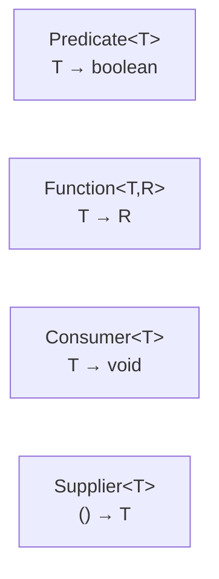
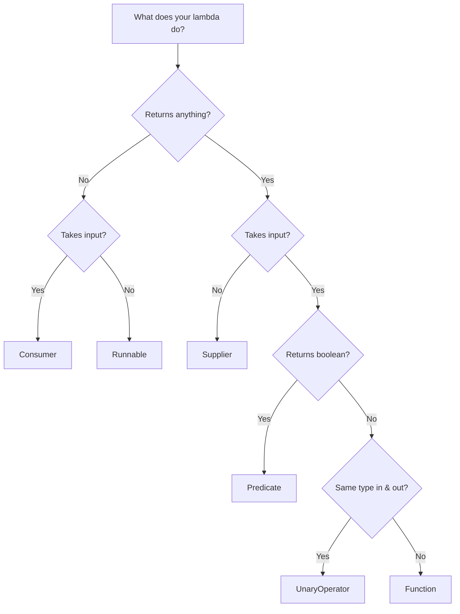

# Lambda Expressions and Functional Interfaces

> A lambda expression is a short, anonymous function you can pass around like data — it replaces bulky anonymous classes and is the foundation of modern Java (streams, `Optional`, `CompletableFuture`, and more).

## What You'll Learn

- Why lambdas were introduced (Java 8) and the problem with anonymous classes
- Lambda syntax — parameters, arrow, body
- Functional interfaces and `@FunctionalInterface`
- Built-in functional interfaces — `Predicate`, `Function`, `Consumer`, `Supplier`, `BiFunction`, `UnaryOperator`, `BinaryOperator`
- Method references — four kinds (`::`)
- Variable capture and "effectively final"
- `this` inside lambdas vs anonymous classes
- Composing functions — `andThen`, `compose`, `and`, `or`, `negate`
- Lambdas with collections (`forEach`, `removeIf`, `replaceAll`, `sort`, `Map` methods)
- Writing your own functional interface
- Common mistakes and a practical example

---

## Why Lambdas?

Before Java 8, passing behaviour meant writing an **anonymous class**:

```java
import java.util.*;

List<String> names = new ArrayList<>(List.of("Charlie", "Alice", "Bob"));

Collections.sort(names, new Comparator<String>() {
    @Override
    public int compare(String a, String b) {
        return a.compareTo(b);
    }
});
```

Five lines of boilerplate for **one line** of real logic. With a lambda:

```java
names.sort((a, b) -> a.compareTo(b));
```

| Anonymous class | Lambda |
| :--- | :--- |
| Verbose | Concise |
| Creates a separate `.class` file | Compiled using `invokedynamic` (no extra class file) |
| Has its own `this` | `this` refers to the enclosing class |
| Can implement interfaces with many methods | Only **functional interfaces** (one abstract method) |

---

## Lambda Syntax

```text
(parameters) -> expression
(parameters) -> { statements; }
```

| Part | Meaning |
| :--- | :--- |
| `(parameters)` | Input values, like a method's parameter list |
| `->` | The **arrow** — separates inputs from the body |
| body | The code to run; a single expression or a block |

### Syntax Variations

```java
// 1. No parameters
Runnable r = () -> System.out.println("Hello!");

// 2. One parameter (parentheses optional)
Consumer<String> printer = s -> System.out.println(s);
Consumer<String> printer2 = (s) -> System.out.println(s);

// 3. Multiple parameters
BinaryOperator<Integer> add = (a, b) -> a + b;

// 4. Explicit parameter types
BinaryOperator<Integer> mul = (Integer a, Integer b) -> a * b;

// 5. Block body — needs braces, and `return` if it gives a value
BinaryOperator<Integer> max = (a, b) -> {
    if (a > b) return a;
    return b;
};
```

### Rules

| Rule | Example |
| :--- | :--- |
| Expression body → value is returned automatically | `(a, b) -> a + b` |
| Block body → must use `return` (if non-void) | `(a, b) -> { return a + b; }` |
| Parameter types are normally inferred | `(a, b) -> a + b` |
| Can't mix typed and untyped params | `(int a, b) -> ...` ❌ |
| Parentheses required for 0 or 2+ params | `() -> ...`, `(a, b) -> ...` |

---

## Functional Interfaces

A **functional interface** is an interface with exactly **one abstract method** (SAM — Single Abstract Method). A lambda *is* an implementation of that method.

```java
@FunctionalInterface
interface Greeting {
    String greet(String name);        // the single abstract method
}

public class Main {
    public static void main(String[] args) {
        Greeting english = name -> "Hello, " + name + "!";
        Greeting spanish = name -> "¡Hola, " + name + "!";

        System.out.println(english.greet("Sam"));   // Hello, Sam!
        System.out.println(spanish.greet("Sam"));   // ¡Hola, Sam!
    }
}
```

### Code Explanation

| Part | What it does |
| :--- | :--- |
| `@FunctionalInterface` | Optional annotation — the compiler errors if there's more than one abstract method |
| `String greet(String name)` | The one abstract method the lambda implements |
| `name -> "Hello, " + name + "!"` | Lambda: takes `name`, returns the greeting |
| Target typing | Java infers the lambda's type from the variable type (`Greeting`) |

> [!NOTE]
> A functional interface may still contain `default` methods, `static` methods, and methods from `Object` (like `equals`) — only **abstract** methods are counted.

### Familiar Functional Interfaces You Already Know

| Interface | Abstract method |
| :--- | :--- |
| `Runnable` | `void run()` |
| `Comparator<T>` | `int compare(T a, T b)` |
| `Callable<V>` | `V call()` |
| `Comparable<T>` | `int compareTo(T o)` |

---

## Built-in Functional Interfaces (`java.util.function`)

Java provides ready-made interfaces so you rarely need to write your own.



### The Core Four

| Interface | Method | Takes | Returns | Typical use |
| :--- | :--- | :--- | :--- | :--- |
| **`Predicate<T>`** | `boolean test(T t)` | `T` | `boolean` | Filtering / conditions |
| **`Function<T, R>`** | `R apply(T t)` | `T` | `R` | Transforming / mapping |
| **`Consumer<T>`** | `void accept(T t)` | `T` | nothing | Performing an action (print, save) |
| **`Supplier<T>`** | `T get()` | nothing | `T` | Producing / lazy values |

```java
import java.util.function.*;

Predicate<Integer> isEven = n -> n % 2 == 0;
System.out.println(isEven.test(4));        // true

Function<String, Integer> length = s -> s.length();
System.out.println(length.apply("Java"));  // 4

Consumer<String> shout = s -> System.out.println(s.toUpperCase() + "!");
shout.accept("hello");                     // HELLO!

Supplier<Double> random = () -> Math.random();
System.out.println(random.get());          // 0.7349...
```

### Two-Argument and Specialised Variants

| Interface | Method | Description |
| :--- | :--- | :--- |
| `BiPredicate<T, U>` | `boolean test(T, U)` | Two inputs → boolean |
| `BiFunction<T, U, R>` | `R apply(T, U)` | Two inputs → result |
| `BiConsumer<T, U>` | `void accept(T, U)` | Two inputs → action (e.g. `Map.forEach`) |
| `UnaryOperator<T>` | `T apply(T)` | `Function<T, T>` — same type in and out |
| `BinaryOperator<T>` | `T apply(T, T)` | `BiFunction<T, T, T>` — combine two |

### Primitive Specialisations (Avoid Boxing)

| Family | Examples |
| :--- | :--- |
| `Int...` | `IntPredicate`, `IntFunction<R>`, `IntUnaryOperator`, `IntBinaryOperator`, `ToIntFunction<T>` |
| `Long...` / `Double...` | `LongSupplier`, `DoubleUnaryOperator`, `ToDoubleFunction<T>` |
| `BooleanSupplier` | Supplies a `boolean` |

```java
IntBinaryOperator sum = (a, b) -> a + b;        // no Integer boxing
System.out.println(sum.applyAsInt(3, 4));       // 7
```

### Choosing the Right Interface



---

## Method References

When a lambda **only calls an existing method**, use a method reference (`::`) for shorter, clearer code.

| Kind | Syntax | Lambda equivalent |
| :--- | :--- | :--- |
| **Static method** | `Integer::parseInt` | `s -> Integer.parseInt(s)` |
| **Instance method of a particular object** | `System.out::println` | `x -> System.out.println(x)` |
| **Instance method of an arbitrary object of a type** | `String::toUpperCase` | `s -> s.toUpperCase()` |
| **Constructor** | `ArrayList::new` | `() -> new ArrayList<>()` |

```java
import java.util.*;
import java.util.function.*;

List<String> names = List.of("alice", "bob", "charlie");

// 1. Static method
Function<String, Integer> parse = Integer::parseInt;

// 2. Particular object
names.forEach(System.out::println);

// 3. Arbitrary object of a type
List<String> upper = new ArrayList<>();
names.forEach(n -> upper.add(n.toUpperCase()));
Function<String, String> toUpper = String::toUpperCase;

// 4. Constructor
Supplier<List<String>> listMaker = ArrayList::new;
Function<String, StringBuilder> sbMaker = StringBuilder::new;
```

> [!TIP]
> Prefer a method reference when it reads naturally; use a lambda when the logic is more than a single method call.

---

## Variable Capture and "Effectively Final"

A lambda can use variables from its surrounding scope, but those variables must be **final or effectively final** (never reassigned after initialization).

```java
int base = 10;                              // effectively final
Function<Integer, Integer> addBase = n -> n + base;
System.out.println(addBase.apply(5));       // 15
```

```java
int counter = 0;
Runnable r = () -> counter++;               // ❌ Compile error!
```

### Why?

A lambda may run later or on another thread. Local variables live on the stack and may be gone; Java therefore **copies** their value into the lambda — so the value must never change, to avoid confusion.

### Workarounds for Mutable State

```java
// 1. Single-element array
int[] count = {0};
Runnable r1 = () -> count[0]++;

// 2. AtomicInteger (thread-safe)
import java.util.concurrent.atomic.AtomicInteger;
AtomicInteger counter = new AtomicInteger();
Runnable r2 = counter::incrementAndGet;
```

> [!NOTE]
> **Instance and static fields** are not restricted — only local variables and parameters must be effectively final.

---

## `this` in Lambdas vs Anonymous Classes

```java
public class Demo {
    private String name = "Demo";

    void run() {
        Runnable anon = new Runnable() {
            private String name = "Anonymous";
            @Override public void run() {
                System.out.println(this.name);   // Anonymous (its own this)
            }
        };

        Runnable lambda = () -> System.out.println(this.name);  // Demo (enclosing this)

        anon.run();
        lambda.run();
    }
}
```

| | Anonymous class | Lambda |
| :--- | :--- | :--- |
| `this` | The anonymous object | The **enclosing** object |
| Can declare fields | Yes | No |
| Can shadow local variables | Yes | No (same scope as the enclosing method) |

---

## Composing Functions

Functional interfaces provide `default` methods to chain behaviour.

### `Function`: `andThen` and `compose`

```java
Function<Integer, Integer> doubleIt = x -> x * 2;
Function<Integer, Integer> addTen   = x -> x + 10;

System.out.println(doubleIt.andThen(addTen).apply(5));   // (5*2)+10 = 20  → doubleIt first
System.out.println(doubleIt.compose(addTen).apply(5));   // (5+10)*2 = 30  → addTen first
```

| Method | Order |
| :--- | :--- |
| `f.andThen(g)` | `g(f(x))` — f first |
| `f.compose(g)` | `f(g(x))` — g first |

### `Predicate`: `and`, `or`, `negate`

```java
Predicate<String> notEmpty   = s -> !s.isEmpty();
Predicate<String> shortWord  = s -> s.length() < 6;
Predicate<String> startsWithA = s -> s.startsWith("A");

Predicate<String> combined = notEmpty.and(shortWord).and(startsWithA);
System.out.println(combined.test("Apple"));    // true
System.out.println(combined.test("Avocado"));  // false (too long)

Predicate<String> isLong = shortWord.negate();
System.out.println(isLong.test("Elephant"));   // true

Predicate<String> either = startsWithA.or(s -> s.startsWith("B"));
```

Static helpers: `Predicate.not(String::isBlank)`, `Predicate.isEqual("x")`, `Function.identity()`, `UnaryOperator.identity()`.

### `Consumer`: `andThen`

```java
Consumer<String> log   = s -> System.out.println("LOG: " + s);
Consumer<String> save  = s -> System.out.println("SAVED: " + s);

log.andThen(save).accept("order-101");
// LOG: order-101
// SAVED: order-101
```

---

## Lambdas with Collections

Java 8 added many methods that accept lambdas.

```java
import java.util.*;

List<String> names = new ArrayList<>(List.of("Charlie", "alice", "Bob", "dave"));

// forEach — act on each element
names.forEach(n -> System.out.println("Hi " + n));

// removeIf — remove elements matching a condition
names.removeIf(n -> n.length() > 5);          // removes Charlie

// replaceAll — transform each element in place
names.replaceAll(String::toUpperCase);        // [ALICE, BOB, DAVE]

// sort — with a comparator lambda
names.sort((a, b) -> b.compareTo(a));         // [DAVE, BOB, ALICE]
```

### `Map` Methods

```java
Map<String, Integer> stock = new HashMap<>();
stock.put("apple", 5);

stock.forEach((k, v) -> System.out.println(k + " = " + v));

// computeIfAbsent — create a value if the key is missing
Map<String, List<String>> groups = new HashMap<>();
groups.computeIfAbsent("fruits", k -> new ArrayList<>()).add("apple");

// merge — combine with existing value (word counting!)
for (String w : "to be or not to be".split(" ")) {
    stock.merge(w, 1, Integer::sum);
}

// compute / computeIfPresent / replaceAll
stock.computeIfPresent("apple", (k, v) -> v + 10);
stock.replaceAll((k, v) -> v * 2);
```

| Method | Lambda role |
| :--- | :--- |
| `Map.forEach(BiConsumer)` | Act on each key/value |
| `computeIfAbsent(key, Function)` | Build value if key absent |
| `computeIfPresent(key, BiFunction)` | Update value if present |
| `merge(key, value, BiFunction)` | Combine new and old values |
| `replaceAll(BiFunction)` | Transform every value |

---

## Creating Your Own Functional Interface

Create one when no built-in fits — typically when you need 3+ parameters, checked exceptions, or a meaningful name.

```java
@FunctionalInterface
interface TriFunction<A, B, C, R> {
    R apply(A a, B b, C c);
}

@FunctionalInterface
interface Validator<T> {
    boolean validate(T value);

    // default methods are allowed
    default Validator<T> and(Validator<T> other) {
        return v -> this.validate(v) && other.validate(v);
    }
}

public class Main {
    public static void main(String[] args) {
        TriFunction<Integer, Integer, Integer, Integer> volume = (l, w, h) -> l * w * h;
        System.out.println(volume.apply(2, 3, 4));   // 24

        Validator<String> notBlank = s -> !s.isBlank();
        Validator<String> minLen   = s -> s.length() >= 3;

        Validator<String> username = notBlank.and(minLen);
        System.out.println(username.validate("ab"));     // false
        System.out.println(username.validate("alice"));  // true
    }
}
```

### Passing Behaviour as a Parameter

```java
public static List<Integer> filter(List<Integer> list, Predicate<Integer> rule) {
    List<Integer> result = new ArrayList<>();
    for (int n : list) {
        if (rule.test(n)) result.add(n);
    }
    return result;
}

List<Integer> nums = List.of(1, 2, 3, 4, 5, 6);
System.out.println(filter(nums, n -> n % 2 == 0));   // [2, 4, 6]
System.out.println(filter(nums, n -> n > 3));        // [4, 5, 6]
```

One method, endless behaviours — this is the heart of functional-style programming and the **Strategy pattern** without extra classes.

---

## Lambdas and Exceptions

Built-in functional interfaces **do not declare checked exceptions**, so this fails:

```java
list.forEach(path -> Files.readString(Path.of(path)));   // ❌ unhandled IOException
```

Options:

```java
// 1. Handle inside the lambda
list.forEach(path -> {
    try {
        System.out.println(Files.readString(Path.of(path)));
    } catch (IOException e) {
        System.out.println("Cannot read " + path);
    }
});

// 2. Custom functional interface that throws
@FunctionalInterface
interface ThrowingFunction<T, R> {
    R apply(T t) throws Exception;
}
```

Unchecked exceptions (e.g. `IllegalArgumentException`) can be thrown from lambdas freely.

---

## Common Mistakes

| Mistake | Problem | Fix |
| :--- | :--- | :--- |
| Modifying a captured local variable | Compile error (not effectively final) | Use array or `AtomicInteger` |
| Lambda for an interface with 2+ abstract methods | Not a functional interface | Use anonymous class, or refactor |
| Long, multi-line lambdas | Hard to read | Extract to a named method and use a method reference |
| Ignoring checked exceptions | Compile error | Try/catch in lambda or custom interface |
| Using `this` expecting the lambda object | It refers to the enclosing class | Use an anonymous class if needed |
| Boxing in hot loops with `Function<Integer,Integer>` | Slower | Use `IntUnaryOperator` etc. |
| Side effects in `Predicate`/`Function` | Surprising behaviour, hard to test | Keep them pure; side effects belong in `Consumer` |
| Reusing a variable name from the enclosing scope as a lambda parameter | Compile error | Use a different name |

---

## Practical Example: Discount Engine

```java
import java.util.*;
import java.util.function.*;

class Product {
    private final String name;
    private final String category;
    private final double price;

    Product(String name, String category, double price) {
        this.name = name; this.category = category; this.price = price;
    }

    public String getName()     { return name; }
    public String getCategory() { return category; }
    public double getPrice()    { return price; }

    @Override public String toString() { return name + " ($" + price + ")"; }
}

public class Main {

    // Apply a discount function to every product matching a condition
    static void applyDiscount(List<Product> products,
                              Predicate<Product> condition,
                              UnaryOperator<Double> discount,
                              Consumer<String> report) {
        for (Product p : products) {
            if (condition.test(p)) {
                double newPrice = discount.apply(p.getPrice());
                report.accept(p.getName() + ": $" + p.getPrice() + " -> $" + newPrice);
            }
        }
    }

    public static void main(String[] args) {
        List<Product> products = List.of(
            new Product("Laptop",  "Electronics", 1000),
            new Product("Phone",   "Electronics",  600),
            new Product("Shirt",   "Clothing",      40),
            new Product("Jeans",   "Clothing",      80)
        );

        // 10% off all electronics
        applyDiscount(products,
            p -> p.getCategory().equals("Electronics"),
            price -> price * 0.90,
            System.out::println);

        System.out.println("---");

        // $10 off clothing priced above $50
        applyDiscount(products,
            p -> p.getCategory().equals("Clothing") && p.getPrice() > 50,
            price -> price - 10,
            msg -> System.out.println("SALE  " + msg));
    }
}
```

**Output:**

```text
Laptop: $1000.0 -> $900.0
Phone: $600.0 -> $540.0
---
SALE  Jeans: $80.0 -> $70.0
```

### How It Works

| Parameter | Interface | Role |
| :--- | :--- | :--- |
| `condition` | `Predicate<Product>` | **Which** products qualify |
| `discount` | `UnaryOperator<Double>` | **How** the price changes |
| `report` | `Consumer<String>` | **What to do** with the result |

The same method supports any rule — new discount types need **no new classes**.

---

## Summary

| Concept | Key Point |
| :--- | :--- |
| **Lambda** | `(params) -> body` — anonymous function that implements a functional interface |
| **Functional interface** | Exactly one abstract method; `@FunctionalInterface` enforces it |
| **`Predicate<T>`** | `T → boolean` (`test`) |
| **`Function<T,R>`** | `T → R` (`apply`) |
| **`Consumer<T>`** | `T → void` (`accept`) |
| **`Supplier<T>`** | `() → T` (`get`) |
| **`UnaryOperator` / `BinaryOperator`** | Same-type variants of `Function` / `BiFunction` |
| **Method reference** | `Class::method` — shorthand when the lambda only calls a method |
| **Effectively final** | Captured local variables must not be reassigned |
| **`this`** | In a lambda refers to the enclosing class |
| **Composition** | `andThen`, `compose`, `and`, `or`, `negate` |
| **Collections** | `forEach`, `removeIf`, `replaceAll`, `sort`, `computeIfAbsent`, `merge` |
| **Checked exceptions** | Not allowed in built-in interfaces; handle inside or create custom interface |
