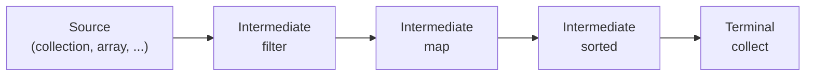

# Streams API

> A stream is a pipeline that processes a sequence of elements declaratively — you describe *what* you want (filter, transform, collect) instead of writing loops that describe *how*.

## What You'll Learn

- What a stream is (and what it is not)
- Stream pipeline — source, intermediate operations, terminal operation
- Creating streams from collections, arrays, values, ranges, and generators
- Intermediate operations — `filter`, `map`, `flatMap`, `distinct`, `sorted`, `limit`, `skip`, `peek`
- Terminal operations — `forEach`, `collect`, `reduce`, `count`, `min`/`max`, `anyMatch`/`allMatch`/`noneMatch`, `findFirst`
- Collectors — `toList`, `toSet`, `toMap`, `joining`, `groupingBy`, `partitioningBy`, `counting`, `summingInt`, `averagingDouble`
- Primitive streams — `IntStream`, `LongStream`, `DoubleStream`
- Lazy evaluation and short-circuiting
- Parallel streams
- Streams vs loops, common mistakes, and a practical example

---

## What is a Stream?

A **stream** (`java.util.stream.Stream`) is a sequence of elements supporting aggregate operations. It is **not** a data structure — it does not store data; it carries values from a **source** through a **pipeline** of operations.

### Loop vs Stream

Task: from a list of names, get the uppercase names longer than 3 letters, sorted.

```java
import java.util.*;
import java.util.stream.*;

List<String> names = List.of("Sam", "Alice", "Bob", "Charlie", "Dave");

// Traditional loop
List<String> result = new ArrayList<>();
for (String n : names) {
    if (n.length() > 3) {
        result.add(n.toUpperCase());
    }
}
Collections.sort(result);

// Stream
List<String> result2 = names.stream()
        .filter(n -> n.length() > 3)
        .map(String::toUpperCase)
        .sorted()
        .collect(Collectors.toList());

System.out.println(result2);   // [ALICE, CHARLIE, DAVE]
```

### Key Properties

| Property | Meaning |
| :--- | :--- |
| **Doesn't store data** | Elements come from a source (collection, array, file, generator) |
| **Doesn't modify the source** | Operations produce a **new** result |
| **Lazy** | Intermediate operations run only when a terminal operation is called |
| **One-time use** | A stream cannot be reused after a terminal operation |
| **Possibly unbounded** | Can be infinite (`Stream.iterate`, `generate`) with `limit` |

> [!NOTE]
> Streams build on [Lambda Expressions](./15.lambda-expressions-and-functional-interfaces.md) and method references — read that note first if those are unfamiliar.

---

## The Stream Pipeline

Every stream pipeline has three parts:



| Part | Examples | Returns |
| :--- | :--- | :--- |
| **Source** | `list.stream()`, `Arrays.stream(arr)`, `Stream.of(...)` | a `Stream` |
| **Intermediate operations** (0 or more) | `filter`, `map`, `sorted`, `distinct`, `limit` | another `Stream` (so you can chain) |
| **Terminal operation** (exactly 1) | `collect`, `forEach`, `count`, `reduce` | a result (or `void`) — **starts** the processing |

```java
long count = names.stream()          // source
        .filter(n -> n.length() > 3) // intermediate
        .count();                    // terminal
```

> [!IMPORTANT]
> Without a terminal operation **nothing happens** — the pipeline is only a recipe until a terminal operation triggers it.

---

## Creating Streams

```java
import java.util.*;
import java.util.stream.*;

// 1. From a collection
List<String> list = List.of("a", "b", "c");
Stream<String> s1 = list.stream();

// 2. From an array
int[] arr = {1, 2, 3};
IntStream s2 = Arrays.stream(arr);
String[] words = {"x", "y"};
Stream<String> s3 = Arrays.stream(words);

// 3. From values
Stream<Integer> s4 = Stream.of(1, 2, 3);

// 4. Ranges (primitive streams)
IntStream s5 = IntStream.range(0, 5);          // 0,1,2,3,4
IntStream s6 = IntStream.rangeClosed(1, 5);    // 1,2,3,4,5

// 5. Infinite streams
Stream<Integer> evens = Stream.iterate(0, n -> n + 2);   // 0,2,4,6,...
Stream<Double> randoms = Stream.generate(Math::random);

// 6. From a Map (via its views)
Map<String, Integer> map = Map.of("a", 1, "b", 2);
Stream<Map.Entry<String, Integer>> s7 = map.entrySet().stream();

// 7. From a String's characters
IntStream chars = "hello".chars();

// 8. From a file's lines
// Stream<String> lines = Files.lines(Path.of("notes.txt"));

// 9. Empty stream
Stream<String> empty = Stream.empty();
```

| Source | Method |
| :--- | :--- |
| `Collection` | `.stream()` |
| Array | `Arrays.stream(arr)` / `Stream.of(arr)` |
| Fixed values | `Stream.of(a, b, c)` |
| Number range | `IntStream.range` / `rangeClosed` |
| Infinite | `Stream.iterate`, `Stream.generate` (always add `limit`) |

---

## Intermediate Operations

Intermediate operations are **lazy** and return a new stream.

Sample data used below:

```java
class Student {
    private final String name;
    private final String course;
    private final int marks;

    Student(String name, String course, int marks) {
        this.name = name; this.course = course; this.marks = marks;
    }
    public String getName()   { return name; }
    public String getCourse() { return course; }
    public int getMarks()     { return marks; }
    @Override public String toString() { return name + "(" + marks + ")"; }
}

List<Student> students = List.of(
    new Student("Alice",   "Java",   85),
    new Student("Bob",     "Python", 92),
    new Student("Charlie", "Java",   70),
    new Student("Diana",   "Python", 92),
    new Student("Eve",     "Java",   60)
);
```

### `filter(Predicate)` — Keep Matching Elements

```java
students.stream()
        .filter(s -> s.getMarks() >= 80)
        .forEach(System.out::println);   // Alice(85) Bob(92) Diana(92)
```

### `map(Function)` — Transform Each Element

```java
List<String> names = students.stream()
        .map(Student::getName)
        .collect(Collectors.toList());   // [Alice, Bob, Charlie, Diana, Eve]
```

### `flatMap(Function)` — Flatten Nested Streams

`map` gives one output per input; `flatMap` turns each input into **many** and flattens the result.

```java
List<List<Integer>> nested = List.of(List.of(1, 2), List.of(3, 4), List.of(5));

List<Integer> flat = nested.stream()
        .flatMap(List::stream)
        .collect(Collectors.toList());   // [1, 2, 3, 4, 5]

List<String> sentences = List.of("hello world", "java streams");
List<String> allWords = sentences.stream()
        .flatMap(s -> Arrays.stream(s.split(" ")))
        .collect(Collectors.toList());   // [hello, world, java, streams]
```

### `distinct()` — Remove Duplicates

Uses `equals`/`hashCode`.

```java
Stream.of(1, 2, 2, 3, 3, 3).distinct().forEach(System.out::print);   // 123
```

### `sorted()` / `sorted(Comparator)` — Order Elements

```java
students.stream()
        .sorted(Comparator.comparingInt(Student::getMarks).reversed()
                          .thenComparing(Student::getName))
        .forEach(System.out::println);   // Bob(92) Diana(92) Alice(85) Charlie(70) Eve(60)
```

See [Comparable and Comparator](./10.comparable-and-comparator.md) for building comparators.

### `limit(n)` and `skip(n)` — Slice

```java
Stream.iterate(1, n -> n + 1)
      .skip(2)         // skip 1, 2
      .limit(5)        // take next 5
      .forEach(System.out::print);   // 34567
```

### `peek(Consumer)` — Debug Only

```java
Stream.of(1, 2, 3)
      .peek(n -> System.out.println("before: " + n))
      .map(n -> n * 2)
      .peek(n -> System.out.println("after: " + n))
      .collect(Collectors.toList());
```

> [!WARNING]
> Use `peek` only for debugging/logging — not to perform essential side effects.

### Other Useful Intermediates

| Operation | Description |
| :--- | :--- |
| `mapToInt` / `mapToDouble` / `mapToLong` | Map to a primitive stream (enables `sum`, `average`) |
| `boxed()` | Primitive stream → object stream |
| `takeWhile(pred)` / `dropWhile(pred)` | Take / drop from the start while condition holds (Java 9+) |

---

## Terminal Operations

A terminal operation produces a result and **closes** the stream.

### `forEach(Consumer)`

```java
students.stream().map(Student::getName).forEach(System.out::println);
```

### `collect(Collector)` — Gather Into a Collection

```java
List<String> list   = students.stream().map(Student::getName).collect(Collectors.toList());
Set<String> courses = students.stream().map(Student::getCourse).collect(Collectors.toSet());

// Java 16+
List<String> immutable = students.stream().map(Student::getName).toList();
```

### `count()`

```java
long javaCount = students.stream().filter(s -> s.getCourse().equals("Java")).count();  // 3
```

### `reduce` — Combine All Elements Into One

```java
int sum = Stream.of(1, 2, 3, 4, 5).reduce(0, (a, b) -> a + b);   // 15
int product = Stream.of(1, 2, 3, 4).reduce(1, (a, b) -> a * b);  // 24

// No identity → returns Optional (stream may be empty)
Optional<Integer> max = Stream.of(3, 9, 4).reduce(Integer::max);  // Optional[9]
```

| Form | Description |
| :--- | :--- |
| `reduce(identity, accumulator)` | Start value + combine function → plain value |
| `reduce(accumulator)` | No start value → `Optional` |

### `min` / `max`

```java
Optional<Student> top = students.stream()
        .max(Comparator.comparingInt(Student::getMarks));
System.out.println(top.get());   // Bob(92)
```

### Matching: `anyMatch`, `allMatch`, `noneMatch`

```java
boolean anyFail  = students.stream().anyMatch(s -> s.getMarks() < 40);    // false
boolean allPass  = students.stream().allMatch(s -> s.getMarks() >= 40);   // true
boolean noneZero = students.stream().noneMatch(s -> s.getMarks() == 0);   // true
```

### Finding: `findFirst`, `findAny`

```java
Optional<Student> first = students.stream()
        .filter(s -> s.getMarks() > 90)
        .findFirst();

first.ifPresent(s -> System.out.println("Found: " + s));   // Found: Bob(92)
```

### Summary of Terminal Operations

| Operation | Returns | Short-circuits? |
| :--- | :--- | :--- |
| `forEach` | `void` | No |
| `collect` / `toList()` | Collection / any result | No |
| `count` | `long` | No |
| `reduce` | Value or `Optional` | No |
| `min` / `max` | `Optional` | No |
| `anyMatch` / `allMatch` / `noneMatch` | `boolean` | **Yes** |
| `findFirst` / `findAny` | `Optional` | **Yes** |

---

## Collectors

`Collectors` (in `java.util.stream`) provides ready-made recipes for `collect`.

### Basic Collectors

```java
import static java.util.stream.Collectors.*;

// Join strings
String joined = students.stream().map(Student::getName).collect(joining(", ", "[", "]"));
// [Alice, Bob, Charlie, Diana, Eve]

// To Map
Map<String, Integer> nameToMarks = students.stream()
        .collect(toMap(Student::getName, Student::getMarks));

// To specific collection
TreeSet<String> sorted = students.stream()
        .map(Student::getName)
        .collect(toCollection(TreeSet::new));
```

> [!WARNING]
> `toMap` throws `IllegalStateException` on duplicate keys. Provide a merge function: `toMap(key, value, (a, b) -> a + b)`.

### Numeric Summaries

```java
double avg   = students.stream().collect(averagingInt(Student::getMarks));    // 79.8
int total    = students.stream().collect(summingInt(Student::getMarks));      // 399
IntSummaryStatistics stats = students.stream().collect(summarizingInt(Student::getMarks));
System.out.println(stats.getMin() + " " + stats.getMax() + " " + stats.getAverage());
```

### `groupingBy` — Group Like SQL `GROUP BY`

```java
// Course -> list of students
Map<String, List<Student>> byCourse = students.stream()
        .collect(groupingBy(Student::getCourse));
// {Java=[Alice(85), Charlie(70), Eve(60)], Python=[Bob(92), Diana(92)]}

// Course -> count
Map<String, Long> countByCourse = students.stream()
        .collect(groupingBy(Student::getCourse, counting()));
// {Java=3, Python=2}

// Course -> average marks
Map<String, Double> avgByCourse = students.stream()
        .collect(groupingBy(Student::getCourse, averagingInt(Student::getMarks)));
// {Java=71.67, Python=92.0}

// Course -> names only
Map<String, List<String>> namesByCourse = students.stream()
        .collect(groupingBy(Student::getCourse, mapping(Student::getName, toList())));
// {Java=[Alice, Charlie, Eve], Python=[Bob, Diana]}

// Course -> top student
Map<String, Optional<Student>> best = students.stream()
        .collect(groupingBy(Student::getCourse,
                 maxBy(Comparator.comparingInt(Student::getMarks))));
```

### `partitioningBy` — Split Into True/False

```java
Map<Boolean, List<Student>> passFail = students.stream()
        .collect(partitioningBy(s -> s.getMarks() >= 75));
// {false=[Charlie(70), Eve(60)], true=[Alice(85), Bob(92), Diana(92)]}
```

### Collector Cheat Sheet

| Collector | Result |
| :--- | :--- |
| `toList()`, `toSet()` | `List` / `Set` |
| `toMap(k, v)` | `Map` |
| `joining(sep, prefix, suffix)` | One `String` |
| `counting()` | `Long` count |
| `summingInt` / `averagingInt` | Sum / average |
| `minBy` / `maxBy` | `Optional` |
| `groupingBy(classifier [, downstream])` | `Map<K, List<T>>` or custom values |
| `partitioningBy(predicate)` | `Map<Boolean, List<T>>` |
| `mapping(fn, downstream)` | Transform before collecting |

---

## Primitive Streams

`IntStream`, `LongStream`, and `DoubleStream` avoid boxing and add numeric methods.

```java
import java.util.stream.*;

int sum = IntStream.rangeClosed(1, 100).sum();               // 5050
double avg = IntStream.of(3, 5, 8).average().orElse(0);      // 5.333...
int max = IntStream.of(3, 9, 4).max().getAsInt();            // 9

// Object stream -> primitive stream
int totalMarks = students.stream().mapToInt(Student::getMarks).sum();   // 399

// Primitive -> objects
List<Integer> squares = IntStream.rangeClosed(1, 5)
        .map(n -> n * n)
        .boxed()
        .collect(Collectors.toList());   // [1, 4, 9, 16, 25]

// Statistics
IntSummaryStatistics st = IntStream.of(4, 8, 6).summaryStatistics();
System.out.println(st);   // count=3, sum=18, min=4, average=6.0, max=8
```

| Method | Purpose |
| :--- | :--- |
| `sum()`, `average()`, `min()`, `max()` | Numeric aggregates |
| `mapToObj(fn)` | `IntStream` → `Stream<T>` |
| `boxed()` | `IntStream` → `Stream<Integer>` |
| `asDoubleStream()` | Widen to `DoubleStream` |

---

## Lazy Evaluation and Short-Circuiting

Elements flow through the **whole pipeline one at a time**, and processing stops as soon as the result is known.

```java
Stream.of("a", "bb", "ccc", "dddd")
      .filter(s -> {
          System.out.println("filter: " + s);
          return s.length() > 1;
      })
      .map(s -> {
          System.out.println("map: " + s);
          return s.toUpperCase();
      })
      .findFirst();
```

**Output:**

```text
filter: a
filter: bb
map: bb
```

- `"a"` is filtered out; `"bb"` passes, is mapped, and `findFirst` stops the pipeline.
- `"ccc"` and `"dddd"` are never touched.

This is why `limit`, `findFirst`, and `anyMatch` can work with **infinite streams**.

---

## Parallel Streams

Split the work across CPU cores with one call:

```java
long count = IntStream.rangeClosed(1, 1_000_000)
        .parallel()
        .filter(n -> n % 2 == 0)
        .count();

// or from a collection
list.parallelStream().map(...).collect(...);
```

| Use parallel when | Avoid parallel when |
| :--- | :--- |
| Large data sets | Small data sets (overhead > benefit) |
| CPU-heavy, independent operations | Operations with shared mutable state |
| Source splits well (`ArrayList`, arrays, ranges) | Sources like `LinkedList`, or I/O-bound work |
| Order doesn't matter | You need ordering (`forEachOrdered` costs speed) |

> [!CAUTION]
> Never modify shared variables inside a parallel stream (e.g. adding to a plain `ArrayList` from `forEach`) — it causes race conditions. Use `collect` instead.

---

## Streams Are Single-Use

```java
Stream<String> s = Stream.of("a", "b");
s.forEach(System.out::println);
s.forEach(System.out::println);   // 💥 IllegalStateException: stream has already been operated upon or closed
```

Create a new stream (or use a `Supplier<Stream<T>>`) each time.

---

## Streams vs Loops

| Aspect | Loop | Stream |
| :--- | :--- | :--- |
| Style | Imperative (*how*) | Declarative (*what*) |
| Readability for pipelines | Nested/verbose | Clean, chainable |
| Parallelism | Manual threading | `.parallel()` |
| Debugging | Easy (breakpoints) | Harder |
| Modifying the source | Possible | Not intended |
| Early `break`/`continue`/checked exceptions | Easy | Awkward |
| Simple iteration | Often simpler | Overkill |

> [!TIP]
> Use streams for filtering/mapping/aggregating data; use a plain loop for simple iteration or when you need `break`, index access, or heavy mutation.

---

## Common Mistakes

| Mistake | Problem | Fix |
| :--- | :--- | :--- |
| No terminal operation | Nothing executes | Always end with `collect`, `forEach`, `count`, etc. |
| Reusing a stream | `IllegalStateException` | Create a new stream |
| Modifying the source while streaming | `ConcurrentModificationException` | Collect results into a new list |
| Side effects in `map`/`filter` | Unpredictable (especially parallel) | Keep operations pure |
| `toMap` with duplicate keys | `IllegalStateException` | Add a merge function |
| Calling `.get()` on an empty `Optional` | `NoSuchElementException` | Use `orElse`, `ifPresent`, `orElseThrow` |
| Infinite stream without `limit` | Program never ends / OOM | Add `limit` or `takeWhile` |
| Unnecessary `parallel()` | Slower on small data | Measure first |
| Boxing in hot paths (`Stream<Integer>` sums) | Slower | Use `mapToInt` / `IntStream` |

---

## Practical Example: Sales Report

```java
import java.util.*;
import java.util.stream.*;
import static java.util.stream.Collectors.*;

class Sale {
    private final String product;
    private final String region;
    private final int quantity;
    private final double unitPrice;

    Sale(String product, String region, int quantity, double unitPrice) {
        this.product = product; this.region = region;
        this.quantity = quantity; this.unitPrice = unitPrice;
    }

    public String getProduct() { return product; }
    public String getRegion()  { return region; }
    public double revenue()    { return quantity * unitPrice; }
}

public class Main {
    public static void main(String[] args) {
        List<Sale> sales = List.of(
            new Sale("Laptop", "North", 5, 900),
            new Sale("Phone",  "North", 10, 500),
            new Sale("Laptop", "South", 3, 900),
            new Sale("Tablet", "South", 7, 300),
            new Sale("Phone",  "East",  4, 500),
            new Sale("Laptop", "East",  2, 900)
        );

        // 1. Total revenue
        double total = sales.stream().mapToDouble(Sale::revenue).sum();
        System.out.println("Total revenue: $" + total);

        // 2. Revenue per region
        Map<String, Double> byRegion = sales.stream()
                .collect(groupingBy(Sale::getRegion, summingDouble(Sale::revenue)));
        System.out.println("By region: " + byRegion);

        // 3. Best-selling product by revenue
        sales.stream()
             .collect(groupingBy(Sale::getProduct, summingDouble(Sale::revenue)))
             .entrySet().stream()
             .max(Map.Entry.comparingByValue())
             .ifPresent(e -> System.out.println("Top product: " + e.getKey()
                                                + " ($" + e.getValue() + ")"));

        // 4. Distinct products, sorted
        String products = sales.stream()
                .map(Sale::getProduct)
                .distinct()
                .sorted()
                .collect(joining(", "));
        System.out.println("Products: " + products);

        // 5. Big sales (> $3000)
        long bigSales = sales.stream().filter(s -> s.revenue() > 3000).count();
        System.out.println("Sales over $3000: " + bigSales);
    }
}
```

**Output** (map order may vary):

```text
Total revenue: $18200.0
By region: {South=4800.0, North=9500.0, East=3800.0}
Top product: Laptop ($9000.0)
Products: Laptop, Phone, Tablet
Sales over $3000: 3
```

### How It Works

| Step | Pipeline |
| :--- | :--- |
| Total | `mapToDouble(revenue).sum()` |
| Per region | `groupingBy(region, summingDouble(revenue))` |
| Top product | group → sum → stream the entries → `max` by value |
| Product list | `map` → `distinct` → `sorted` → `joining` |
| Count | `filter` → `count` |

---

## Summary

| Concept | Key Point |
| :--- | :--- |
| **Stream** | A pipeline of operations on a data source; doesn't store or modify data |
| **Pipeline** | Source → intermediate operations → one terminal operation |
| **Lazy** | Nothing runs until a terminal operation; processing short-circuits when possible |
| **Create** | `.stream()`, `Stream.of`, `Arrays.stream`, `IntStream.range`, `iterate`, `generate` |
| **Intermediate** | `filter`, `map`, `flatMap`, `distinct`, `sorted`, `limit`, `skip`, `peek` |
| **Terminal** | `forEach`, `collect`, `count`, `reduce`, `min`/`max`, `anyMatch`, `findFirst` |
| **Collectors** | `toList`, `toMap`, `joining`, `groupingBy`, `partitioningBy`, `counting`, `summingInt` |
| **Primitive streams** | `IntStream` etc. — no boxing, extra numeric methods |
| **Parallel** | `.parallel()` for big, independent, CPU-bound work only |
| **Single-use** | A stream can be consumed only once |
| **Best practice** | Keep operations pure, avoid side effects, prefer `collect` over mutating shared state |
