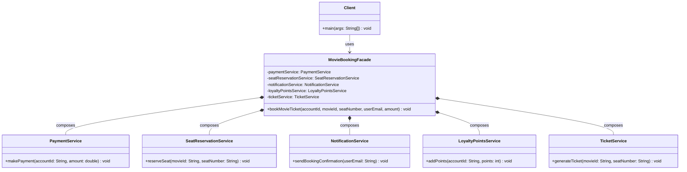

# Facade Pattern

> The Facade Pattern provides a simplified, unified interface to a complex subsystem or group of classes, hiding the underlying complexity and making the system easier to use.

## What You'll Learn

- What the Facade Pattern is and the problem it solves
- The real-life analogy of a manual vs. automatic car
- How tightly coupled client code becomes unmanageable without a facade
- How to implement the Facade Pattern with a Movie Ticket Booking example
- How `MovieBookingFacade` hides the orchestration of multiple services
- When to use the Facade Pattern
- Advantages and disadvantages of the pattern
- The class diagram showing all participants of the pattern

---

## Introduction

Structural design patterns are concerned with the composition of classes and objects. They help in forming large object structures while keeping them manageable, decoupled, and easy to work with. One such pattern is the Facade Pattern, which simplifies complex systems by providing a unified interface.

---

## What Is the Facade Pattern?

The Facade Pattern is a structural design pattern that provides a simplified, unified interface to a complex subsystem or group of classes.

It acts as a single entry point for clients to interact with the system, hiding the underlying complexity and making the system easier to use.

---

## Real-Life Analogy

Think of **Manual vs. Automatic Car**:

- **Complex Subsystem (Manual Car)**: Driving a manual car requires intricate knowledge of multiple components (clutch, gear shifter, accelerator) and their precise coordination to shift gears and drive. It's complex and requires the driver to manage many interactions.
- **Facade (Automatic Car)**: An automatic car acts as a facade. It provides a simplified interface (e.g., "Drive," "Reverse," "Park") to the complex underlying mechanics of gear shifting. The driver (client) no longer needs to manually coordinate the clutch and gears; the automatic transmission handles these complexities internally, making driving much easier.

In short, the manual car exposes the complexity, while the automatic car (the facade) simplifies it for the user.

---

## Problem It Solves

The Facade Pattern solves the problem of dealing with complex subsystems by hiding the complexities behind a single, unified interface. For example, imagine a movie ticket booking system with:

- `PaymentService`
- `SeatReservationService`
- `NotificationService`
- `LoyaltyPointsService`
- `TicketService`

Instead of making the client interact with all of these directly, the Facade Pattern provides a single class like `MovieBookingFacade`, which internally coordinates all the services.

---

## Real-Life Coding Example

Imagine you're developing a movie ticket booking application, like BookMyShow. Let's first take a look at a poorly structured approach to implementing the booking functionality.

### Without Facade Pattern

```java
// Service class responsible for handling payments
class PaymentService {
    public void makePayment(String accountId, double amount) {
        System.out.println("Payment of ₹" + amount + " successful for account " + accountId);
    }
}

// Service class responsible for reserving seats
class SeatReservationService {
    public void reserveSeat(String movieId, String seatNumber) {
        System.out.println("Seat " + seatNumber + " reserved for movie " + movieId);
    }
}

// Service class responsible for sending notifications
class NotificationService {
    public void sendBookingConfirmation(String userEmail) {
        System.out.println("Booking confirmation sent to " + userEmail);
    }
}

// Service class for managing loyalty/reward points
class LoyaltyPointsService {
    public void addPoints(String accountId, int points) {
        System.out.println(points + " loyalty points added to account " + accountId);
    }
}

// Service class for generating movie tickets
class TicketService {
    public void generateTicket(String movieId, String seatNumber) {
        System.out.println("Ticket generated for movie " + movieId + ", Seat: " + seatNumber);
    }
}

// Client Code
class Main {
    public static void main(String[] args) {
        // Booking a movie ticket manually (without a facade)

        // Step 1: Make payment
        PaymentService paymentService = new PaymentService();
        paymentService.makePayment("user123", 500);

        // Step 2: Reserve seat
        SeatReservationService seatReservationService = new SeatReservationService();
        seatReservationService.reserveSeat("movie456", "A10");

        // Step 3: Send booking confirmation via email
        NotificationService notificationService = new NotificationService();
        notificationService.sendBookingConfirmation("user@example.com");

        // Step 4: Add loyalty points to user's account
        LoyaltyPointsService loyaltyPointsService = new LoyaltyPointsService();
        loyaltyPointsService.addPoints("user123", 50);

        // Step 5: Generate the ticket
        TicketService ticketService = new TicketService();
        ticketService.generateTicket("movie456", "A10");
    }
}
```

While this code works, it's tightly coupled. The `Main` class (or client code) is manually calling each subsystem service in the correct order and with the correct parameters.

This leads to:

- High complexity for the client
- Duplicate code if you have to do this in multiple places
- Violation of the Single Responsibility Principle (the `Main` class knows too much)

This sets the stage for the Facade Pattern, which will encapsulate all these steps in one high-level method like `bookTicket()` and make the client code clean and readable.

---

### Using Facade Pattern

```java
// Service class responsible for handling payments
class PaymentService {
    public void makePayment(String accountId, double amount) {
        System.out.println("Payment of ₹" + amount + " successful for account " + accountId);
    }
}

// Service class responsible for reserving seats
class SeatReservationService {
    public void reserveSeat(String movieId, String seatNumber) {
        System.out.println("Seat " + seatNumber + " reserved for movie " + movieId);
    }
}

// Service class responsible for sending notifications
class NotificationService {
    public void sendBookingConfirmation(String userEmail) {
        System.out.println("Booking confirmation sent to " + userEmail);
    }
}

// Service class for managing loyalty/reward points
class LoyaltyPointsService {
    public void addPoints(String accountId, int points) {
        System.out.println(points + " loyalty points added to account " + accountId);
    }
}

// Service class for generating movie tickets
class TicketService {
    public void generateTicket(String movieId, String seatNumber) {
        System.out.println("Ticket generated for movie " + movieId + ", Seat: " + seatNumber);
    }
}

// ========== The MovieBookingFacade class ==============
class MovieBookingFacade {
    private PaymentService paymentService;
    private SeatReservationService seatReservationService;
    private NotificationService notificationService;
    private LoyaltyPointsService loyaltyPointsService;
    private TicketService ticketService;

    // Constructor to initialize all the subsystem services
    public MovieBookingFacade() {
        this.paymentService = new PaymentService();
        this.seatReservationService = new SeatReservationService();
        this.notificationService = new NotificationService();
        this.loyaltyPointsService = new LoyaltyPointsService();
        this.ticketService = new TicketService();
    }

    // Method providing a simplified interface for booking a movie ticket
    public void bookMovieTicket(String accountId, String movieId, String seatNumber, String userEmail, double amount) {
        paymentService.makePayment(accountId, amount);
        seatReservationService.reserveSeat(movieId, seatNumber);
        ticketService.generateTicket(movieId, seatNumber);
        loyaltyPointsService.addPoints(accountId, 50);
        notificationService.sendBookingConfirmation(userEmail);
        // Indicate successful completion of the entire booking process
        System.out.println("Movie ticket booking completed successfully!");
    }
}

// Client Code
class Main {
    public static void main(String[] args) {
        // Booking a movie ticket using facade
        MovieBookingFacade movieBookingFacade = new MovieBookingFacade();
        movieBookingFacade.bookMovieTicket("user123", "movie456", "A10", "user@example.com", 500);
    }
}
```

### How Facade Pattern Solves the Issue

By introducing `MovieBookingFacade`, we:

- Provide a simple, unified interface (`bookMovieTicket()`).
- Hide the complexity of internal service calls from the client.
- Reduce coupling, so changes in internal services don't affect the client.
- Centralize the workflow logic, making it easier to update and reuse.

---

## Class Diagram

The class diagram below illustrates the Facade Pattern. `MovieBookingFacade` is the single entry point for the client, internally composing and coordinating all subsystem services.



---

## When to Use the Facade Pattern

You should use the Facade Pattern when:

- **Subsystems are complex**: There are too many classes and too many dependencies within the system you are trying to simplify.
- **You want to provide a simpler API for the outer world**: The facade acts as a simplified entry point, hiding the complexity from clients.
- **You want to reduce coupling between subsystems and client code**: By interacting with the facade, the client code becomes less dependent on the individual components of the subsystem.
- **You want to layer your architecture cleanly**: The facade helps in organizing the system into distinct layers, making it more modular and understandable.

---

## Advantages and Disadvantages

### Advantages

- **Lightweight Coupling**: It reduces the dependencies between the client and the subsystem.
- **Flexibility**: It allows the subsystem to evolve without impacting the client code.
- **Simplifies Client Design**: Clients interact with a single, simplified interface instead of multiple complex objects.
- **Promotes Layered Architecture**: It helps organize the system into distinct layers, improving maintainability and scalability.
- **Better Testability**: Individual subsystem components can be tested independently, and the facade itself can be tested for its orchestration logic.

### Disadvantages

- **Fragile Coupling**: If the facade itself changes frequently, it can still lead to ripple effects on client code.
- **Hidden Complexity**: While it simplifies the client's view, the underlying complexity of the subsystem still exists, just hidden. This can make debugging or understanding the full flow more challenging for developers working on the subsystem.
- **Runtime Errors**: Errors originating from the complex subsystem might be harder to diagnose when only interacting through the facade.
- **Difficult to Trace**: Debugging can be more challenging as the facade adds another layer of indirection.
- **Violation of SRP (Single Responsibility Principle)**: A facade might take on too many responsibilities if it orchestrates a very large and diverse set of operations, potentially becoming a "god object."

---

## Summary

| **Concept** | **Description** |
| :--- | :--- |
| **Pattern Type** | Structural Design Pattern |
| **Intent** | Provide a simplified, unified interface to a complex subsystem |
| **Facade** | The single entry point that hides subsystem complexity (`MovieBookingFacade`) |
| **Subsystem Classes** | The individual service classes coordinated by the facade (`PaymentService`, `TicketService`, etc.) |
| **Client** | Interacts only with the facade, unaware of subsystem details (`Main`) |
| **Key Benefit** | Reduces coupling and complexity; client code stays clean regardless of subsystem changes |
| **Key Trade-off** | Hidden complexity can make debugging harder; facade risks becoming a god object |
| **When to Use** | When subsystems are complex, tightly coupled to clients, or need a clean layered architecture |
