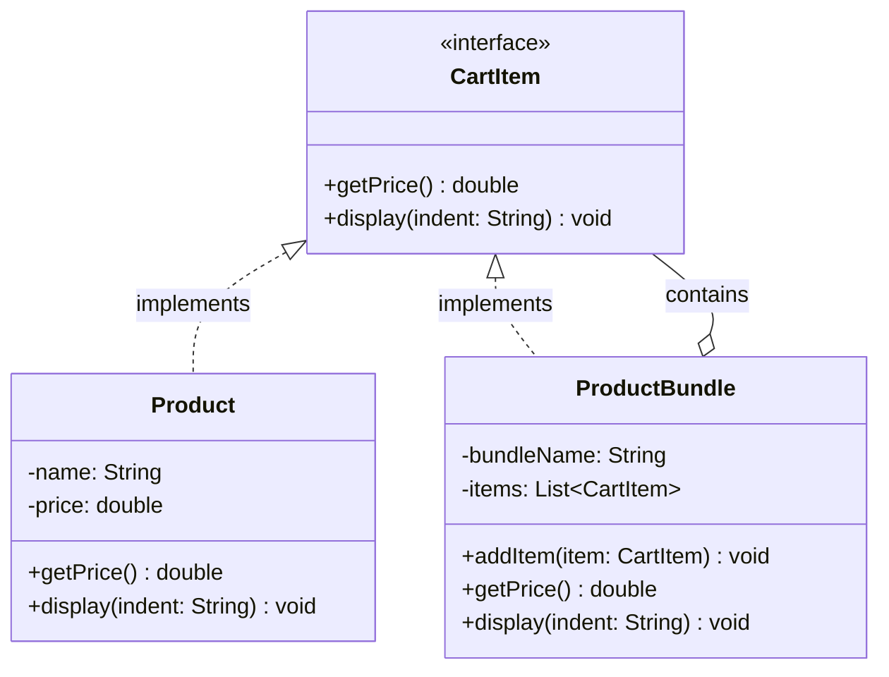

# Composite Pattern

> The Composite Pattern is a structural design pattern that allows you to compose objects into tree structures to represent part-whole hierarchies, letting clients treat individual objects and compositions of objects uniformly.

## What You'll Learn

- What the Composite Pattern is and the problem it solves
- How code without the pattern leads to type-checking and duplication issues
- How to refactor using a shared interface and recursive composition
- Understanding Leaf and Composite roles in the pattern
- When to use the Composite Pattern
- Advantages and disadvantages of the Composite Pattern
- The class diagram showing all participants of the pattern

---

## Introduction

Structural design patterns are concerned with the composition of classes and objects. They focus on how to assemble classes and objects into larger structures while keeping these structures flexible and efficient. Composite Pattern is one of the most important structural design patterns. Let's understand in depth.

---

## What Is the Composite Pattern?

The Composite Pattern is a structural design pattern that allows you to compose objects into tree structures to represent part-whole hierarchies. It lets clients treat individual objects and compositions of objects uniformly.

---

## Problem It Solves

The Composite Pattern solves the problem of treating individual objects and groups of objects in the same way. The main problem arises when:

- You want to work with a hierarchy of objects.
- You want the client code to be agnostic to whether it's dealing with a single object or a collection of them.

---

## Understanding the Problem

Consider you are building the checkout service of an e-commerce application and you take the following approach as shown in the code below.

### Code — Without Composite Pattern

```java
import java.util.*;

// Represents a single product
class Product {
    private String name;
    private double price;
    
    public Product(String name, double price) {
        this.name = name;
        this.price = price;
    }
    public double getPrice() {
        return price;
    }
    public void display(String indent) {
        System.out.println(indent + "Product: " + name + " - ₹" + price);
    }
}

// Represents a bundle of products
class ProductBundle {
    private String bundleName;
    private List<Product> products = new ArrayList<>();
    
    public ProductBundle(String bundleName) {
        this.bundleName = bundleName;
    }
    public void addProduct(Product product) {
        products.add(product);
    }
    public double getPrice() {
        double total = 0;
        for (Product product : products) {
            total += product.getPrice();
        }
        return total;
    }
    public void display(String indent) {
        System.out.println(indent + "Bundle: " + bundleName);
        for (Product product : products) {
            product.display(indent + "  ");
        }
    }
}

// Main logic
class Main {
    public static void main(String[] args) {
        // Individual Items
        Product book = new Product("Book", 500);
        Product headphones = new Product("Headphones", 1500);
        Product charger = new Product("Charger", 800);
        Product pen = new Product("Pen", 20);
        Product notebook = new Product("Notebook", 60);
        
        // Bundle: Iphone Combo
        ProductBundle iphoneCombo = new ProductBundle("iPhone Combo Pack");
        iphoneCombo.addProduct(headphones);
        iphoneCombo.addProduct(charger);
    
        // Bundle: School Kit
        ProductBundle schoolKit = new ProductBundle("School Kit");
        schoolKit.addProduct(pen);
        schoolKit.addProduct(notebook);
        
        // Add to cart logic
        List<Object> cart = new ArrayList<>();
        cart.add(book);
        cart.add(iphoneCombo);
        cart.add(schoolKit);
        
        // Display Cart    
        double total = 0;
        System.out.println("Cart Details:\n");
        for (Object item : cart) {
            if (item instanceof Product) {
                ((Product) item).display("  ");
                total += ((Product) item).getPrice();
            } else if (item instanceof ProductBundle) {
                ((ProductBundle) item).display("  ");
                total += ((ProductBundle) item).getPrice();
            }
        }
        System.out.println("\nTotal Price: ₹" + total);
    }
}
```

### Working of Code

- `Product` class represents a simple item with name and price.
- `ProductBundle` class represents a group of products bundled together.
- Both classes have methods to display and return their prices.
- In `main()`, individual products and bundles are created and added to the cart.
- The cart is a `List<Object>` that holds both products and bundles.
- During checkout, the code checks each item's type using `instanceof`.
- Based on the type, it casts the object and calls its respective methods.
- Finally, it displays all items and calculates the total price.

### Problems in the Above Code

In the above example, the code lacks the structure to treat individual and group items uniformly, i.e., In the current implementation, individual products (`Product`) and product bundles (`ProductBundle`) are completely separate types with no shared interface or superclass. This means we cannot write code that treats both uniformly and the logic always has to check which type we're working with.

Other than these, there are some other problems as well:

- `instanceof` is used repeatedly, breaking polymorphism.
- Cart uses `List<Object>`, which is unsafe and violates abstraction.
- `ProductBundle` cannot contain another `ProductBundle` (no recursive structure).
- Display and price logic are duplicated instead of unified.

---

## Refactored Code Using Composite Pattern

Let's refactor the code using the Composite Pattern. The idea is to create a common interface `CartItem` for both `Product` and `ProductBundle`, allowing us to treat them uniformly.

```java
import java.util.*;

// Interface for items that can be added to the cart
interface CartItem {
    double getPrice();
    void display(String indent);
}

// Product class implementing CartItem
class Product implements CartItem {
    private String name;
    private double price;
    public Product(String name, double price) {
        this.name = name;
        this.price = price;
    }
    @Override
    public double getPrice() {
        return price;
    }
    @Override
    public void display(String indent) {
        System.out.println(indent + "Product: " + name + " - ₹" + price);
    }
}

// ProductBundle class implementing CartItem
class ProductBundle implements CartItem {
    private String bundleName;
    private List<CartItem> items = new ArrayList<>();
    public ProductBundle(String bundleName) {
        this.bundleName = bundleName;
    }
    public void addItem(CartItem item) {
        items.add(item);
    }
    @Override
    public double getPrice() {
        double total = 0;
        for (CartItem item : items) {
            total += item.getPrice();
        }
        return total;
    }
    @Override
    public void display(String indent) {
        System.out.println(indent + "Bundle: " + bundleName);
        for (CartItem item : items) {
            item.display(indent + "  ");
        }
    }
}

// Main class
class Main {
    public static void main(String[] args) {
        // Individual Products
        CartItem book = new Product("Atomic Habits", 499);
        CartItem phone = new Product("iPhone 15", 79999);
        CartItem earbuds = new Product("AirPods", 15999);
        CartItem charger = new Product("20W Charger", 1999);
        // Combo Deal
        ProductBundle iphoneCombo = new ProductBundle("iPhone Essentials Combo");
        iphoneCombo.addItem(phone);
        iphoneCombo.addItem(earbuds);
        iphoneCombo.addItem(charger);
        // Back to School Kit
        ProductBundle schoolKit = new ProductBundle("Back to School Kit");
        schoolKit.addItem(new Product("Notebook Pack", 249));
        schoolKit.addItem(new Product("Pen Set", 99));
        schoolKit.addItem(new Product("Highlighter", 149));
        // Add everything to cart
        List<CartItem> cart = new ArrayList<>();
        cart.add(book);
        cart.add(iphoneCombo);
        cart.add(schoolKit);
        // Display cart
        System.out.println("Your Amazon Cart:");
        double total = 0;
        for (CartItem item : cart) {
            item.display("  ");
            total += item.getPrice();
        }
        System.out.println("\nTotal: ₹" + total);
    }
}
```

### Working of Refactored Code

- `CartItem` interface defines the common methods for both products and bundles.
- `Product` and `ProductBundle` classes implement the `CartItem` interface.
- The cart now holds a list of `CartItem`, allowing us to treat both products and bundles uniformly.
- The display and price calculation logic is simplified, as we no longer need to check types.

---

## Understanding Leaf and Composite

In the Composite Design Pattern, we categorize components into two main roles:

### Leaf (Individual Object)

A Leaf is a simple, atomic object in the structure. It does not contain any child components. In our example:

- `Product` is a Leaf.
- It represents individual purchasable items like books, phones, pens, etc.
- Implements `CartItem` and provides its own `getPrice()` and `display()` logic.

### Composite (Container of Components)

A Composite is a complex object that can hold multiple `CartItem` objects, including both Leaf and other Composite objects. In our example:

- `ProductBundle` is a Composite.
- It can contain `Product`s (leaves) and even other `ProductBundle`s (nested composites).
- Implements `CartItem` and delegates actions (`getPrice()` and `display()`) to its children.

---

## How It Solves the Issues

### Uniform Treatment via Shared Interface (`CartItem`)

Now, both `Product` and `ProductBundle` implement `CartItem`, so the cart can contain any of them without special handling. This eliminates the need for type checking (`instanceof`).

### Enables Polymorphism

All operations like `getPrice()` and `display()` are defined in the `CartItem` interface, so they can be called uniformly on both products and bundles. This simplifies logic and improves code extensibility.

### Recursive Composition Made Easy

Bundles can now include other bundles or products seamlessly. This supports deeply nested combos or kits which is a common real-world scenario.

### No Code Duplication

The cart-handling logic like computing total and displaying items is written once and works for any `CartItem`. This promotes cleaner, DRY (Don't Repeat Yourself) code.

---

## When to Use Composite Pattern

The Composite Pattern is particularly useful when:

- **You have a hierarchical structure**: Use the composite pattern when your objects form a tree-like structure (e.g., folders inside folders, or products inside bundles).
- **You want to treat individual and groups in the same way**: When operations on single items and collections of items should be uniform (e.g., calculating total price, displaying structure).
- **You want to avoid client-side logic to differentiate leaf and composite**: Let polymorphism handle the differences between simple and composite objects, keeping client code clean and maintainable.

---

## Advantages and Disadvantages

### Pros

- **Uniformity**: Treats individual and composite objects in the same way.
- **Extensible**: Easy to add new item types or structures.
- **Cleaner Client Code**: Reduces complexity for the user of the structure.
- **Supports OCP (Open/Closed Principle)**: Add new components without modifying existing code.

### Cons

- **Violates SRP on Scale**: Components manage both hierarchy and business logic.
- **Overkill for Flat and Simple Structures**: Adds unnecessary complexity.
- **Can Hide Important Distinctions**: In regulated or sensitive systems, uniform treatment might blur critical differences between types.

---

## Class Diagram

The class diagram below illustrates the structure of the Composite Pattern.



---

## Summary

| **Concept** | **Description** |
| :--- | :--- |
| **Pattern Type** | Structural Design Pattern |
| **Intent** | Compose objects into tree structures for part-whole hierarchies; treat individual and composite objects uniformly |
| **Component Interface** | The shared interface (`CartItem`) with common operations (`getPrice()`, `display()`) |
| **Leaf** | A simple, atomic object with no children (`Product`) |
| **Composite** | A container that holds multiple components, including other composites (`ProductBundle`) |
| **Key Benefit** | Eliminates type-checking; enables uniform treatment via polymorphism |
| **Recursive Composition** | Composites can contain other composites, supporting deeply nested hierarchies |
| **Key Trade-off** | Can violate SRP and add unnecessary complexity for flat structures |
| **When to Use** | Tree-like hierarchies, uniform treatment of singles and groups, avoiding `instanceof` checks |
