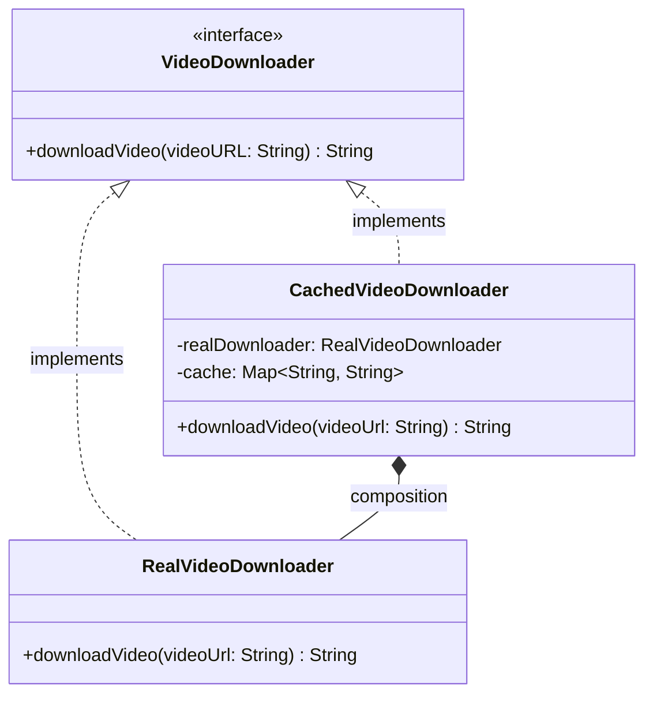

# Proxy Pattern

> The Proxy Pattern is a structural design pattern that provides a surrogate or placeholder for another object to control access to it, acting as an intermediary that implements the same interface as the original object.

## What You'll Learn

- What the Proxy Pattern is and the problem it solves
- The real-life analogy of a personal assistant
- How uncontrolled access leads to redundant resource usage
- How to implement the Proxy Pattern with a Video Downloader example
- The different types of proxies (Virtual, Protection, Remote, Smart)
- When to use the Proxy Pattern
- Advantages and disadvantages of the Proxy Pattern
- The class diagram showing all participants of the pattern

---

## Introduction

Structural design patterns are concerned with the composition of classes and objects. They help manage relationships between objects to make systems more efficient, secure, and scalable. One such pattern is the Proxy Pattern, which acts as a placeholder or surrogate for another object to control access to it. Let's explore this pattern in detail.

---

## What Is the Proxy Pattern?

The Proxy Pattern is a structural design pattern that provides a surrogate or placeholder for another object to control access to it.

A proxy acts as an intermediary that implements the same interface as the original object, allowing it to intercept and manage requests to the real object.

---

## Real-Life Analogy

Think of a personal assistant:

- A busy CEO may not respond to everyone directly.
- Instead, their assistant takes calls, filters emails, manages the calendar, and only involves the CEO when necessary.
- The assistant controls access to the CEO while still providing essential services to others.

Here, the assistant is the proxy that controls and optimizes access to the real resource (the CEO).

---

## Problem It Solves

It solves the problem of uncontrolled or expensive access to an object. For example, consider a scenario where:

- You have a heavy object like a video player that consumes a lot of resources on initialization.
- You want to delay its creation until it's actually needed (lazy loading).
- Or maybe the object resides on a remote server and you want to add a layer to manage the network communication.

The Proxy Pattern allows you to control access, defer initialization, add logging, caching, or security without modifying the original object.

---

## Real-Life Coding Example

Imagine you're building a feature like a video streaming app (think YouTube or Netflix) where users can download videos. Now, consider this: multiple users might try to download the same video multiple times — or even the same user may repeat the request. In such scenarios, if we go ahead and download the video from the internet every single time, it leads to unnecessary network calls, longer wait times, and wasted bandwidth.

Let's consider a scenario where we want to download a video multiple times, perhaps from different places in the code or by different users. A poor design would look like this:

### Bad Design — Without Proxy

```java
// ========== RealVideoDownloader Class ==========
class RealVideoDownloader {
    public String downloadVideo(String videoUrl) {
        // caching logic missing
        // filtering logic missing
        // access logic missing
        System.out.println("Downloading video from URL: " + videoUrl);
        String content = "Video content from " + videoUrl;
        System.out.println("Downloaded Content: " + content);
        return content;
    }
}

// ================ Main Class ===================
class Main {
    public static void main(String[] args) {
        System.out.println("User 1 tries to download the video.");
        RealVideoDownloader downloader1 = new RealVideoDownloader();
        downloader1.downloadVideo("https://video.com/proxy-pattern");

        System.out.println();

        System.out.println("User 2 tries to download the same video again.");
        RealVideoDownloader downloader2 = new RealVideoDownloader();
        downloader2.downloadVideo("https://video.com/proxy-pattern");
    }
}
```

### Understanding the Issues

- There's no caching, so the same video is downloaded again and again even if it's already available.
- There's no access control or content filtering — any video URL is downloaded without restrictions.
- The client directly depends on the `RealVideoDownloader`, meaning there's no way to intercept, log, or modify the download behavior without changing core logic.
- It results in multiple object creations and redundant resource usage.

The previous implementation made direct use of the `RealVideoDownloader` class for every download request, even if the same video was requested multiple times. This meant the system would re-download and reprocess the same video repeatedly, leading to unnecessary network usage and redundant computation.

To solve this, we use the Proxy Design Pattern — a structural pattern that provides a placeholder or surrogate for another object to control access to it.

---

### Good Design — Using Proxy Pattern

```java
import java.util.*;

interface VideoDownloader {
    String downloadVideo(String videoURL);
}

// ========== RealVideoDownloader Class ==========
class RealVideoDownloader implements VideoDownloader {
    @Override
    public String downloadVideo(String videoUrl) {
        System.out.println("Downloading video from URL: " + videoUrl);
        return "Video content from " + videoUrl;
    }
}

// =============== Proxy With Cache ====================
class CachedVideoDownloader implements VideoDownloader {
    private RealVideoDownloader realDownloader;
    private Map<String, String> cache;

    public CachedVideoDownloader() {
        this.realDownloader = new RealVideoDownloader();
        this.cache = new HashMap<>();
    }

    @Override
    public String downloadVideo(String videoUrl) {
        if (cache.containsKey(videoUrl)) {
            System.out.println("Returning cached video for: " + videoUrl);
            return cache.get(videoUrl);
        }
        System.out.println("Cache miss. Downloading...");
        String video = realDownloader.downloadVideo(videoUrl);
        cache.put(videoUrl, video);
        return video;
    }
}

// ================ Main Class ===================
class Main {
    public static void main(String[] args) {
        VideoDownloader cacheVideoDownloader = new CachedVideoDownloader();

        System.out.println("User 1 tries to download the video.");
        cacheVideoDownloader.downloadVideo("https://video.com/proxy-pattern");

        System.out.println();

        System.out.println("User 2 tries to download the same video again.");
        cacheVideoDownloader.downloadVideo("https://video.com/proxy-pattern");
    }
}
```

### How Proxy Pattern Solves the Issue

In this example, the proxy (`CachedVideoDownloader` Class) was used that implements a caching logic that checks if a video has already been downloaded. If so, it simply returns the cached result, saving time and resources.

This way, the real object is accessed only when absolutely necessary, while repeated requests are served efficiently through the proxy — resulting in faster response times and optimized performance.

---

## When to Use Proxy Pattern

The proxy pattern can be used when:

- When object creation is expensive, and you want to delay or control its instantiation.
- When you need to control access to sensitive operations or enforce permission checks.
- When interacting with remote objects that are costly or slow to fetch.
- When lazy loading is needed to optimize system performance and resource usage.

---

## Types of Proxy

At a high level, proxies can be categorized into several types based on the specific purpose they serve:

### Virtual Proxy

- **Purpose**: Controls access to a resource that is expensive to create.
- **Use Case**: Commonly used for lazy initialization — where the real object is created only when absolutely necessary.
- **Example**: A video downloader app that only fetches and loads the video data when the user hits "Play".

### Protection Proxy

- **Purpose**: Controls access to an object based on user permissions or roles.
- **Use Case**: Useful in systems with multi-level access control, such as admin vs. regular users.
- **Example**: In a document editor, only editors can modify content while viewers can only read.

### Remote Proxy

- **Purpose**: Controls access to an object located on a remote server or in a different address space.
- **Use Case**: Enables local code to access remote services as if they were local.
- **Example**: A Java RMI object or API wrapper that abstracts out network communication.

### Smart Proxy

- **Purpose**: Adds additional behavior when accessing the real object.
- **Use Case**: Often used for logging, access counting, or reference counting.
- **Example**: Automatically logging every time a file is accessed or updated.

---

## Advantages and Disadvantages

### Pros

- **Performance Optimization**: By introducing features like caching or lazy initialization, proxies can significantly reduce resource consumption and improve application performance.
- **Access Control**: Proxies act as a gatekeeper, controlling access to sensitive or expensive resources, and ensuring that only authorized users can access them.
- **Lazy Initialization**: Proxies delay the creation of costly resources until they are actually needed, optimizing resource usage and startup times.
- **Added Functionality**: Without modifying the original object, proxies can add additional behavior such as logging, security checks, or usage tracking.

### Cons

- **Increased Complexity**: Introducing a proxy layer adds more components to the system, which can make the overall design harder to understand and maintain.
- **Potential Delays**: The proxy may introduce delays in accessing the actual object, especially when additional logic like permission checks or data fetching is involved.
- **Maintenance Overhead**: With extra layers and duplicated interfaces, maintaining proxies alongside real objects can increase the development and debugging effort.

---

## Class Diagram

The class diagram below illustrates the structure of the Proxy Pattern. The `VideoDownloader` interface is the **subject interface**, while `RealVideoDownloader` is the **real subject**. The `CachedVideoDownloader` acts as the proxy, controlling access to the real subject.



---

## Summary

| **Concept** | **Description** |
| :--- | :--- |
| **Pattern Type** | Structural Design Pattern |
| **Intent** | Provide a surrogate or placeholder for another object to control access to it |
| **Subject Interface** | The shared interface (`VideoDownloader`) implemented by both the real object and the proxy |
| **Real Subject** | The actual object that performs the real work (`RealVideoDownloader`) |
| **Proxy** | The intermediary that controls access to the real subject (`CachedVideoDownloader`) |
| **Key Benefit** | Controls access, adds caching/logging/security without modifying the original object |
| **Types** | Virtual Proxy, Protection Proxy, Remote Proxy, Smart Proxy |
| **Key Trade-off** | Adds an extra layer of abstraction that can increase complexity and introduce delays |
| **When to Use** | Expensive object creation, access control, remote objects, lazy loading |
