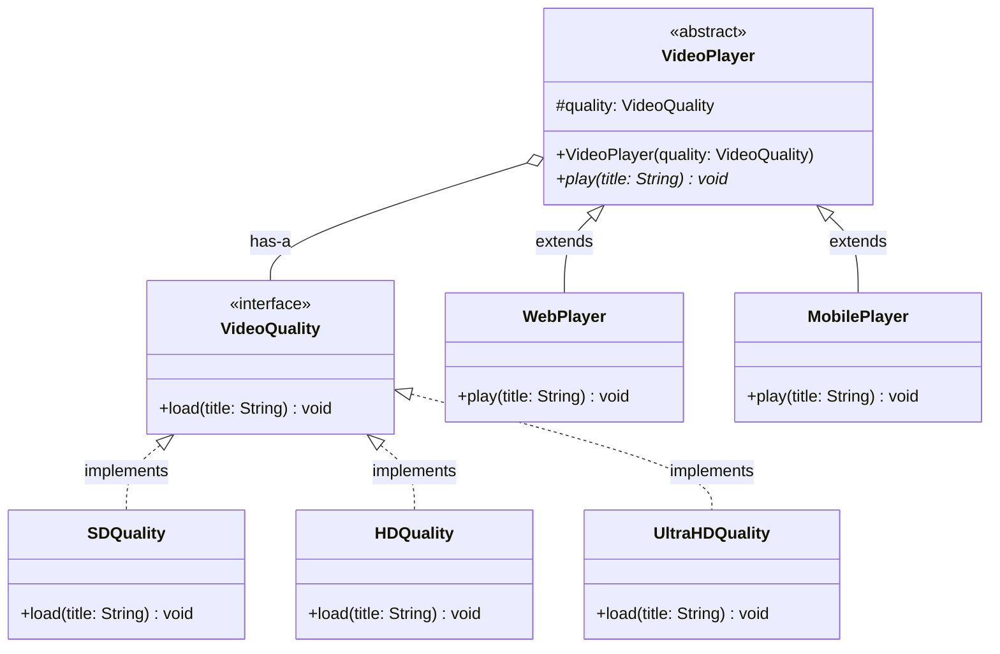

# Bridge Pattern

> The Bridge Pattern is a structural design pattern that decouples an abstraction from its implementation so that the two can vary independently, avoiding combinatorial class explosion.

## What You'll Learn

- What the Bridge Pattern is and the problem it solves
- The real-life analogy of a TV remote and a TV
- How tight coupling between abstraction and implementation causes class explosion
- How to implement the Bridge Pattern with a Video Player example
- When to use the Bridge Pattern
- Advantages and disadvantages of the Bridge Pattern
- The class diagram showing all participants of the pattern

---

## Introduction

Structural design patterns are concerned with the composition of classes and objects. They focus on how to assemble classes and objects into larger structures while keeping these structures flexible and efficient. Bridge Pattern is one of the most important structural design patterns. Let's understand in depth.

---

## What Is the Bridge Pattern?

The Bridge Pattern is a structural design pattern that is used to decouple an abstraction from its implementation so that the two can vary independently.

---

## Problem It Solves

When you have multiple dimensions of variability, such as different types of features (abstractions) and multiple implementations of those features, you might end up with a combinatorial explosion of subclasses if you try to use inheritance to handle all combinations. Thus bridge pattern:

- Avoids tight coupling between abstraction and implementation.
- Eliminates code duplication that would occur if every combination of abstraction and implementation had its own class.
- Promotes composition over inheritance, allowing more flexible code evolution.

---

## Real-Life Analogy

Think of a TV remote and a TV:

- The remote is the abstraction (interface the user interacts with).
- The TV is the implementation (actual functionality).

You can have different types of remotes (basic, advanced) and different brands of TVs (Samsung, Sony). Bridge Pattern allows any remote to work with any TV without creating a separate class for each combination.

---

## Real-Life Coding Example

Assume we are building a video player that aims to model different video players (like Web, Mobile, Smart TV) each with different quality types (HD, Ultra HD, 4K).

### Bad Design — Using Tight Coupling Causing Class Explosion

```java
import java.util.*;

// ======= Interface for video quality =======
interface PlayQuality {
    void play(String title);
}

// Each class here represents a combination of platform and quality
class WebHDPlayer implements PlayQuality {
    public void play(String title) {
        // Web player plays in HD
        System.out.println("Web Player: Playing " + title + " in HD");
    }
}

class MobileHDPlayer implements PlayQuality {
    public void play(String title) {
        // Mobile player plays in HD
        System.out.println("Mobile Player: Playing " + title + " in HD");
    }
}

class SmartTVUltraHDPlayer implements PlayQuality {
    public void play(String title) {
        // Smart TV plays in Ultra HD
        System.out.println("Smart TV: Playing " + title + " in ultra HD");
    }
}

class Web4KPlayer implements PlayQuality {
    public void play(String title) {
        // Web player plays in 4K
        System.out.println("Web Player: Playing " + title + " in 4K");
    }
}

// ============ Main class ================
class Main {
    public static void main(String[] args) {
        PlayQuality player = new WebHDPlayer();
        player.play("Interstellar");
    }
}
```

### Understanding the Issue

In the given design, platform types (like Web, Mobile, Smart TV) are tightly coupled with video quality types (like HD, Ultra HD, 4K). This results in a rigid system where every combination requires a separate class — for example, `WebHDPlayer`, `MobileHDPlayer`, `SmartTVUltraHDPlayer`, and so on.

As new platforms or quality types are introduced, the number of classes grows rapidly. Adding just one new platform or one new quality level leads to multiple new classes. If you have 5 platforms and 5 quality types, you end up with 25 distinct classes — most of which share very similar code.

Such tightly coupled designs are hard to test, extend, and manage over time. This is where the Bridge Pattern proves valuable — by decoupling the abstraction (platform) from its implementation (quality), it allows both to evolve independently, eliminating unnecessary class combinations.

---

### Good Design — Using Bridge Pattern

```java
import java.util.*;

// ======== Implementor Interface =========
interface VideoQuality {
    void load(String title);
}

// ============ Concrete Implementors ==============
class SDQuality implements VideoQuality {
    public void load(String title) {
        System.out.println("Streaming " + title + " in SD Quality");
    }
}

class HDQuality implements VideoQuality {
    public void load(String title) {
        System.out.println("Streaming " + title + " in HD Quality");
    }
}

class UltraHDQuality implements VideoQuality {
    public void load(String title) {
        System.out.println("Streaming " + title + " in 4K Ultra HD Quality");
    }
}

// ========== Abstraction ==========
abstract class VideoPlayer {
    protected VideoQuality quality;

    public VideoPlayer(VideoQuality quality) {
        this.quality = quality;
    }

    public abstract void play(String title);
}

// =========== Refined Abstractions ==============
class WebPlayer extends VideoPlayer {
    public WebPlayer(VideoQuality quality) {
        super(quality);
    }

    public void play(String title) {
        System.out.println("Web Platform:");
        quality.load(title);
    }
}

class MobilePlayer extends VideoPlayer {
    public MobilePlayer(VideoQuality quality) {
        super(quality);
    }

    public void play(String title) {
        System.out.println("Mobile Platform:");
        quality.load(title);
    }
}

// Client Code
class Main {
    public static void main(String[] args) {
        // Playing on Web with HD Quality
        VideoPlayer player1 = new WebPlayer(new HDQuality());
        player1.play("Interstellar");

        // Playing on Mobile with Ultra HD Quality
        VideoPlayer player2 = new MobilePlayer(new UltraHDQuality());
        player2.play("Inception");
    }
}
```

### How Bridge Pattern Solves the Issue

- **Separation of Concerns**: `VideoPlayer` (abstraction) focuses on the platform-specific behavior, while `VideoQuality` (implementor) handles quality-specific streaming logic.
- **Flexible Combinations**: You can mix and match any platform with any quality at runtime without creating new classes.
- **Easier to Extend**: Adding a new platform or a new quality only requires one new class, not multiple combinations:
  - Add `SmartTVPlayer` → works with all existing qualities.
  - Add `FullHDQuality` → works with all existing players.
- **Cleaner Code Structure**: Each class has a single responsibility. This promotes maintainability, scalability, and adheres to the Open/Closed Principle.

---

## When to Use Bridge Pattern

Bridge Pattern is particularly useful when:

- You have multiple dimensions of variation.
- You want to decouple abstraction from implementation.
- You anticipate frequent changes or additions.
- You want to follow SOLID principles.
- You want runtime flexibility.

---

## Advantages and Disadvantages

### Pros

- **Decouples Abstraction and Implementation**: Changes in one side (abstraction or implementation) do not affect the other.
- **Avoids Class Explosion**: You don't need to create a separate class for every combination of abstraction and implementation.
- **Supports the Open/Closed Principle (OCP)**: You can extend functionalities without modifying existing code.
- **Ideal for Cross-platform Development**: Useful when developing for multiple platforms that share similar features.
- **Improves Maintainability and Testing**: Easier to manage and test each part independently.

### Cons

- **Increased Complexity**: Might be overkill if your application is simple or has limited variations.
- **Can Be Confused with Other Patterns**: Especially with patterns like Strategy or Adapter, due to structural similarities.
- **Coordination Needed Between Teams**: If abstraction and implementation are developed separately, good communication is essential.

---

## Class Diagram

The class diagram below illustrates the structure of the Bridge Pattern. The `VideoPlayer` abstract class is the **abstraction**, while `VideoQuality` is the **implementor interface**. The refined abstractions (`WebPlayer`, `MobilePlayer`) delegate quality-specific behavior to the concrete implementors (`SDQuality`, `HDQuality`, `UltraHDQuality`).



---

## Summary

| **Concept** | **Description** |
| :--- | :--- |
| **Pattern Type** | Structural Design Pattern |
| **Intent** | Decouple abstraction from implementation so both can vary independently |
| **Abstraction** | The high-level control layer that defines platform behavior (`VideoPlayer`) |
| **Refined Abstraction** | Concrete extensions of the abstraction (`WebPlayer`, `MobilePlayer`) |
| **Implementor** | The interface defining implementation-specific operations (`VideoQuality`) |
| **Concrete Implementor** | Actual implementations of the implementor interface (`SDQuality`, `HDQuality`, `UltraHDQuality`) |
| **Key Benefit** | Avoids combinatorial class explosion; enables flexible mix-and-match at runtime |
| **Key Trade-off** | Adds structural complexity that may be overkill for simple systems |
| **When to Use** | Multiple dimensions of variation, cross-platform development, runtime flexibility |
