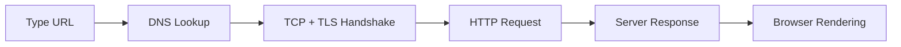

# What Happens When You Type a URL in Your Browser

> In under a fraction of a second, your browser translates a human-readable domain name into an IP address, negotiates a secure connection, downloads the page, and paints pixels on your screen.

## What You'll Learn

- How DNS turns a domain name into an IP address
- How TCP and TLS establish a reliable, encrypted connection
- What an HTTP request and response look like
- How the browser parses HTML, CSS, and JavaScript to render pixels
- Where caching speeds up the journey

---

## The Big Picture



Every time you press **Enter** on `https://example.com`, your computer runs through five well-coordinated stages.

---

## 1. DNS Lookup (Finding the Server's Address)

Computers communicate using **IP addresses** (like `93.184.216.34`), not domain names. **DNS (Domain Name System)** is the phonebook of the internet.

### Where the Browser Checks First

Before asking the internet, your device checks several caches in order:

1. **Browser cache** — recently visited domains.
2. **OS cache & `/etc/hosts`** — operating system level cache.
3. **Router cache** — your home or office router.
4. **ISP / Recursive DNS resolver** — e.g. Cloudflare (`1.1.1.1`) or Google (`8.8.8.8`).

If none of those have the answer, the resolver walks the DNS hierarchy:

- **Root server (`.`)** → points to the `.com` TLD server
- **TLD server (`.com`)** → points to `example.com`'s authoritative nameserver
- **Authoritative nameserver** → returns the actual IP address

> [!TIP]
> You can watch this lookup happen from your terminal using `nslookup example.com` or `dig example.com`.

---

## 2. TCP & TLS Handshake (Opening a Secure Pipe)

Once the browser has the IP address, it opens a network connection to port `443` (HTTPS) or `80` (HTTP).

### TCP Three-Way Handshake

TCP guarantees packets arrive in order and without loss. Before sending any data, client and server agree on a connection:

1. **SYN** — Client: *"Hey, want to talk?"*
2. **SYN-ACK** — Server: *"Sure, I hear you!"*
3. **ACK** — Client: *"Great, starting now."*

### TLS Handshake (for HTTPS)

On top of TCP, **TLS** verifies the server's identity (via its SSL/TLS certificate) and negotiates a shared encryption key so nobody on the network can eavesdrop or tamper with the traffic.

---

## 3. HTTP Request & Response

With the secure pipe open, the browser sends an **HTTP request**:

```http
GET / HTTP/1.1
Host: example.com
User-Agent: Mozilla/5.0
Accept: text/html
```

The server processes the request (routing it through load balancers, web servers, application code, and databases) and sends back an **HTTP response**:

```http
HTTP/1.1 200 OK
Content-Type: text/html; charset=UTF-8
Cache-Control: max-age=3600

<!DOCTYPE html>
<html>...</html>
```

### Common HTTP Status Code Families

| Range | Meaning | Common Examples |
| :--- | :--- | :--- |
| **2xx** | Success | `200 OK`, `201 Created`, `204 No Content` |
| **3xx** | Redirection | `301 Moved Permanently`, `304 Not Modified` |
| **4xx** | Client Error | `400 Bad Request`, `401 Unauthorized`, `404 Not Found` |
| **5xx** | Server Error | `500 Internal Server Error`, `502 Bad Gateway`, `503 Service Unavailable` |

---

## 4. Browser Rendering Pipeline

Receiving HTML is only half the story. The browser turns raw text into an interactive page through the **Critical Rendering Path**:

1. **Parse HTML → DOM** (Document Object Model) — tree of elements.
2. **Parse CSS → CSSOM** (CSS Object Model) — tree of styles.
3. **Combine DOM + CSSOM → Render Tree** — only visible elements with computed styles.
4. **Layout (Reflow)** — calculate exact position and size of every box on the screen.
5. **Paint & Composite** — draw pixels onto layers and send them to the GPU.

While parsing HTML, whenever the browser encounters `<link>`, ``, or `<script>` tags, it fires off additional HTTP requests to fetch those assets (often in parallel over HTTP/2 or HTTP/3).

---

## 5. Where Caching Makes It Fast

Without caching, every click would repeat the entire chain from scratch:

- **DNS cache** skips repeated domain lookups.
- **Browser HTTP cache** (`Cache-Control`, `ETag`) reuses images, CSS, and JS locally.
- **CDN (Content Delivery Network)** serves static assets from a server geographically close to you instead of the origin server across the world.
- **HTTP/2 & HTTP/3 (QUIC)** multiplex multiple requests over a single connection and cut handshake round-trips.

---

## Summary

| Stage | Purpose | Key Protocol / Concept |
| :--- | :--- | :--- |
| **DNS Lookup** | Resolve domain name to IP address | DNS, Root / TLD / Authoritative servers |
| **Connection** | Establish reliable, encrypted channel | TCP 3-way handshake, TLS |
| **Data Transfer** | Request page and receive HTML/assets | HTTP/1.1, HTTP/2, HTTP/3 |
| **Rendering** | Turn HTML, CSS, JS into pixels | DOM, CSSOM, Render Tree, Layout, Paint |
| **Speedups** | Avoid redundant network work | Browser cache, CDN, Keep-Alive |
