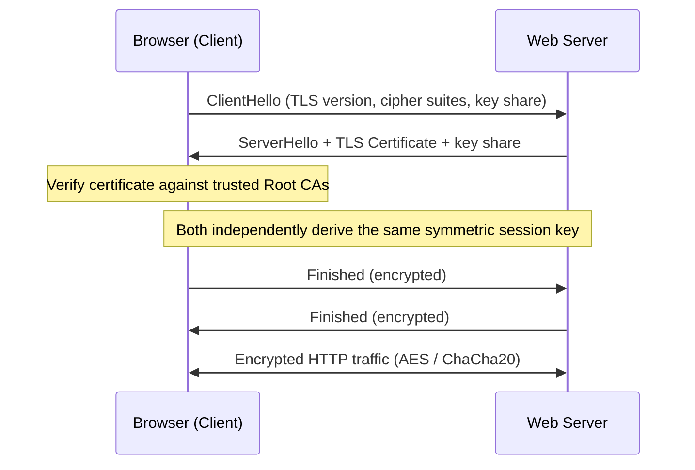

# How HTTPS and TLS Actually Work

> HTTPS wraps normal HTTP traffic inside an encrypted TLS tunnel using a clever combination of asymmetric encryption (for trust and key exchange) and symmetric encryption (for speed).

## What You'll Learn

- What problem HTTPS solves (eavesdropping, tampering, impersonation)
- The difference between symmetric and asymmetric encryption
- How digital certificates and Certificate Authorities (CAs) establish trust
- How the TLS handshake works step by step
- Common misconceptions about HTTPS

---

## Why Plain HTTP Isn't Safe

Plain **HTTP** sends everything in **cleartext**. Anyone sitting between your device and the website — a coffee-shop Wi-Fi router, an ISP, or a compromised network switch — can:

1. **Read** passwords, cookies, and personal data (**Eavesdropping**).
2. **Modify** the response in transit, e.g. injecting ads or malicious scripts (**Tampering**).
3. **Pretend** to be your bank's server (**Impersonation / Man-in-the-Middle**).

**HTTPS** (`HTTP over TLS`) prevents all three by guaranteeing **Confidentiality**, **Integrity**, and **Authentication**.

---

## Symmetric vs Asymmetric Encryption

TLS doesn't pick just one kind of encryption — it uses **both** for what each does best.

| Aspect | Symmetric Encryption | Asymmetric Encryption |
| :--- | :--- | :--- |
| **Keys** | One shared secret key for both encrypting and decrypting | A math-linked pair: **Public Key** (shared openly) and **Private Key** (kept secret) |
| **Speed** | Very fast (ideal for gigabytes of web traffic) | Much slower (heavy math) |
| **Main Challenge** | How do two strangers agree on the same secret key over an untrusted network? | Too slow to encrypt entire web pages |
| **Common Algorithms** | AES-GCM, ChaCha20 | RSA, ECDHE (Elliptic Curve Diffie-Hellman) |

**The TLS trick:** Use **asymmetric** crypto at the start to verify the server and safely agree on a temporary **symmetric** session key, then switch to fast **symmetric** encryption for the rest of the connection.

---

## Digital Certificates & Certificate Authorities

If a server simply hands you its public key, how do you know it really belongs to `github.com` and not an attacker?

That's where **Certificate Authorities (CAs)** (like Let's Encrypt, DigiCert, Sectigo) come in:

1. `github.com` proves to a trusted CA that it controls the domain.
2. The CA issues a **TLS Certificate** containing `github.com`'s domain name, public key, expiration date, and the CA's **digital signature**.
3. Your operating system and browser ship with a pre-installed list of trusted **Root CA certificates**.
4. When you visit `github.com`, your browser verifies the CA's signature mathematically. If the signature is valid, the domain matches, and the certificate isn't expired, your browser trusts the server.

> [!NOTE]
> If a certificate is expired, self-signed, or issued for a different domain, the browser stops you with the big *"Your connection is not private"* warning.

---

## The TLS Handshake (Simplified)

In **TLS 1.3** (the modern standard), this entire handshake takes just **1 round-trip** before encrypted HTTP data starts flowing.

---

## Common Misconceptions

- **Myth: "HTTPS means the website itself is trustworthy."**
  **Reality:** HTTPS only means your connection to *that domain* is encrypted. A phishing site like `paypa1-login.com` can easily get a valid free TLS certificate from Let's Encrypt. Always check the domain name.
- **Myth: "HTTPS hides which websites I visit from my ISP."**
  **Reality:** HTTPS encrypts the URL path, headers, and page contents, but the **domain name** is typically still visible via DNS queries and the TLS SNI (Server Name Indication) header unless Encrypted DNS (DoH/DoT) and ECH are used.
- **Myth: "HTTPS is slow."**
  **Reality:** Modern CPUs have hardware AES acceleration, and HTTP/2 + HTTP/3 actually require HTTPS — making HTTPS sites *faster* than plain HTTP in practice.

---

## Summary

| Component | What It Does |
| :--- | :--- |
| **TLS Certificate & CA** | Proves the server really owns the domain |
| **Asymmetric Crypto (ECDHE/RSA)** | Authenticates the server and exchanges key material safely |
| **Symmetric Crypto (AES/ChaCha20)** | Fast encryption and integrity protection for actual HTTP traffic |
| **TLS 1.3 Handshake** | Sets up the encrypted tunnel in a single network round-trip |
