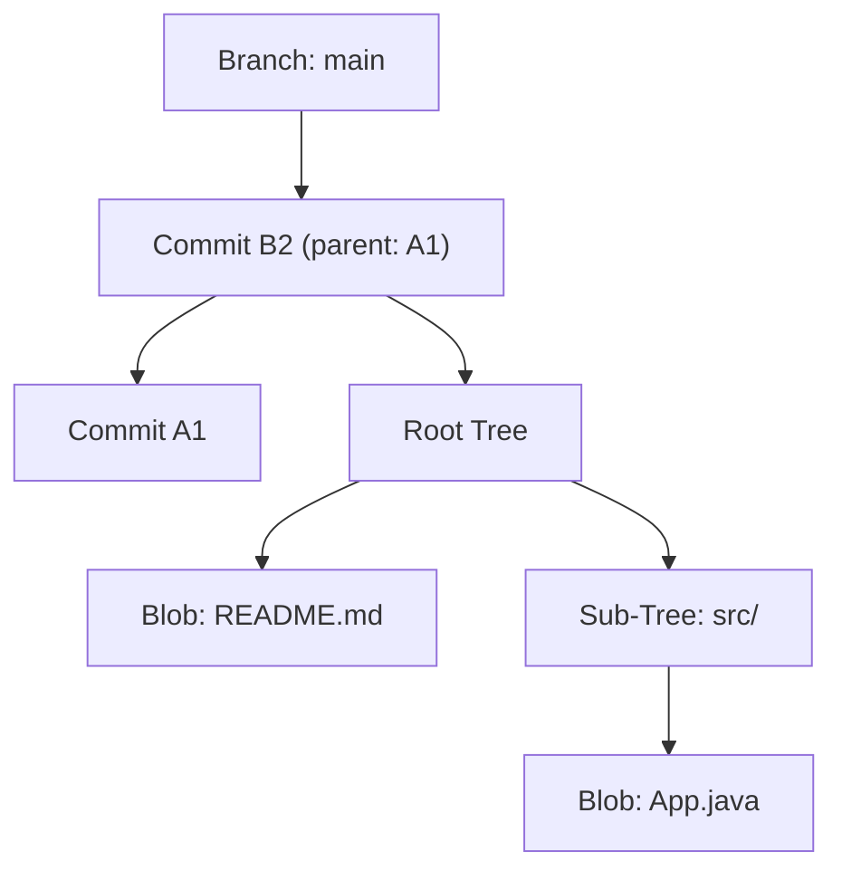

# How Git Actually Works Under the Hood

> Git is not a file-diff tool — it is a tiny, content-addressable filesystem where every commit is a complete snapshot and every branch is just a 41-byte pointer to a commit hash.

## What You'll Learn

- Why Git stores snapshots instead of file diffs
- The four core Git objects: **Blob**, **Tree**, **Commit**, and **Tag**
- How content-addressable hashing works inside `.git/objects/`
- Why creating and switching branches in Git is practically instant
- How `HEAD`, branches, and commits connect in a graph (DAG)

---

## Snapshots, Not Diffs

Many older version control systems (like SVN) stored a base file plus a list of line-by-line **diffs** over time.

Git takes a different approach: every time you commit, Git records a **snapshot of your entire project** at that moment. If a file didn't change between commits, Git doesn't store it again — it simply points to the exact same already-stored file object.

---

## The Four Git Objects

Inside the hidden `.git/objects/` folder, Git stores almost everything as one of **four object types**:

| Object Type | What It Represents | Contains |
| :--- | :--- | :--- |
| **Blob** | File contents (no filename!) | Raw compressed bytes of a file |
| **Tree** | A directory listing | Filenames, file permissions, and hashes pointing to blobs or sub-trees |
| **Commit** | A project snapshot in time | Root tree hash, parent commit hash(es), author, timestamp, and commit message |
| **Tag** | A permanent named label (e.g. `v1.0.0`) | Pointer to a commit plus tagger metadata and message |

### How They Connect



Notice something cool: if two files in different folders have the **exact same content**, Git stores only **one blob** and both trees point to the same hash!

---

## Content-Addressable Storage

Every Git object is named by the **SHA-1 hash** (40 hex characters, e.g. `ac35a9bd...`) of its type, size, and contents.

- Change even a single comma in a file → the blob's hash changes → its parent tree's hash changes → the commit's hash changes.
- That's why Git history is **tamper-evident**: you cannot secretly edit an old commit without changing the hash of every commit that comes after it.

> [!TIP]
> You can inspect any Git object yourself from the terminal with `git cat-file -p <hash>`.

---

## Why Branches Are So Cheap

In Git, a branch is **not** a copy of your codebase. Open `.git/refs/heads/main` and you'll find a plain text file containing just **41 bytes**: a 40-character commit hash plus a newline.

```text
ac35a9bd007a081e40e96dfc50093fe7bf3c47fb
```

And `HEAD` (stored in `.git/HEAD`) is just another tiny text file pointing to your currently checked-out branch:

```text
ref: refs/heads/main
```

Creating a new branch literally writes a single 41-byte file. When you make a new commit, Git simply updates that file to the new commit's hash.

---

## The Three Areas of Git

Understanding Git commands becomes much easier once you picture the three local areas:

1. **Working Directory** — the actual files you edit on disk.
2. **Staging Area (Index)** — `.git/index`, a draft of what will go into your next commit (`git add`).
3. **Repository (`.git/objects`)** — permanently committed snapshots (`git commit`).

---

## Summary

| Concept | Key Takeaway |
| :--- | :--- |
| **Storage Model** | Full snapshots (deduplicated by content hash), not incremental diffs |
| **Core Objects** | `blob` (file content), `tree` (directory), `commit` (snapshot + parent), `tag` (label) |
| **Branches** | Lightweight 41-byte files holding a commit hash |
| **HEAD** | Pointer to the current branch (or directly to a commit in detached HEAD state) |
| **Integrity** | Every object is identified by its cryptographic hash, making history tamper-evident |
