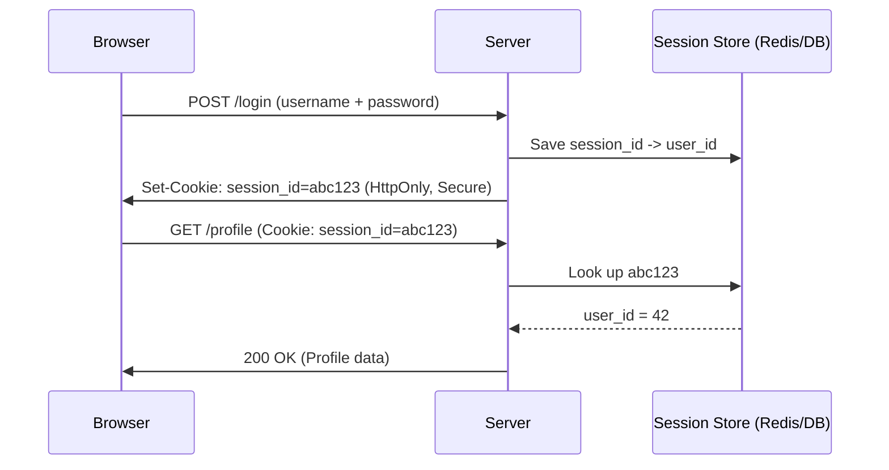

# JWT vs Sessions — How Web Login Actually Works

> HTTP is stateless — every request arrives like a stranger. Sessions solve this by keeping login state on the server, while JWTs pack a cryptographically signed proof of identity into a token carried by the client.

## What You'll Learn

- Why HTTP needs a mechanism to remember logged-in users
- How traditional server-side **Sessions** work
- How **JWTs (JSON Web Tokens)** work and what their three parts mean
- Common JWT security mistakes (like assuming JWTs are encrypted)
- When to choose Sessions vs JWTs

---

## The Core Problem: HTTP Is Stateless

When you log in on page 1 and click your profile on page 2, HTTP itself has **no memory** that both requests came from the same person. Websites solve this in two main ways:

1. **Session-based authentication** (stateful)
2. **Token-based authentication with JWT** (stateless)

---

## 1. Server-Side Sessions (Stateful)

Think of a session like a **coat-check ticket**: you hand over your identity once, the server stores your details in memory/database/Redis, and gives your browser a random unguessable ticket (`session_id`) inside a cookie.



### Pros & Cons of Sessions

- **Easy instant revocation:** Delete the session from Redis/DB and the user is logged out immediately (great for *"Log out of all devices"*).
- **Small cookie:** Only a tiny opaque ID travels over the network.
- **Server state required:** Every authenticated request requires a session store lookup (usually fast with Redis, but adds infrastructure to scale across servers).

---

## 2. JSON Web Tokens — JWT (Stateless)

Think of a JWT like a **passport**: instead of checking a central database every time, the server signs a self-contained document with its secret key and hands it to the client. On future requests, any server with the signing key can verify it mathematically without hitting a database.

### Anatomy of a JWT

A JWT is three Base64URL-encoded strings separated by dots (`.`):

```text
HEADER.PAYLOAD.SIGNATURE
```

1. **Header** — token type and signing algorithm:
   ```json
   { "alg": "HS256", "typ": "JWT" }
   ```
2. **Payload (Claims)** — user metadata and expiration time:
   ```json
   { "sub": "42", "role": "admin", "exp": 1735689600 }
   ```
3. **Signature** — `HMACSHA256(base64(header) + "." + base64(payload), SECRET_KEY)`. If anyone edits even one letter of the payload, the signature check fails.

> [!WARNING]
> **A JWT is signed, NOT encrypted!** Anyone who intercepts a JWT can Base64-decode the payload and read every field inside it. Never put passwords, secrets, or sensitive personal data in a JWT payload.

### The Revocation Catch

Because the server doesn't store issued JWTs, you **cannot easily invalidate a JWT before it expires**. To mitigate this, real-world apps use a **two-token pattern**:

- **Access Token (JWT):** Short-lived (5–15 minutes), sent with API requests.
- **Refresh Token:** Longer-lived, stored in a database/Redis and an `HttpOnly` cookie, used to mint new access tokens — and revocable at any time.

---

## Sessions vs JWTs Compared

| Aspect | Sessions | JWTs |
| :--- | :--- | :--- |
| **Where State Lives** | Server (Redis / DB) | Client (self-contained token) |
| **Instant Logout / Revocation** | Easy (delete from store) | Hard (must wait for expiry or maintain a denylist) |
| **Horizontal Scaling** | Needs shared session store (e.g. Redis) | Easy across multiple microservices |
| **Token Size** | Tiny (just an ID) | Larger (carries header, claims, signature) |
| **Best Fit** | Traditional web apps, SaaS dashboards | Microservices, mobile apps, cross-domain APIs, OAuth2 / OIDC |

---

## Summary

| Concept | Key Takeaway |
| :--- | :--- |
| **Sessions** | Server stores login state; browser holds an opaque `HttpOnly` cookie ID |
| **JWT** | Self-contained `header.payload.signature` token verified with a secret/public key |
| **Security Rule** | JWT payloads are readable by anyone — never store secrets inside them |
| **Best Practice** | Prefer `HttpOnly`, `Secure`, `SameSite` cookies over `localStorage` to protect against XSS |
