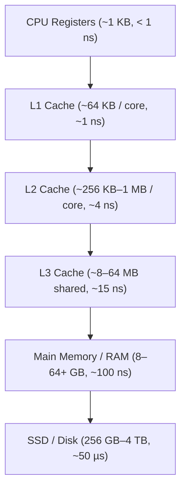

# Why RAM Is Slow — CPU Caches and the Memory Hierarchy

> Modern CPUs can execute billions of instructions per second, but fetching a single number from RAM feels like an eternity to them — which is why CPUs rely on tiny, ultra-fast L1, L2, and L3 caches.

## What You'll Learn

- How fast CPU caches, RAM, SSDs, and networks are compared to human timescales
- What L1, L2, and L3 caches do
- The two principles that make caching work: **Temporal** and **Spatial Locality**
- Why traversing a 2D array row-by-row can be dramatically faster than column-by-column

---

## Latency Numbers Every Developer Should Feel

Nanoseconds are hard to imagine. Let's scale **1 nanosecond = 1 second** in human time so the speed gaps become obvious:

| Operation | Real Latency | Human-Scale Equivalent (`1 ns = 1 s`) |
| :--- | :--- | :--- |
| **L1 Cache reference** | ~1 ns | **1 second** (grabbing a pen from your desk) |
| **L2 Cache reference** | ~4 ns | **4 seconds** (picking up a book from a shelf) |
| **L3 Cache reference** | ~15 ns | **15 seconds** (walking to the next room) |
| **Main Memory (RAM)** | ~100 ns | **1.7 minutes** (walking down the street) |
| **NVMe SSD read** | ~20–100 µs | **5–27 hours** (a road trip across a country) |
| **Network packet (same datacenter)** | ~0.5 ms | **6 days** |
| **Network packet (cross-continent)** | ~150 ms | **4.7 years** |

To a CPU running at 3 GHz, waiting for RAM (~100 ns) means sitting idle for **~300 clock cycles**!

---

## The Memory Hierarchy



There is a fundamental hardware trade-off: **the faster memory is, the smaller and more expensive it is**. So computers stack layers of memory from tiny-and-blazing-fast at the top to huge-and-slower at the bottom.

---

## Why Caching Works: Principle of Locality

Caches only help if the CPU can guess which data you'll need next. Real programs are surprisingly predictable in two ways:

1. **Temporal Locality** — *If you used a variable just now, you'll probably use it again very soon* (e.g. a loop counter or accumulator).
2. **Spatial Locality** — *If you read memory address `X`, you'll probably read `X + 1`, `X + 2`, ... next* (e.g. looping through an array).

Because of spatial locality, whenever the CPU fetches 1 byte from RAM, it actually grabs a whole **64-byte chunk** called a **cache line** and loads it into L1 cache.

---

## Real-World Proof: Row-Major vs Column-Major Loops

In Java, C, and most languages, 2D arrays are stored **row by row** in memory. Both loops below do the exact same number of additions — yet the first one is significantly faster:

```java
int size = 10_000;
int[][] grid = new int[size][size];

// Fast: Row-major (cache-friendly — reads sequential memory in the same cache line)
long sum1 = 0;
for (int r = 0; r < size; r++) {
    for (int c = 0; c < size; c++) {
        sum1 += grid[r][c];
    }
}

// Slow: Column-major (cache-unfriendly — jumps across rows, causing constant cache misses)
long sum2 = 0;
for (int c = 0; c < size; c++) {
    for (int r = 0; r < size; r++) {
        sum2 += grid[r][c];
    }
}
```

### Why `ArrayList` Beats `LinkedList` in Practice

Even though `ArrayList` and `LinkedList` both iterate in `O(n)` time:
- **`ArrayList`** stores elements side-by-side in a contiguous array → **high spatial locality** → the CPU prefetcher loads upcoming elements into L1 cache before you even ask for them.
- **`LinkedList`** scatters node objects randomly across the heap → **pointer chasing** → frequent cache misses waiting on RAM.

> [!TIP]
> Big-O notation ignores hardware constants, but in real systems, **cache friendliness** often makes an `ArrayList` 5×–10× faster to iterate than a `LinkedList`.

---

## Summary

| Concept | Key Takeaway |
| :--- | :--- |
| **Speed Gap** | L1 cache is ~100× faster than RAM; RAM is ~500× faster than an SSD |
| **Cache Line** | CPUs fetch memory in 64-byte chunks, not individual bytes |
| **Temporal Locality** | Recently accessed data is likely to be accessed again soon |
| **Spatial Locality** | Neighboring memory addresses are likely to be accessed together |
| **Practical Impact** | Contiguous data structures (`ArrayList`, row-major loops) run much faster than pointer-heavy structures (`LinkedList`) |
