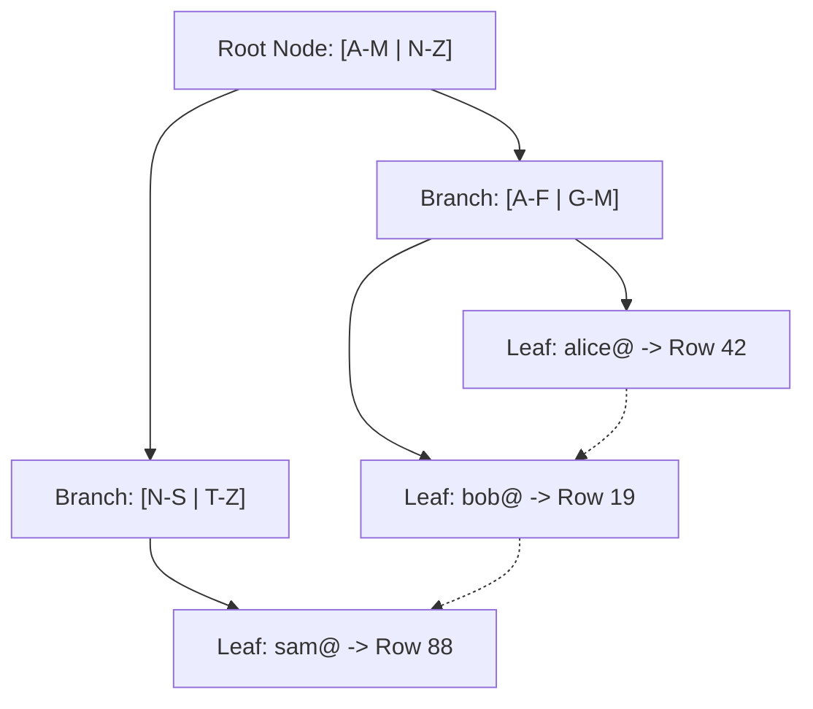

# How Database Indexes Work (B-Trees Explained Simply)

> A database index is just like the index at the back of a textbook — instead of reading every single page from cover to cover, you jump straight to the exact page number in milliseconds.

## What You'll Learn

- Why queries get slow without an index (Full Table Scan)
- How a **B-Tree** index finds 1 row out of 10 million in ~3–4 hops
- Why indexes speed up reads (`SELECT`) but slow down writes (`INSERT`/`UPDATE`/`DELETE`)
- The **Leftmost Prefix Rule** for composite (multi-column) indexes
- Common mistakes that accidentally disable an index

---

## Full Table Scan vs Index Seek

Imagine a `users` table with **10,000,000 rows** and you run:

```sql
SELECT * FROM users WHERE email = 'alice@example.com';
```

- **Without an index:** The database performs a **Full Table Scan** — checking rows 1, 2, 3, ... all the way to 10,000,000 (`O(n)`).
- **With an index on `email`:** The database walks a sorted **B-Tree** and finds the exact disk location in **~3–4 disk reads** (`O(log n)`).

---

## How a B-Tree Index Works

Most relational databases (PostgreSQL, MySQL/InnoDB, SQLite) use a **B+Tree** by default:



### Why B+Trees Are Ideal for Databases

- **Short and wide:** Each node holds hundreds of keys, so even a table with **1 billion rows** has a tree only **3–4 levels deep**.
- **Linked leaf nodes:** Leaf nodes point to the next leaf in sorted order, making **range queries** (`BETWEEN`, `>`, `<`, `ORDER BY`) blazingly fast.

---

## The Trade-Off: Indexes Aren't Free

If indexes make reads so fast, why not index every column?

| Operation | Impact of Adding an Index |
| :--- | :--- |
| **`SELECT` (with `WHERE` / `JOIN` / `ORDER BY`)** | Much faster (`O(log n)` instead of `O(n)`) |
| **`INSERT` / `UPDATE` / `DELETE`** | Slower — the database must update the table **and** rebalance every index on it |
| **Disk & RAM Usage** | Extra storage needed for every index structure |

> [!TIP]
> Index columns you frequently filter (`WHERE`), join (`ON`), or sort (`ORDER BY`) — especially high-cardinality columns like `email`, `user_id`, or `created_at`. Avoid indexing low-cardinality columns like `is_active` (boolean) on their own.

---

## Composite Indexes & The Leftmost Prefix Rule

Suppose you create a multi-column index on `(last_name, first_name)`:

```sql
CREATE INDEX idx_users_name ON users (last_name, first_name);
```

Think of a physical phonebook sorted by **Last Name, then First Name**:

- `WHERE last_name = 'Smith'` → **Uses index** (leftmost column matches).
- `WHERE last_name = 'Smith' AND first_name = 'Alice'` → **Uses index** (both columns match).
- `WHERE first_name = 'Alice'` → **Cannot use index efficiently** (you'd have to scan every last name in the phonebook!).

---

## Common Mistakes That Break Index Usage

1. **Wrapping the indexed column in a function:**
   - Bad: `WHERE LOWER(email) = 'alice@example.com'` (forces full scan unless you have a functional index).
   - Good: Store normalized lowercase emails or create an index on `LOWER(email)`.
2. **Leading wildcard in `LIKE`:**
   - `WHERE name LIKE 'Ali%'` → **Uses index** (range scan).
   - `WHERE name LIKE '%lice'` → **Full table scan** (can't use sorted B-Tree order).
3. **Implicit type mismatch:**
   - Comparing a `VARCHAR` column to an integer (`WHERE phone = 9876543210`) can force a type cast on every row and skip the index.

> [!NOTE]
> Use `EXPLAIN` (or `EXPLAIN ANALYZE` in PostgreSQL) before any slow query to verify whether the database is doing an **Index Scan** or a **Seq/Full Table Scan**.

---

## Summary

| Concept | Key Takeaway |
| :--- | :--- |
| **B+Tree Index** | Keeps sorted keys in a shallow tree (`O(log n)` lookups + fast range scans) |
| **Trade-Off** | Faster reads (`SELECT`), slower writes (`INSERT`/`UPDATE`/`DELETE`), more storage |
| **Leftmost Prefix** | Index on `(A, B)` helps queries on `A` or `(A, B)`, not `B` alone |
| **Debugging** | Always check query plans with `EXPLAIN` / `EXPLAIN ANALYZE` |
