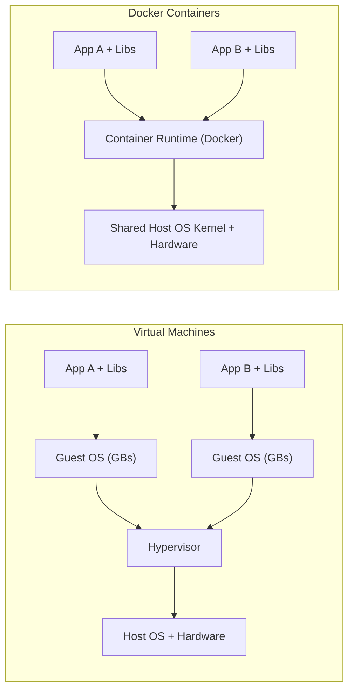

# Docker Containers vs Virtual Machines

> Virtual Machines virtualize an entire computer (hardware + full OS), whereas Docker containers share the host's OS kernel and isolate only the app and its dependencies — making them megabytes in size and able to start in milliseconds.

## What You'll Learn

- Why *"it works on my machine"* happens and how containers solve it
- Architectural difference between **Virtual Machines** and **Containers**
- What powers containers under the hood (Linux **Namespaces** and **cgroups**)
- How **Docker Images**, **Layers**, and **Containers** relate
- When a VM is still the better choice over a container

---

## Architecture Comparison

A **VM** is like owning separate standalone houses (each with its own plumbing, electrical panel, and roof). A **Container** is like apartments in the same building — each apartment is private and isolated, but they share the building's foundation and utilities (the OS kernel).

---

## Side-by-Side Comparison

| Aspect | Virtual Machine (VM) | Docker Container |
| :--- | :--- | :--- |
| **Isolation Level** | Hardware-level (full separate OS kernel) | Process-level (shared host OS kernel) |
| **Startup Time** | Seconds to minutes (boots a whole OS) | Milliseconds (starts a normal process) |
| **Disk Size** | Gigabytes (full OS image) | Megabytes (only app + runtime libs) |
| **Memory Overhead** | High (RAM reserved per Guest OS) | Minimal (just what the app uses) |
| **OS Flexibility** | Can run Windows, Linux, BSD on the same host | Must match the host kernel (Linux containers need a Linux kernel) |
| **Security Boundary** | Stronger (separate kernels) | Strong, but a kernel vulnerability affects all containers on the host |

---

## How Containers Actually Work Under the Hood

A container is **not** a mini-VM. To the host Linux OS, a container is just a **regular process** wrapped in two kernel features:

1. **Namespaces (What you can *see*):**
   - Give the process its own private view of the filesystem (`mnt`), process IDs (`pid` — your app thinks it's PID 1!), network interfaces (`net`), and hostname (`uts`).
2. **cgroups — Control Groups (What you can *use*):**
   - Enforce strict limits on how much CPU, RAM, and disk I/O the container is allowed to consume so one misbehaving app can't crash the whole server.

---

## Images, Layers, and Containers

Think of OOP classes and objects:

- **Dockerfile** → the source code recipe (`FROM`, `COPY`, `RUN`, `CMD`).
- **Docker Image** → an immutable, read-only blueprint built from a Dockerfile (like a **Class**).
- **Docker Container** → a running instance of an image (like an **Object**).

### Why Docker Builds Are Fast: Image Layers

Each instruction in a `Dockerfile` creates a cached read-only **layer**. If you only edit your app's source code on the last line, Docker reuses all earlier cached layers (base OS, installed packages) and rebuilds only the tiny top layer in seconds.

> [!TIP]
> In a `Dockerfile`, always copy dependency files (`package.json`, `pom.xml`, `requirements.txt`) and install dependencies **before** copying your application source code — that way, code edits don't invalidate the slow dependency-install cache layer!

---

## When to Use VMs vs Containers

- **Use Containers** for microservices, CI/CD pipelines, consistent dev/prod environments, and packing many apps efficiently onto one server.
- **Use VMs** when you need to run completely different operating systems (e.g. Windows apps on a Linux host) or need strict hardware-level multi-tenant security isolation (e.g. cloud providers isolating different customers).
- **Use Both Together** (most common in production): Cloud providers run Kubernetes/Docker containers *inside* cloud VMs (like AWS EC2) to get the best of both worlds.

---

## Summary

| Concept | Key Takeaway |
| :--- | :--- |
| **Virtual Machine** | Virtualizes hardware + runs a full Guest OS; heavier but strongest isolation |
| **Container** | Isolated host process sharing the host OS kernel; lightweight and starts in ms |
| **Namespaces & cgroups** | The Linux kernel features that isolate visibility and limit CPU/RAM |
| **Image vs Container** | Image = read-only layered blueprint; Container = running instance |
