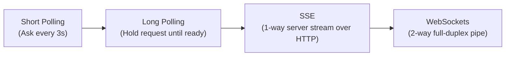

# Real-Time Web — Polling vs Long Polling vs SSE vs WebSockets

> Standard HTTP only lets the browser speak first. To power live chat, stock tickers, notifications, and streaming AI responses, web apps choose between four real-time patterns — each with very different trade-offs.

## What You'll Learn

- Why normal HTTP struggles with instant server-to-client updates
- How **Short Polling**, **Long Polling**, **SSE (Server-Sent Events)**, and **WebSockets** work
- Which technology powers ChatGPT/LLM streaming vs multiplayer games
- How to pick the simplest right option for your app

---

## The Four Real-Time Patterns



---

## 1. Short Polling ("Are we there yet?")

The client sends a regular HTTP request on a timer (e.g., every 3 seconds):

- **Client:** *"Any new messages?"* → **Server:** *"No."*
- **Client (3s later):** *"Any new messages?"* → **Server:** *"No."*
- **Client (3s later):** *"Any new messages?"* → **Server:** *"Yes, here's 1!"*

**Trade-offs:** Dead simple to build, but wastes bandwidth and server CPU on empty responses and has latency up to the polling interval.

---

## 2. Long Polling ("Tell me as soon as something happens")

The client sends an HTTP request, and the server **intentionally holds the connection open** until new data arrives (or a timeout hits). The instant the server responds, the client immediately opens a new request.

**Trade-offs:** Near-instant updates without empty spam responses, works through every firewall, but still incurs HTTP header overhead on every message.

---

## 3. Server-Sent Events — SSE (One-Way Live Stream)

**SSE** keeps a single standard HTTP connection open and lets the server **push text events continuously** to the browser (`Content-Type: text/event-stream`):

```text
data: {"token": "Hello"}

data: {"token": " world!"}
```

On the browser side, it's built right into JavaScript with `EventSource`:

```javascript
const source = new EventSource("/api/stream");
source.onmessage = (event) => {
  console.log("Received:", event.data);
};
```

### Why SSE Is Having a Huge Renaissance

- **Automatic reconnection** built into browsers out of the box.
- Works over standard HTTP/2, plays nicely with firewalls, load balancers, and CDNs.
- **This is how almost every AI / LLM chat UI streams tokens** word-by-word!

**Limitation:** **One-way only** (Server → Client). If the client wants to send data back, it just sends a normal HTTP `POST`.

---

## 4. WebSockets (Full-Duplex Two-Way Pipe)

A **WebSocket** starts with an HTTP `Upgrade: websocket` handshake, then switches the TCP connection into a persistent, **bi-directional, low-latency** tunnel where both client and server can send text or binary frames at any time.

```javascript
const ws = new WebSocket("wss://example.com/chat");
ws.onmessage = (event) => console.log("Server says:", event.data);
ws.send("Hello from client!");
```

**Trade-offs:** Lowest latency and supports binary data + true two-way chatter, **but** harder to scale (stateful connections across multiple servers require sticky sessions or a pub/sub broker like Redis), and you have to handle reconnection and heartbeats yourself.

---

## Side-by-Side Comparison

| Feature | Short Polling | Long Polling | SSE | WebSockets |
| :--- | :--- | :--- | :--- | :--- |
| **Direction** | Client → Server | Client → Server | Server → Client (1-way) | Bi-directional (2-way) |
| **Protocol** | Standard HTTP | Standard HTTP | Standard HTTP | `ws://` / `wss://` (TCP upgrade) |
| **Binary Data** | Yes | Yes | Text (UTF-8) only | Yes (text & binary) |
| **Auto-Reconnect** | N/A | Manual | Built-in | Manual |
| **Best Use Cases** | Infrequent status checks | Legacy fallback | Live feeds, notifications, stock tickers, **AI streaming** | Chat apps, multiplayer games, collaborative docs (Figma/Docs) |

> [!TIP]
> Don't jump straight to WebSockets by default. If your app only needs the server to push updates to the client (notifications, dashboards, AI responses), **SSE is much simpler and easier to scale**.

---

## Summary

| Need | Best Choice |
| :--- | :--- |
| **Simple updates every ~30s** | Short Polling |
| **Live server-to-client stream (feeds, AI tokens, progress bars)** | SSE (Server-Sent Events) |
| **High-frequency two-way interaction (chat, gaming, whiteboards)** | WebSockets |
