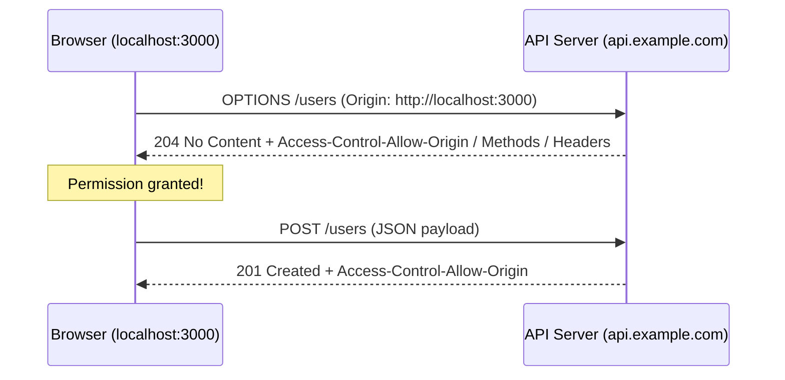

# CORS Explained Without the Headache

> CORS is not a server firewall — it is a **browser security rule** that stops a malicious website you visit from secretly making authenticated requests to your bank or email on your behalf.

## What You'll Learn

- What an **Origin** is and why browsers enforce the **Same-Origin Policy (SOP)**
- Why your API works in `curl` / Postman but fails with a CORS error in Chrome
- The difference between **Simple Requests** and **Preflight (`OPTIONS`) Requests**
- Which HTTP response headers actually fix CORS (and why you can't fix it from frontend code alone)

---

## What Is an "Origin"?

An **Origin** is the exact combination of three parts: **Protocol + Domain (Host) + Port**.

Comparing against `https://app.example.com:443`:

| URL | Same Origin? | Why |
| :--- | :--- | :--- |
| `https://app.example.com/profile` | **Yes** | Same protocol, domain, and port (default `443`) |
| `http://app.example.com` | **No** | Different protocol (`http` vs `https`) |
| `https://api.example.com` | **No** | Different subdomain (`api` vs `app`) |
| `https://app.example.com:8080` | **No** | Different port (`8080` vs `443`) |

---

## Why Does CORS Exist?

Imagine you're logged into `https://mybank.com` (so your browser holds a valid session cookie for it). In another tab, you accidentally visit `https://evil-site.com`.

Without browser protection, JavaScript on `evil-site.com` could run:

```javascript
fetch("https://mybank.com/api/account-balance", { credentials: "include" });
```

Because browsers automatically attach cookies to requests for `mybank.com`, `evil-site.com` could read your bank balance!

To stop this, browsers enforce the **Same-Origin Policy (SOP)**: JavaScript on Origin A **cannot read responses** from Origin B unless Origin B explicitly grants permission via **CORS (Cross-Origin Resource Sharing)** headers.

> [!NOTE]
> **Why Postman and `curl` never get CORS errors:** CORS is enforced strictly by **web browsers**, not by servers or CLI tools. When you see a CORS error, the server often *did* receive and process the request — the browser just blocked your JavaScript from reading the response!

---

## Simple Requests vs Preflight (`OPTIONS`) Requests

### 1. Simple Requests

Basic `GET` or `POST` requests with standard headers (no `Authorization` header, no `application/json` content type) are sent directly. The browser checks the server's `Access-Control-Allow-Origin` header before letting JS read the response.

### 2. Preflight Requests (Most Modern APIs)

Whenever your frontend sends `Content-Type: application/json`, an `Authorization` header, or uses `PUT`/`PATCH`/`DELETE`, the browser first sends a tiny automatic **`OPTIONS` preflight request** asking the server for permission:



---

## The Key CORS Response Headers (Set on the Server)

You fix CORS on the **backend server** (or API Gateway), not in React/JavaScript:

```http
Access-Control-Allow-Origin: https://app.example.com
Access-Control-Allow-Methods: GET, POST, PUT, DELETE, OPTIONS
Access-Control-Allow-Headers: Content-Type, Authorization
Access-Control-Allow-Credentials: true
```

### Common CORS Gotcha with Cookies

If your frontend sends cookies (`credentials: "include"`), the server **cannot** respond with `Access-Control-Allow-Origin: *`. The browser requires an **exact origin** (e.g. `https://app.example.com`) paired with `Access-Control-Allow-Credentials: true`.

---

## Summary

| Concept | Key Takeaway |
| :--- | :--- |
| **Origin** | `protocol + host + port` — all three must match to be "same-origin" |
| **Who Enforces CORS** | The **browser** (never `curl`, Postman, or server-to-server calls) |
| **Preflight** | Automatic `OPTIONS` check sent before JSON, `PUT`/`DELETE`, or custom-header requests |
| **Where to Fix It** | Backend response headers (`Access-Control-Allow-Origin`, etc.) |
