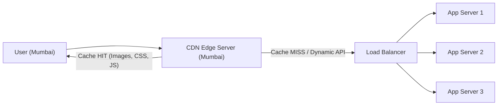

# How Load Balancers and CDNs Handle Millions of Users

> No single server can handle millions of concurrent users alone. **CDNs** serve static content from edge servers right next to the user, while **Load Balancers** spread dynamic requests evenly across fleets of backend servers.

## What You'll Learn

- The difference between a **Forward Proxy** and a **Reverse Proxy**
- How a **Load Balancer** distributes traffic and detects dead servers
- **Layer 4 (TCP)** vs **Layer 7 (HTTP)** load balancing
- Common routing algorithms (Round Robin, Least Connections, Consistent Hashing)
- How a **CDN (Content Delivery Network)** slashes latency worldwide

---

## How They Work Together

---

## 1. Forward Proxy vs Reverse Proxy

Both sit in the middle of network traffic, just protecting opposite sides:

| Proxy Type | Sits In Front Of | Real-World Examples |
| :--- | :--- | :--- |
| **Forward Proxy** | **Clients** (hides the client from the internet) | Corporate office proxy, VPN |
| **Reverse Proxy** | **Servers** (hides backend servers from clients) | Nginx, HAProxy, Cloudflare, AWS ALB |

A **Load Balancer** is a specialized **Reverse Proxy** that distributes incoming requests across multiple backend servers.

---

## 2. Layer 4 vs Layer 7 Load Balancing

| Aspect | Layer 4 (Transport — TCP/UDP) | Layer 7 (Application — HTTP/HTTPS) |
| :--- | :--- | :--- |
| **What It Inspects** | IP address and Port only | Full HTTP URL, headers, cookies, HTTP method |
| **Smart Routing** | No — blindly forwards packets | Yes — e.g. `/api/*` → API servers, `/images/*` → Media servers |
| **TLS Termination** | Usually passes encrypted traffic straight through | Decrypts HTTPS at the load balancer |
| **Speed** | Ultra-fast, minimal CPU | Slightly more CPU, far more flexible |

### Health Checks

Load balancers continuously ping backend servers (e.g. `GET /health` every 5 seconds). If Server 2 crashes or stops responding, the load balancer automatically removes it from rotation so users never see an error — giving you **High Availability** and **Zero-Downtime Deployments**.

---

## 3. Popular Load Balancing Algorithms

| Algorithm | How It Picks a Server | Best For |
| :--- | :--- | :--- |
| **Round Robin** | Takes turns: Server 1 → 2 → 3 → 1 | Identical servers with uniform request costs |
| **Weighted Round Robin** | Stronger servers get proportionally more turns | Mixed hardware (e.g. 16-core + 4-core servers) |
| **Least Connections** | Picks the server with the fewest active connections right now | Requests with wildly varying processing times |
| **IP Hash / Consistent Hashing** | Routes the same user/key to the same server | Caching layers, stateful sessions |

---

## 4. How a CDN (Content Delivery Network) Works

Even at the speed of light in fiber-optic cables, sending a packet from Mumbai to Virginia and back takes **~220 ms** of unavoidable physics delay.

A **CDN** (Cloudflare, Akamai, AWS CloudFront, Fastly) solves physics by placing hundreds of **Edge Servers (Points of Presence / PoPs)** in cities all over the world:

1. The first user in Mumbai requests `logo.png` → **Cache MISS** → the Mumbai edge server fetches it from the origin server in Virginia, caches a copy locally, and returns it.
2. The next 100,000 users in Mumbai request `logo.png` → **Cache HIT** → served directly from Mumbai in **~10 ms**, without ever touching your origin server!

### Bonus Benefits of a CDN

- **Massive bandwidth savings** on your origin servers.
- **DDoS protection** — edge networks absorb gigantic traffic spikes before they can knock your origin offline.
- **Global reliability** — even if one edge location goes down, traffic automatically routes to the next nearest city.

---

## Summary

| Component | Primary Job |
| :--- | :--- |
| **CDN** | Cache and serve static/edge content geographically close to users |
| **Load Balancer** | Spread dynamic traffic across backend servers + route around failed servers |
| **L4 vs L7** | L4 routes by IP/port (fastest); L7 routes by HTTP URL/headers/cookies (smartest) |
| **Health Checks** | Automatically detect and isolate unhealthy servers for high availability |
